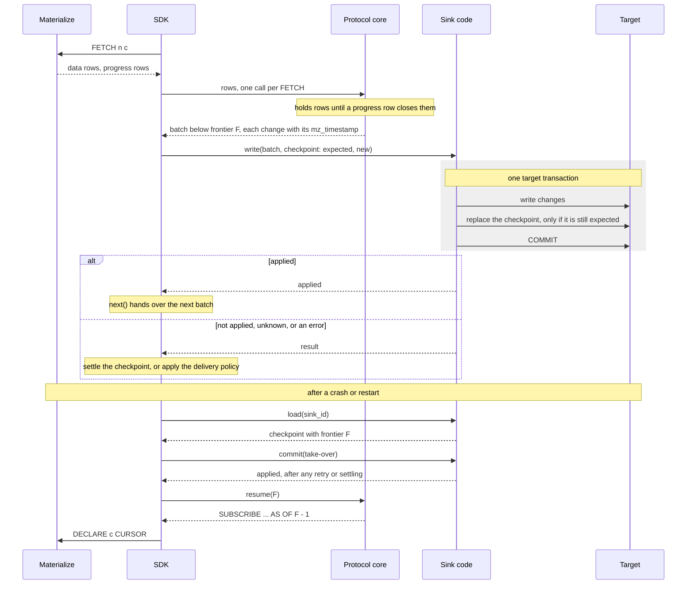

# Materialize SDK: correct `SUBSCRIBE` consumption and a framework for custom sinks

- Associated:
  - Product requirements: [Sink SDK PRD](https://app.notion.com/p/materialize/Sink-SDK-3dd13f48d37b8024985ce70b1d96e9cd) (PRD-85). Overlapping proposal: PRD-87 (`mzq`).
  - Tracking: Linear project "Subscribe SDK" (DEX).
  - [#38468](https://github.com/MaterializeInc/materialize/pull/38468): durable subscribe design, the server primitive this SDK moves onto later.
  - [#37483](https://github.com/MaterializeInc/materialize/pull/37483), [#37517](https://github.com/MaterializeInc/materialize/pull/37517): prototype Rust and Python packages.
  - [#37905](https://github.com/MaterializeInc/materialize/pull/37905): server-side bound on subscribe output buffering.
  - SQL-528: `SUBSCRIBE ... WITH (PROGRESS) ... UP TO` emits no final progress row.
  - [database-issues#5182](https://github.com/MaterializeInc/database-issues/issues/5182): dataflow errors poison a subscribe.
  - [Durable subscriptions pattern](https://materialize.com/docs/transform-data/patterns/durable-subscriptions/): the manual protocol this SDK packages.
  - Prior art: [mz-sink-sdk](https://github.com/MaterializeIncLabs/mz-sink-sdk) and its private-preview [build your own sink](https://materialize.com/docs/export-data/build-your-own-sink/) guide (#38872), [mz-redis-sync](https://github.com/MaterializeIncLabs/mz-redis-sync), [novu-materialize-integration](https://github.com/MaterializeIncLabs/novu-materialize-integration), [mz-turbopuffer-sink](https://github.com/MaterializeInc/mz-turbopuffer-sink).

## The Problem

Customers want Materialize results in systems we do not sink to natively:
caches, search indexes, their own Postgres, notification services, live UIs,
and agents. `SUBSCRIBE` is the primitive for all of them, and every team that
uses it re-derives the same protocol by hand. The use cases behind the product
requirements are representative:

- A cache that keeps a Valkey or Redis keyspace equal to a materialized view.
  It needs the initial snapshot and a fast, gap-free restart.
- A search index that keeps two turbopuffer namespaces equal to two views, at
  one consistent timestamp, exactly once. Today this runs through Kafka.
- A relational target that writes several views into an application's
  Postgres, transactionally across tables.

The protocol for consuming `SUBSCRIBE` durably is:

1. Subscribe `WITH (PROGRESS, SNAPSHOT = true)`.
2. Buffer updates until a progress message proves a timestamp is closed.
3. Apply the closed batch and persist its frontier atomically.
4. On restart, resume `WITH (PROGRESS, SNAPSHOT = false) AS OF frontier - 1`.
5. Keep history readable at the stored frontier, and fail loudly when it is not.

Each step has a failure mode that is invisible in testing. Every existing
implementation we could find gets a different one wrong:

| Codebase | Commit discipline | Resume | Idempotency | Retractions |
| --- | --- | --- | --- | --- |
| mz-redis-sync | Correct: data and frontier commit together at progress rows | Omits `SNAPSHOT` on resume, so every restart replays the full snapshot | Inherent (keyed writes) | Delegated to `ENVELOPE UPSERT`, but `key_violation` crashes the process and poisons restarts |
| novu-materialize-integration | Persists the timestamp of the first row of a batch, so a crash mid-batch loses the rest of that timestamp | Wall-clock guess of whether the checkpoint is still retained | Content-hash keys, which false-dedup identical payloads across time | Maps a retraction to a revoke, with two bugs |
| A work-queue subscriber in an internal project | No `PROGRESS`, so batch boundaries are a heuristic | Re-snapshots on every restart | Relies on the target being idempotent | Ignored |

None of them reconnects on failure, and none has tests. Our per-language client
docs teach a bare `DECLARE`/`FETCH` loop with no progress handling and no
resume. The durable-subscriptions pattern page is correct, but it is prose that
every user turns into code again.

The rest of this section describes the server behavior a correct consumer has
to account for. Each item was checked against the code.

### Resume arithmetic

With `SNAPSHOT = false`, an `AS OF t` emits times strictly greater than `t`
(`src/compute/src/sink/subscribe.rs:115-122`). A consumer that holds everything
below frontier `F` resumes with `AS OF F - 1`.

### Retention window

`RETAIN HISTORY` sets `since = upper - window`. After an environment outage or
upgrade the upper catches up and the window slides with it, so a one-hour
window can expire during a one-hour outage. A `REFRESH EVERY` view's upper
jumps to the next refresh, so a sink that is down across a refresh can lose
history however short the downtime. Retention belongs to the view's owner, and
any `ALTER` changes every sink's margin without telling it. `RETAIN HISTORY` is
also in private preview (`doc/user/data/examples/create_materialized_view.yml`),
and durable mode needs it until durable subscriptions land (deferred question
13).

A connected subscribe holds its input readable up to what it has emitted, not up
to what the consumer has committed. The data between those two points needs
retention even while the consumer is connected, because after a disconnect the
consumer resumes from its committed frontier.

### Indexed targets

If the subscribed object has an index on the cluster the subscribe runs on, the
dataflow imports the index instead of the persist shard
(`src/adapter/src/optimize/dataflows.rs:326-343`,
`src/adapter/src/coord/indexes.rs:88-93`), and `AS OF` is checked against the
index's `since` (`src/adapter/src/coord/timestamp_selection.rs:277-297`). An
index's default window is one second (`src/adapter-types/src/compaction.rs:20`),
and the view's `RETAIN HISTORY` does not carry over to its indexes. So `AS OF
F - 1` fails on an indexed view once the checkpoint is more than about a second
behind, however long the view's retention. An index on a different cluster does
not count. Index-level `RETAIN HISTORY` requires `enable_index_options`, which
is off by default.

### Snapshot elision

`SUBSCRIBE <object>` with `SNAPSHOT = false` never reads the snapshot
(`src/transform/src/dataflow.rs:464-522`,
`src/persist-client/src/operators/shard_source.rs:438-448`). Any query form,
including `SELECT * FROM mv` or a projection and filter, reads the whole
snapshot at the `AS OF` before emitting anything. A non-materialized view is
inlined, so its inputs' snapshots are read too.

### Stream shape

Diff output is ordered by (time, row bytes) and consolidated
(`src/compute/src/sink/subscribe.rs:212-217`). Upsert and Debezium envelopes
order by (time, key, row). Retractions do not come first.
`WITHIN TIMESTAMP ORDER BY` changes the order but requires
`enable_within_timestamp_order_by_in_subscribe`, off by default.

Everything between two progress messages arrives together, so one batch spans
many timestamps. "At most one row per key" holds per timestamp, not per batch.

`UP TO` ends without a final progress row (SQL-528), so data after the last
progress row is never closed by the server.

### Buffering limits

When a subscribe's backlog in `environmentd` exceeds
`subscribe_max_buffered_bytes` (default 128 MiB), the subscribe is retired with
`SubscribeFellBehind` (#37905).

`environmentd` also collects every update between two progress messages before
passing them on, and fails the subscribe with "total result exceeds max size"
once that collection exceeds `max_result_size`, a system setting with a default
of 1 GB and a minimum of 1 MB (`PendingSubscribe::stash` in
`src/compute-client/src/service.rs`). Each replica checks the batch it sends
against the same limit and fails with "result exceeds max size", without "total"
(`SubscribeBatch::to_error_if_exceeds` in
`src/compute-client/src/protocol/response.rs`).

An initial snapshot is one timestamp, so the whole snapshot must fit. A resume
after long downtime can hit the same limit when the frontier advances in one
step. The failure is deterministic, so a retry repeats it, and nothing the
client does with chunks can avoid it.

Both limits apply per subscribe, and nothing bounds their sum
(`src/adapter/src/coord/message_handler.rs`, the backlog check per active
subscribe). Every sink holds its own subscribe, so many sinks on one environment
multiply the worst case: each can hold up to `max_result_size` while it takes a
snapshot, and up to `subscribe_max_buffered_bytes` if its client falls behind.

### Errors

| Condition | SQLSTATE | Message |
| --- | --- | --- |
| `AS OF` below the readable frontier | `22000` (`DATA_EXCEPTION`, shared) | "could not find a valid timestamp for the query" |
| Subscribed object or cluster dropped | `42704` | "relation 'x' was dropped" and similar |
| Client fell behind | `53200` (shared with the adapter's result-size error) | `SubscribeFellBehind` |
| Result over `max_result_size` | `XX000` (`INTERNAL_ERROR`, shared) | "total result exceeds max size of ..." |
| Dataflow error | `XX000` (`INTERNAL_ERROR`, shared) | the evaluation error, repeated on every retry |

An error raised inside a running subscribe reaches the client as an unstructured
adapter error, which maps to `XX000`
(`src/adapter/src/active_compute_sink.rs:283`, `src/adapter/src/error.rs:1063`).
So a dataflow error, a result-size failure, and a genuine internal error share
one code. `53200` covers both `SubscribeFellBehind` and the adapter's
result-size error (`error.rs:1014-1015`), but a subscribe's size error takes the
`XX000` path, so during a subscribe `53200` means the client fell behind. The
history-loss message has changed once already (#34712), which broke the one
client that matched its text. A dataflow error repeats until the data or the
view changes (database-issues#5182), so retrying cannot fix it.

## Success Criteria

"PRD" marks a requirement from the product requirements. "Design" marks one
this document adds.

| # | Requirement | Source |
| --- | --- | --- |
| R1 | Exactly-once state in the target, across restarts and crashes | PRD |
| R2 | Back off and retry while the target is unavailable | PRD |
| R3 | Dead-letter a batch after too many retries, and reject single rows the target cannot take | PRD |
| R4 | One consistent timestamp across several views | PRD |
| R5 | Transactional writes when the target supports them | PRD |
| R6 | Every change carries its `mz_timestamp` | PRD |
| R7 | Live streaming with no target (UIs, caches, agents) | Design |
| R8 | Bounded client memory, and no server-side buffering on behalf of a slow client | Design |
| R9 | A small set of typed errors, with history loss stopping the consumer by default | Design |
| R10 | Several languages with identical behavior, checked by machines | Design |
| R11 | Sink authors can test without a live environment | Design |

R4 is met in full by targets that can write the whole cut atomically, such as
one Postgres transaction. A target with no transaction over the whole cut, such
as turbopuffer, where only one write request is atomic, gets convergence: once
the sink has caught up past every write any worker made, the target equals the
cut at the committed frontier. Before that, readers can see part of a batch, and
after a crash they can see state newer than the checkpoint (see "Appendix:
turbopuffer sink").

A user following the happy path cannot commit an unclosed timestamp, cannot
get the `AS OF` arithmetic wrong, and cannot silently lose or duplicate updates
across a restart. The check kills a sink at random points. A target that commits
data and checkpoint together must then hold exactly `SELECT ... AS OF F - 1`,
where `F` is its committed frontier. The frontier is exclusive, so `AS OF F`
would also include changes at `F`. A target without that transaction must hold
the same once the sink has caught up and stopped writing.

## Out of Scope

- Rewriting subscribe internals. The server changes this program depends on are
  listed under "Materialize-side workstream".
- Exactly-once side effects. No client can make an HTTP call exactly once, so
  event targets get at-least-once delivery with idempotency keys.
- A general Materialize client. Drivers already run queries well. See "Naming".
- Scale-out of one subscription across parallel workers, which has no server
  support.
- Stateless workers (functions, lambdas). They need history kept across idle
  gaps without a hand-sized `RETAIN HISTORY` window, which durable subscriptions
  (#38468) provide.
- Private-preview subscribe features (`ENVELOPE DEBEZIUM`,
  `WITHIN TIMESTAMP ORDER BY`), which are behind flags. Durable subscriptions
  support both envelopes across a resume, so `ENVELOPE DEBEZIUM` can move in
  once its flag lifts.

## Solution Proposal

The SDK will hold the subscribe protocol in one Rust library, the protocol core,
which performs no I/O and is compiled into a thin package per language. Each
package will use that language's own database driver for the connection and
will expose two modules: `subscribe` for live and durable consumption, and
`sink` for writing to targets. Every change will keep its `mz_timestamp`.

Durable consumption, which powers sinks, will store its checkpoint in the
target, fenced by an epoch. It will read one table, source, or materialized view
directly with `SUBSCRIBE <object>`, the same objects `CREATE SINK` accepts. Live
streams that never resume will accept any query.

The Rust package comes first, with Python and Node to follow, and the first sink
will be turbopuffer, written in Rust. The spec, conformance vectors, and an
end-to-end suite will live in this repository and run in the nightlies.

### Naming

This document proposes **Materialize SDK**, with `subscribe` and `sink` as its
first modules. This is the decision we most want reviewers to push on.

"Sink SDK" names the most visible use and excludes live UIs, cache warmers, and
agents that watch a view with no sink at all (R7). "Subscribe SDK" names the
primitive accurately, but the package will need things that are not
`SUBSCRIBE`: checking a view's retention margin, choosing a cluster, attaching
to a durable subscription, and later the WebSocket transport. "Materialize SDK"
gives those a home without renaming the package after the first publish, which
is expensive once users pin it. The risk is that the name reads as a general
client. The scope rules that out: drivers stay the way to run queries, and the
SDK only adds modules for things drivers get wrong.

Package names will be `materialize-sdk` on PyPI, `@materializeinc/sdk` on npm,
and `materialize-sdk` on crates.io.

### Architecture

```
   +---------------------------------------------------------------+
   |  sink:       targets (turbopuffer first), retry, dead-letter  |
   +---------------------------------------------------------------+
   |  subscribe:  durable consumption (checkpoints, fencing,       |
   |              history-loss policy) and live streams            |
   +---------------------------------------------------------------+
   |  transport, per language: the native driver                   |
   |  (psycopg, node-postgres, tokio-postgres), owns connections   |
   +---------------------------------------------------------------+
   |  protocol core, Rust, no I/O: decode, release engine,         |
   |  multi-view cut, checkpoints, statements, error classification|
   +---------------------------------------------------------------+
```

The protocol core is a library, not a service. It runs inside the user's
process, compiled into whichever package they install, and never opens a
connection. The package's driver fetches rows from Materialize and passes them
to the protocol core in a function call. The protocol core returns decoded
changes, closed batches and their frontiers, checkpoints, SQL text, and typed
errors. "Language and generation strategy" explains the choice.

The rest of this doc uses these terms:

- Target: the external system a sink writes to, such as turbopuffer or a
  Postgres table.
- Sink: the code that writes batches to a target, written by the user or
  shipped with the SDK, like the turbopuffer sink.
- SDK: the package the user installs. It runs the loop, fetches through the
  driver, keeps the checkpoint, and calls the sink.
- Driver: the language's native Postgres driver, which the SDK uses to talk to
  Materialize.
- Store: where a sink's checkpoint lives, the target itself or a separate
  store (see "Checkpoints and fencing").
- Worker: one running copy of the SDK with its sink. Each worker holds its own
  epoch.

### Batches

A batch will hold every change below its frontier that was not in an earlier
batch, and nothing at or above it. Apart from the snapshot chunks
described under "Live streams", users will not be able to observe a
half-delivered timestamp.

Every change will keep its `mz_timestamp` (R6). Changes in a batch will be
ordered by timestamp and consolidated per timestamp, never across timestamps.
Consolidating across a batch drops the timestamps that targets need to stamp
rows, to order a delete before a re-insert of the same key, and to derive
idempotency keys that survive a resume. A helper will give the net change per
key across the batch for keyed targets that only want the final state.

Progress will be an exclusive frontier: everything below `F` is committed. The
`- 1` will exist in exactly one function in the protocol core.

The SDK runs the loop. It takes the next batch with `next()` and hands it to the
sink's `write` (see "Sink API"). A transactional sink gets the expected and the
new checkpoint text with the batch and writes both in one target transaction.
The SDK calls `next()` again only after `write` returns applied or the delivery
policy skips the batch. A non-transactional sink gets the batch alone, and the
SDK commits the checkpoint after `write` returns applied.

Fetching is separate from writing. It runs in the background into a bounded
buffer (see "Live streams"), so a target transaction never stays open while the
SDK waits for Materialize, which can take seconds, or hours for a `REFRESH`
view. While a snapshot is written into a new incarnation, the SDK hands over
later batches without a commit each, and commits once the snapshot completes
(see "Appendix: turbopuffer sink").

The diagram shows a transactional sink.



### Subscription scope

The SDK will separate two uses of `SUBSCRIBE`:

- A live subscribe, for a UI, a cache warmer, or an agent watching results,
  never resumes. It will accept any query, including a temporal filter with
  `mz_now()`.
- A sink, or any durable subscription that checkpoints and resumes, will read
  one table, source, or materialized view directly, as `SUBSCRIBE <object>` with
  an optional envelope. It accepts no query, projection, or filter. These are
  the objects `CREATE SINK` accepts (`plan_create_sink` in
  `src/sql/src/plan/statement/ddl.rs`), so sinks built on the SDK follow the
  same rule as Kafka sinks.

A sink that needs a projection, a filter, or a join will read a materialized
view that computes it. Resuming a query rehydrates its whole dataflow and needs
history on every input of the query, and a plain view is inlined, so resuming it
costs the same. Only the plain object form skips the snapshot on resume (see
"Snapshot elision"), so with this rule a sink's resume never reads the snapshot.
Reading an object backed by a storage shard also leaves room for server-side
optimizations aimed at that case.

Durable subscriptions (#38468) accept one storage collection with an optional
projection and filter, a wider surface than this. Starting narrow keeps the
later move a transport change, because widening later is compatible and
narrowing is not. Building the statement from an object and an envelope also
lets the SDK place `ENVELOPE` before `WITH` without parsing user SQL.

The SDK will refuse an indexed object at startup. It will check whether the
subscribed object has an index on the subscribing cluster and fail with an error
that names the remedy: a dedicated subscribe cluster with no index on the
object. An index created later makes the next resume fail with the
timestamp-selection error, so the SDK will check again before it treats that
error as history loss. Whether durable subscriptions still need this check is
open in #38468 (see "Durable subscriptions").

### Live streams

A background loop will fetch with `FETCH <n> c WITH (timeout = ...)` into a
bounded buffer, independent of the consumer's pace. If the consumer falls
behind, the client will fail with a typed error. Pausing the fetch loop instead
would push the backlog into `environmentd` until the server retires the
subscribe (R8).

Durable consumption will use the same fetch loop, so a slow target write fills
the client buffer, not `environmentd`. When the client buffer fills, or the
server retires the subscribe with `FellBehind`, the SDK will resume from the
last commit with exponential backoff and report a metric. Each cycle restarts a
dataflow, so a target that stays slower than the stream needs a larger buffer or
a longer `commit_interval`.

The initial snapshot is one timestamp and can exceed client memory. It will
arrive as chunks, followed by the batch that completes it and carries its
frontier. Chunks bound client memory only. A snapshot or catch-up larger than
`max_result_size` fails on the server before the first chunk arrives (see
"Buffering limits"), and the SDK will report it as `ResultTooLarge` with the
remedies: subscribe to a smaller materialized view, for example one with fewer
columns, or have an administrator raise `max_result_size`. Server-side chunking
would remove the limit (see "Materialize-side workstream"). The sink module's
generations (see "Sink module") give atomic snapshot visibility to targets that
need it.

A frontier advance with no data will yield an empty batch with the new frontier,
so checkpoints keep moving through quiet hours.

`UP TO` will be supported. A bounded stream can end without a progress row at
`UP TO` (SQL-528), so once it has ended the SDK will release everything below
`UP TO`, and no closed data is lost. That release does nothing when a progress
row already reached `UP TO`, so it needs no gate on the server version.

An empty `FETCH` with a timeout does not prove the end, because a timeout and an
exhausted cursor return the same empty result (`src/pgwire/src/protocol.rs`).
So after any empty timed fetch the SDK will issue a `FETCH` without a timeout,
which returns with the next rows, normally the next progress row, or with
nothing once the stream has ended (`src/sql/src/plan/statement/scl.rs`). Only an
empty result there counts as the end.

The same check also detects an unbounded stream that ends, such as a
materialized view past its last refresh, whose upper becomes empty with no
progress row. While the frontier stands still, as on a `REFRESH EVERY` view
between refreshes, that `FETCH` keeps waiting, so the transport cancels it when
it must stop sooner.

### Checkpoints and fencing

A checkpoint records the owner's epoch, a generation, the frontier, the
subscriptions' fingerprints, and, while a snapshot is being written, its `AS
OF`. The frontier is where a resume starts: the next subscribe reads from `AS OF
F - 1`. A checkpoint has no frontier until the first batch of a snapshot
commits. The checkpoint encodes to the same text every time. Sink code treats
that text as opaque. It stores and compares the text, and only the SDK reads the
fields. The SDK gives sink code what it needs from them, such as the committed
frontier.

A checkpoint store will have `load(sink_id)` and one write operation, a
compare-and-set on the text. Every store meets this contract:

- A write replaces exactly the text the writer read or last wrote, atomically,
  and fails if the stored text changed or no checkpoint exists. Only creating a
  sink's first checkpoint writes where none exists, and it fails if one does.
  Creating it is a setup step that runs once per sink before any worker starts,
  so workers only load and compare-and-set.
- A write ends as applied, not applied, or unknown. A write that times out is
  unknown, never not applied. Writes time out after 30 seconds by default, and
  a store can set its own timeout.
- An applied write is durable.
- `load` returns the latest applied write, also after a write whose response
  was lost.
- The checkpoint text is at most 1 MiB by default, counted in UTF-8 bytes, and
  a store can set a lower limit. A checkpoint grows with the number of
  subscriptions and their columns, so the SDK checks the size before every
  write and fails with `CheckpointTooLarge` instead of a store error.

Reading the checkpoint back settles an unknown result, with one limit: a read
cannot prove that a write still in flight will not apply later. So after an
unknown result the SDK reads the checkpoint and follows one rule for every write
except a take-over:

- If the stored text is the new text, the write applied.
- If it is still the expected text, the SDK sends the same write again, and only
  one of the two can apply.
- Otherwise another write came in between, and the SDK tells why as described
  below.

A snapshot write, or a change staged for a multi-view cut, commits no frontier
and leaves the text unchanged. A read cannot tell whether it applied, so the SDK
sends it again while the checkpoint read back is still the expected one. That is
safe because of the repeat-safety rule for writes that commit no frontier (see
"Sink API").

A take-over whose result is unknown takes over again from what it reads, because
two workers that start from the same checkpoint write the same take-over, and a
read cannot tell whose landed. It stops once a take-over is known to have
applied.

The target is the recommended store, because writing data and checkpoint in one
transaction gives exactly-once state (R1, R5). There the sink implements the
store's compare-and-set inside `write`, in the same transaction as the batch
(see "Sink API"), which also lists the kinds of write. A store that keeps fields
of its own, like the turbopuffer store, changes them only inside such a write,
so its changes never race the worker's commits.

A Materialize-table store and a local file store will ship for sinks that cannot
store a checkpoint (see "Sink API"). Neither commits atomically with the target,
so both give at-least-once delivery only. The file store fences only workers on
one host that share its file, so it is meant for development and single-host
deployments.

Each worker start will take the next epoch, with a compare-and-set like any
other write, so two workers that start at once cannot both take the same epoch.
A commit then applies only if the stored text is still the one the worker read
or last wrote. Without the fence, a second instance of one sink would overwrite
the first one's progress.

When the condition fails, the SDK reads the checkpoint back and compares it with
the expected one to tell why:

- A newer epoch means a newer worker took over, and this one gets a typed
  `Fenced` error and stops.
- A higher generation under the same epoch means the owner restarted the
  snapshot, and the write is `Superseded`.
- If the stored checkpoint is the one this write would leave, an earlier attempt
  landed and only its response was lost, so the write counts as applied.
- Anything else, including a change to the fingerprints alone, is `Diverged`,
  because no write of this worker explains it.

Because a take-over is a compare-and-set too, a commit by the old owner between
the new owner's read and its write makes the take-over fail and read again,
instead of being overwritten. For a `Transactional` sink, the compare-and-set
runs in the same transaction as the data, so a batch that was already committed
rolls back as a whole instead of being applied twice.

Every durable subscription will require an explicit `sink_id`, which is its
checkpoint identity. It is chosen by the user and stays stable across restarts,
like a consumer group id, and it is not the name of the subscribed object. A
default derived from a class name would give two deployments one checkpoint, and
they would fence each other. Rows from several views will be tagged by view
name, because tagging by list position remaps rows when the list is reordered.

The checkpoint will also record a fingerprint of the subscription: the object's
name, catalog id, and storage shard (from `mz_internal.mz_storage_shards`,
joined through `mz_internal.mz_object_global_ids`), and the envelope and output
column types. A resume compares it with the object the name resolves to now, and
"Object identity" decides what each difference means. The shard matters because
blue/green deploys use `ALTER SCHEMA ... SWAP`, which moves names and leaves ids
unchanged. After a swap the same name points at a different object with the same
columns, and without the shard a reconnect would switch objects silently.

### Delivery guarantees

A sink's type decides its delivery guarantee (see "Sink API"). A `Transactional`
sink commits the batch and the checkpoint together, so state is exactly once. A
`NonTransactional` sink applies the batch first and commits the checkpoint
after, so delivery is at least once. The SDK will provide an idempotency key
built from the `sink_id`, `mz_timestamp`, the key columns, and an ordinal within
the timestamp. An ordinal within the batch would break deduplication, because
batch boundaries move across a resume.

When delivery fails, a policy will return one of three results:

- `retry`: back off and deliver the same batch again.
- `skip`: the user has dead-lettered it, advance past it.
- `stall`: exit, and an operator resumes from the checkpoint.

The default will be exponential backoff from 1s to 1m for ten attempts, then
`stall` (R2, R3). `skip` moves the checkpoint past real data, so it will never
be a default and will always be logged.

A sink can mark a delivery error as permanent, such as a request the target will
never accept. The policy sees that mark: the default policy stalls at once
instead of retrying, and a policy can still `skip` the batch to a dead-letter. A
stall sends no new writes, but a write whose result is unknown can still apply
later (see "Checkpoints and fencing"). Restarting does not cure a permanent
failure: a restarted worker replays from the checkpoint it finds, which reaches
the failing data again unless an unknown write landed in the meantime. The
stall's error says what blocked it and what an operator can change.

When the target cannot take a single row, the sink returns it as rejected, and
the rest of the batch commits. The SDK also treats `key_violation` rows as
rejected by default, without passing them to the sink (see "Sink module").

A rejection is reported as a structured warning through the logger the
application configures, with the sink id, the row's `mz_timestamp`, an error
category, and a message the SDK writes, and it raises a counter of rejections
(see "Observability"). Row values and keys can hold sensitive data, so neither
is logged by default, and logging the key can be turned on. The target's own
error text can contain row data too, so it is not logged by default. A retried
batch can reject the same row again, so the counter counts rejections, not
distinct rows.

`commit_interval` will be the minimum time between commits, for targets that
prefer fewer, larger writes. `max_commit_bytes` will be a soft bound on one
commit. A batch after a catch-up can be large, and every timestamp in it is
closed on its own. So the SDK will split a batch at timestamp boundaries and
commit the frontier at each split. Netting per key happens only within one
piece: a piece that netted in a change from a later piece would commit a
frontier past data it has not written.

The SDK never splits inside a timestamp. A timestamp larger than the limit
commits as one unit, in one transaction where the target has one, or across
several requests followed by one commit where it does not. A target whose
transaction cannot hold such a timestamp fails it on every attempt, so the sink
should mark that error permanent. Only a snapshot is staged instead, through a
generation or a new incarnation (see "Sink module"), because staging replaces
the whole state, which an incremental timestamp must not do.

One incremental timestamp can also be larger than the client can hold. The
server bounds it only by `max_result_size` (see "Buffering limits"). The
protocol core's memory bound can be exceeded by one timestamp, because only a
snapshot is released in chunks.

So the SDK will also set a hard limit on the updates of one open timestamp that
the protocol core holds. The protocol core checks it as it adds each update, so
it catches a timestamp that passes the limit even when the same `FETCH` closes
it. The SDK then stops with `TimestampTooLarge`, naming the remedies: a larger
client or a smaller materialized view. Retrying cannot help, because the
timestamp is the same on every attempt. This is a different case from a full
buffer of finished batches, which means the sink is slow and resumes with
backoff (see "Live streams"). The limit bounds what the SDK keeps, not every
allocation in the process.

Releasing an incremental timestamp in chunks, as a snapshot is, would remove the
limit for targets without transactions, which already write one timestamp in
several requests. That is future work.

### History loss and retention margin

When the checkpoint is older than the readable frontier, a policy will decide:
`stall` (the default), `resnapshot` (rebuild the target, for keyed targets that
can reconcile), or `skip_to_now` (accept a gap, for notification-style
consumers). Detection will use the error type (R9).

At startup and periodically, the SDK will compare the checkpoint to the
object's readable frontier and report the margin as a metric, with a warning
below a configured threshold.

A connected subscribe holds history only up to what it has emitted, not up to
what the sink has committed (see "Retention window"). The margin therefore has
to cover the commit lag (the client buffer, `commit_interval`, and the target's
write time) as well as the retry budget and an operator's response to a stall. A
resume fails once `F - 1` falls below the object's `since`. With the default
one-second window that happens after about a second of commit lag or downtime,
so the SDK will refuse to start durable consumption when the object's retention
is below the commit lag.

Under durable subscriptions the margin becomes the time since the last
acknowledgement against the subscription's `ACKNOWLEDGE WITHIN` deadline. A
subscription that has caught up does not age (#38468), so a healthy sink on a
`REFRESH EVERY` view, a paused source, or a cluster with no replicas does not
expire. The deadline must exceed the retry budget plus an operator's response to
a stall, and the SDK will warn at startup when it does not.

### Object identity

The checkpoint fingerprint lets the SDK tell three kinds of change apart:

| Change | Example | Default | With `refollow` |
| --- | --- | --- | --- |
| Different output columns | the view's definition changed | stop with `SchemaMismatch` | stop |
| Same columns, same storage shard, new catalog id | `ALTER MATERIALIZED VIEW ... APPLY REPLACEMENT` | re-run the retention-margin check, then resume | same |
| Same columns, new storage shard | `ALTER SCHEMA ... SWAP` in a blue/green deploy | stop | re-snapshot from the new object, into a new incarnation (a new namespace in turbopuffer) for targets without transactions |
| The name resolves to nothing | the object was dropped while the sink was offline | stop with `ObjectDropped` | stop |

The SDK will look the name up in the catalog before each `SUBSCRIBE`. A cursor's
statement is planned at `DECLARE` and checked against the catalog again at its
first `FETCH`, which plans it again if the catalog changed in between
(`verify_portal` in `src/adapter/src/coord/command_handler.rs`). So a name that
resolves to nothing, or an id that no longer exists, fails with `XX000`
(`src/adapter/src/error.rs:1001`) at either point, the same code a dataflow
error has. Changed columns fail at the first `FETCH` with `0A000`
(`ChangedPlan`, `src/adapter/src/error.rs:942`).

The SDK will therefore classify errors by when they happen:

- Before the cursor's first progress row, an `XX000` other than the result-size
  error, or the `ChangedPlan` `0A000` ("cached plan must not change result
  type"), is a start error. The SDK repeats the name lookup and classifies the
  change through the table above. If the object is unchanged, the original error
  keeps its own classification.
- Every other error before the first progress row, such as a dropped connection,
  a cancel, expired credentials, or `HistoryLost`, is classified by "Typed
  errors" as it would be later.
- After the first progress row, an `XX000` is a dataflow error.

`42704` arrives only for a drop during a running stream.

A name swap needs a re-snapshot even when the new object's history covers the
checkpoint. The target holds the old object's state at `F - 1`, and resuming the
new object without a snapshot delivers only its changes after that point. A key
the old object had and the new one never had would then survive forever.

The generation sweep after the re-snapshot removes such keys from a target that
writes data and checkpoint in one transaction, because the checkpoint condition
in that transaction also rolls back a stale worker still reading the old object.
A target without such a transaction cannot fence those writes per document: a
stale worker could write a key the new object never has, at a timestamp after
the snapshot, and nothing would remove it. For such targets, turbopuffer among
them, every re-snapshot goes into a new incarnation of the target and switches
readers when it completes (see "Sink module").

The lookup and the `SUBSCRIBE` are two statements, so a swap between them would
subscribe to the new object after the check passed. The SDK will therefore
subscribe by the catalog id it fingerprinted, with the bracket syntax the
catalog uses for stored definitions: `SUBSCRIBE [u123 AS "db"."schema"."name"]`.
That resolves by id, not by name, and fails with `InvalidId` once the id is gone
(`src/sql/src/names.rs:1585-1608`). A swap leaves ids unchanged, so the stream
keeps reading the object that was checked, and an `InvalidId` failure at
`DECLARE` follows the rule above. The syntax is not documented for users, so
deferred question 2 asks whether the SDK can rely on it.

A replacement keeps the storage shard and gives the view a new catalog id
(`src/adapter/src/catalog/transact.rs:1334`), so its data history is continuous.
It takes its retention and refresh schedule from the replacement object, though
(`MaterializedView::apply_replacement` in `src/catalog/src/memory/objects.rs`).
A replacement created without `RETAIN HISTORY` drops the shard to the one-second
default. So the SDK will re-run the retention-margin check after it sees a new
catalog id, and deploy tooling has to carry `RETAIN HISTORY` onto the
replacement. After a successful resume, the SDK will store the new catalog id in
the checkpoint, so later resumes compare against it.

A name swap moves the name to a different object. The running stream keeps
reading the old object until the deploy drops it, which ends the stream with
`ObjectDropped` (`42704`) and sends it through the same table. Different columns
always stop, because resuming would mix rows of two shapes in one target, even
when the history-loss policy is `resnapshot`.

On a signal, the SDK will finish the in-flight batch, commit, close the cursor,
and disconnect.

### Multi-view consistency

A multi-view subscription (R4) will release changes only up to the minimum
frontier across its members, so every released moment is a consistent cut
across all views. A Materialize timestamp is a global commit order, so one
stored frontier names that cut. Log-position systems cannot do this from
positions alone, which is worth saying in the product story.

The SDK will pick one `AS OF` and pass it to every member, and startup will fail
if any member cannot be read there. Members that pick their own `AS OF` values
hand out one view's snapshot before another's exists.

The lag budget will count only changes the joint frontier holds back. A member's
own snapshot waiting for its own progress row will not count.

Each view's `RETAIN HISTORY` counts from its own upper, so a lagging view can
leave the stored cut readable on one view and compacted on another. The
retention-margin check will run per member.

Members must share the default `EpochMilliseconds` timeline, because timestamps
from different timelines are not comparable and the cut would be unsound. Only
sources with `ENVELOPE MATERIALIZE`, which is behind a flag, get another
timeline (`src/sql/src/plan/statement/ddl.rs:1000-1004`), and objects built on
them inherit it. The SDK will reject a member that is such a source or depends
on one, using `mz_sources.envelope_type`, the envelope of source tables in
`mz_internal.mz_kafka_source_tables.envelope_type` (a table created
`FROM SOURCE ... ENVELOPE MATERIALIZE` carries the envelope, not its source),
and `mz_internal.mz_object_transitive_dependencies`.

Each member's snapshot is collected in `environmentd` up to `max_result_size`
(see "Buffering limits"), so N members starting together can hold N times that
at once. The SDK will start members one at a time at the shared `AS OF`, and
start the next only after the previous member's snapshot has drained, so at most
one snapshot sits in `environmentd`. The same one-at-a-time rule applies to
every catch-up, including recovery, not only the first start. Members that have
started can still each hold up to `subscribe_max_buffered_bytes`. Server-side
chunking removes the limit itself (see "Materialize-side workstream").

A member that has not started counts as being at the shared `AS OF` in the joint
minimum, so nothing is released past a point it has not reached. Before the
first member starts, the SDK checks that every member is readable at the shared
`AS OF`, and its retention check includes the time the staggered start takes.

A multi-view subscription will hold one connection per member. Any member error
will end all members, and recovery will resume every member at the stored cut.
If one member's history no longer covers the cut and the history-loss policy is
`resnapshot`, recovery depends on the target.

A target that commits data and checkpoint in one transaction follows the recipe
in #38468:

1. The SDK re-snapshots each expired member at a new timestamp `t_i` while the
   others resume from the cut, and re-establishes the cut at `t*`, the largest
   `t_i`.
2. Each re-snapshotted member writes its snapshot under a new generation scoped
   to that member. The other members stage their changes as ordinary changes,
   not as replacement state.
3. In one step at `t*`, the write that completes the cut makes the new snapshots
   and every member's changes through `t*` visible. It hides older generations
   of the re-snapshotted members only, so unchanged rows of the other members
   stay.
4. `sweep_generations` deletes the hidden rows later.

The live members stage every change from the old cut to `t*`, which spans the
whole outage, and the catch-up can still hit `max_result_size` (see "Buffering
limits").

A target without that transaction re-snapshots every member, not only the
expired ones, at one new `AS OF`, into a new incarnation. Readers resolve one
incarnation for all of a sink's namespaces (see "Appendix: turbopuffer sink"),
so re-snapshotting only some members would leave the others behind in namespaces
readers no longer use. Before durable subscriptions the SDK chooses that `AS OF`
itself, so the spread between `t_i` values does not arise.

### Typed errors

| Error | Detected by | Default |
| --- | --- | --- |
| `Transient` | no SQLSTATE, `08000`, `08001`, `08003`, `08004`, `08006`, `25P03` | reconnect through the connection factory and resume, within the retry budget, then stall |
| `CredentialsExpired` | `28000` | one reconnect through the connection factory, then `Fatal` |
| `Canceled` | `57014` (a cancel or a timeout) | stop |
| `FellBehind` | `53200` | resume from the last commit with backoff, report a metric |
| `ResultTooLarge` | `XX000` plus the "result exceeds max size" message, from `environmentd` or a replica | stop with remedy |
| `HistoryLost` | `22000` plus the timestamp-selection message, after the index re-check | history-loss policy |
| `ObjectDropped` | `42704` | see "Object identity" |
| `SchemaMismatch` | checkpoint fingerprint, or the `ChangedPlan` `0A000` before the first progress row | see "Object identity" |
| `StreamPoisoned` | `XX000` after the first progress row with any other message, which includes genuine internal errors | stop |
| `Fenced` | any checkpoint write, after reading the checkpoint back | stop |
| `Superseded` | a checkpoint write for a snapshot the owner has since restarted | drop the write |
| `Diverged` | a checkpoint read back after a failed write that no write of this worker explains | stop |
| `CheckpointTooLarge` | the size check before a checkpoint write | stop with remedy |
| `TimestampTooLarge` | the client limit on one open timestamp | stop with remedy |
| `DeliveryFailed` | a sink error after the retry policy gives up, or one marked permanent | the delivery policy, `stall` by default |
| `IndexedTarget` | startup check, and the re-check before `HistoryLost` | stop with remedy |
| `Fatal` | anything else (auth, TLS, SQL) | stop |

A session that sits idle inside its transaction for longer than
`idle_in_transaction_session_timeout` (two minutes by default,
`src/sql/src/session/vars/definitions.rs:391-393`) is ended with `25P03`. The
fetch loop never idles that long, so this means the process itself was paused,
and the SDK reconnects.

Reconnects go through the connection factory. balancerd refuses connections with
`08004` while `environmentd` restarts (`src/balancerd/src/lib.rs:964-1004`), so
that is retried. The same code also means an unsupported protocol version. That
is why every reconnect counts against the retry budget and a deterministic
failure stalls instead of looping. `08P01` protocol errors are `Fatal`.

A session whose credentials expired ends with `28000` "authentication expired"
(`src/pgwire/src/protocol.rs:667`). Bad credentials share that code, so the SDK
reconnects once with credentials from the factory and treats a second `28000` as
`Fatal`.

`57014` covers an operator's cancel and statement timeouts, and retrying it
would make a sink impossible to stop. During a subscribe, `53200` means
`FellBehind` (see "Errors"). Other `0A000` errors at the start, such as a
cluster with no replicas, are `Fatal`.

Until dedicated SQLSTATEs exist, two errors need message text: `HistoryLost` and
`ResultTooLarge`. All message matching will live in one function, with
conformance vectors pinned to each message. The SDK supports Materialize v26.39
and later, the first release that retires a subscribe whose client fell behind
(#37905), so it carries no rules for older messages. The workstream asks for
dedicated codes so message matching can go away.

Durable subscriptions add three failures: attaching to an expired subscription
and an `AS OF` outside its window both map to `HistoryLost`, and an attach by a
newer reader, which ends the older reader's stream, maps to `Fenced`. Their
detection waits on the error codes #38468 settles on.

### Connections

Each subscription will hold one session for its whole life. Transaction-mode
poolers break `DECLARE`/`FETCH`, and a session-mode pool gains nothing because
the session is never returned. The SDK will take a connection factory as well as
a URL, so rotating credentials (OIDC tokens, app passwords) can plug in. A
multi-view subscription of N views will use N connections.

The WebSocket SQL API supports `SUBSCRIBE` but is experimental. It is the
natural transport for browsers and functions. The protocol core is
transport-agnostic, so adding it later will not change the model.

### Sink API

Every sink will implement one API, and the SDK will call it the same way for
every target. The SDK drives everything else: fetching, snapshot, resume,
retry, fencing, and the history-loss policy. Which envelope a sink reads and
which history-loss policy it allows are configuration the SDK checks at
startup, not calls. In Rust the API will look like this:

```rust
trait Sink {
    fn sink_type(&self) -> SinkType;
    /// Creates the sink's first checkpoint. Run once, by the setup step.
    async fn create(&mut self, sink_id: &str, checkpoint: &str) -> WriteResult;
    async fn load(&mut self, sink_id: &str)
        -> Result<Option<String>, SinkError>;
    async fn write(
        &mut self,
        batch: &Batch,
        checkpoint: Option<&CheckpointWrite>,
    ) -> WriteResult;
    /// A checkpoint write without a batch.
    async fn commit(&mut self, checkpoint: &CheckpointWrite) -> WriteResult;
    async fn sweep_generations(&mut self, generations: &Generations)
        -> Result<(), SinkError>;
}
```

- `SinkType` is `Transactional` or `NonTransactional`. It names what the
  target can do, and the delivery guarantee follows from it (see "Delivery
  guarantees").
- `CheckpointWrite` holds the expected and the new checkpoint text and the kind
  of write, with what the sink needs from it: a take-over with the frontier it
  read, a commit with its frontier, the start of a snapshot with its `AS OF`
  and the old and the new generations, a snapshot write or a change staged for
  a multi-view cut, which commits no frontier (the expected and the new text
  are the same), the write that completes a snapshot or a cut with the
  generations it makes visible, or new fingerprints.
- A `Batch` carries the current generation of each subscription it holds, and
  says whether it is part of a snapshot.
- `Generations` holds the generation of each subscription's last completed
  snapshot, so that a multi-view re-snapshot sweeps only the members it
  re-snapshotted (see "Multi-view consistency").
- `WriteResult` is applied, with the rows the target could not take and an
  error category for each, or not applied, unknown, or an error. An error can be
  marked permanent (see "Delivery guarantees").

The SDK guarantees every sink that:

- It makes one call at a time, and hands over a batch only after the one
  before it applied or the delivery policy skipped it.
- On first delivery, each incremental batch starts where the one before it
  ended, and every change keeps its `mz_timestamp`. A snapshot arrives as
  writes that commit no frontier, followed by the write that completes it (see
  "Live streams").
- After a failure or a restart, delivery resumes from the committed checkpoint,
  so what came after it arrives again, possibly split at other timestamps.
- A `Transactional` sink gets a checkpoint write with every `write`. The SDK
  merges the batches of one `commit_interval` into one `write` and splits at
  `max_commit_bytes` (see "Delivery guarantees").
- A sink that returns `SinkError::NotSupported` from `load` gets no `create` or
  `commit` calls. The SDK keeps its checkpoint in the store the user
  configures, a Materialize table by default or a local file, and refuses such
  a sink if it is `Transactional`. Any other error from `load` goes to the
  retry policy and never selects that store, because that would resume from a
  checkpoint the sink did not write.
- It calls `sweep_generations` after the write that completes a snapshot, and
  at every worker start while the checkpoint has a frontier, so a crash in
  between leaves nothing behind.
- It applies the store's timeout to `create`, `load`, and `commit`, and a
  timeout the sink sets to `write`. On a timeout it drops the call, and treats
  a write as unknown and a `load` as an error for the retry policy, so every
  call must be safe to drop.
- A worker learns that it was fenced from a failed checkpoint write, and then
  stops. How a single long write learns it sooner is deferred question 14.

Each call guarantees the SDK:

- `sink_type` must not change for a sink id. `Transactional` requires that
  each `write` applies its batch and its checkpoint write together or not at
  all, and that the checkpoint condition sees the latest committed checkpoint.
  A target whose transactions cannot do both is `NonTransactional`.
- `create` fails if a checkpoint exists. `load` returns the latest applied
  checkpoint, and `None` only for a sink that was never set up, which stops
  the worker. A sink that cannot store a checkpoint, such as a webhook,
  returns `SinkError::NotSupported` on every call to `load`. Such a sink
  cannot switch readers to a new incarnation, so it is for event targets.
- `write` of a `Transactional` sink applies the batch and replaces the expected
  checkpoint with the new one, only if the stored one is still the expected
  one, in one target transaction. It returns applied once the transaction
  committed, and not applied only when the checkpoint condition failed. Any
  other failure rolls the transaction back and returns an error. When the
  response to the `COMMIT` is lost it returns unknown: the batch and the
  checkpoint applied together or not at all, and the SDK settles which as for
  any unknown write (see "Checkpoints and fencing").
- `write` of a `NonTransactional` sink returns applied once the target durably
  accepted every change it did not return as rejected, or an error. After an
  error or a timeout, part of the batch may have applied, or may still apply
  later.
- Every `NonTransactional` write, and every write that commits no frontier, can
  apply again or late. A keyed sink must leave the target as if each change
  applied once and in order. An event sink passes the SDK's idempotency key to
  the receiver, and a receiver that ignores it sees duplicates.
- `commit` meets the store contract (see "Checkpoints and fencing"), including
  for the fields a sink keeps next to the checkpoint. Equal checkpoint text does
  not show whether those fields changed, so such a sink settles them itself.
  After a dropped or unknown write it keeps that exact conditional write, and
  sends it again or reads its whole stored record back before it accepts
  another write.
- `sweep_generations` deletes the rows each subscription wrote under a
  generation older than the one given. Until it returns, readers can still see
  such rows, for example keys deleted before the snapshot's `AS OF`. A sink
  whose readers must never see them hides older generations in the write that
  completes the snapshot. A sink that switched readers to a new incarnation in
  that write, or that has no keyed state, does nothing here.

### Sink module

Keyed-state targets (caches, search indexes, tables) will read the upsert
envelope. How they re-snapshot depends on whether the target commits data and
checkpoint in one transaction.

A target with such a transaction will re-snapshot in place: the sink writes the
snapshot under a new generation and, at the end, the SDK calls
`sweep_generations` to remove keys from older generations. The checkpoint
condition in each transaction rolls back a stale worker's writes, so nothing
outside the snapshot can reach the target. A target that needs the snapshot to
appear at once makes the new generation visible, and hides the older ones, in
the write that completes the snapshot (see "Sink API").

The generation is a counter stored in the checkpoint, raised by a conditional
commit before each re-snapshot attempt starts, and writes after the snapshot
carry it too. A snapshot's `AS OF` cannot serve as the generation, because a
retry can pick the same `AS OF` and a new object after a swap can have an older
one. With a counter, a re-snapshot that crashed and was retried never reuses a
generation, and keys only the failed attempt wrote are swept. A target with
transactions never continues a crashed snapshot. Every attempt takes a new
generation. That removes keys deleted while the sink was offline, which a plain
re-snapshot leaves behind.

A target without such a transaction will re-snapshot into a new incarnation, a
fresh namespace, keyspace, or table, and switch readers when the snapshot
completes. In place, a key that was deleted before the snapshot's `AS OF` never
reaches the target, so nothing marks it deleted. A stale worker's older write of
that key would create it with nothing left to remove it. Per-document conditions
cannot stop that write, because there is no document to compare against.

A fresh incarnation keeps writes from earlier snapshot attempts out of it.
Continuing a crashed attempt shares its incarnation and relies on the replay and
the timestamp conditions. Each incarnation belongs to one snapshot `AS OF`,
recorded in the checkpoint document before its first write (see "Appendix:
turbopuffer sink").

The upsert envelope of `SUBSCRIBE` is stateless per timestamp. It turns one
timestamp's changes for a key into `upsert`, `delete`, or `key_violation`
without knowing the key's other rows (`process_response` in
`src/adapter/src/active_compute_sink.rs`). If the key is not unique in the
object, a removed row becomes a `delete` even while another row with that key
remains, and an added duplicate becomes an `upsert` that replaces the first
value. A `key_violation` appears only when a key's changes inside one timestamp
do not fit an insert, update, or delete.

So a sink's key must be unique in the object. `CREATE SINK` enforces this: the
key must contain a unique key Materialize infers for the object, or the user
writes `KEY (...) NOT ENFORCED` (`src/sql/src/plan/statement/ddl.rs:3429-3445`).
`SUBSCRIBE` only checks that the key columns exist
(`src/sql/src/plan/statement/dml.rs:1727-1750`).

The SDK will apply the `CREATE SINK` rule. The catalog does not expose the
unique keys Materialize infers for a user object. `EXPLAIN ... WITH (keys)`
shows them, but its output is written for people and has no stable format, so
the check needs a server change (see "Materialize-side workstream"). Until it
lands, a sink must declare its key as not enforced, the same acknowledgement
`CREATE SINK` asks for, and the docs will state that a key that is not unique
makes deletes wrong.

The SDK will treat `key_violation` rows as rejected by default, and a sink can
choose `stall` instead, so a key violation never crashes the process.

Event targets (webhooks, queues, notifications) will read the diff envelope
at least once, with the idempotency key above. They will declare what a
retraction means: ignore it, or call a compensating function. Compensation will
use a correlation key built from the row's key columns only, because the
idempotency key includes the timestamp and so differs between an insert and its
later retraction.

### turbopuffer sink

The first sink keeps turbopuffer namespaces equal to views. It is one sink that
meets the Sink API, and nothing in the SDK depends on it. Its design is in
"Appendix: turbopuffer sink".

### Durable subscriptions

Durable subscriptions (#38468) give the server a per-consumer hold advanced by
`ACKNOWLEDGE`, with a wall-clock deadline (`ACKNOWLEDGE WITHIN`) in place of a
window measured from the upper. When they land, the SDK will attach with
`SUBSCRIBE USING DURABLE SUBSCRIPTION` and still pass `AS OF F - 1`, positioning
the read at its own checkpoint. If a recreate or `RESET` has moved the
subscription's hold past the checkpoint, that attach fails loudly. Resuming from
the server's position and filtering below the checkpoint would hide the same gap
whenever the opening progress check is missed.

The SDK will acknowledge only after the target commit, including for empty
batches. The target-side checkpoint will stay mandatory, because the server
alone is at-least-once. `START AT` will migrate an existing sink at its stored
frontier without a gap.

Subscriptions are provisioned per logical consumer, because creating one is a
catalog transaction (#38468). The SDK will attach to an existing subscription by
name and will not create one on start. Creating it, and choosing its deadline,
is a deploy step.

A blue/green cutover needs a new subscription on the new object, and the sink
re-snapshots from it, for the reason "Object identity" gives. Dropping the old
object needs `CASCADE` while the old subscription exists. Deploy tooling will
own both steps, and `refollow` then attaches to the new subscription with a
snapshot.

Durable subscriptions will remove the retention sizing problem and turn the
retention-margin check into a deadline check (see "History loss and retention
margin"). Stateless workers become possible, because the server holds history
for each consumer. `IndexedTarget` should no longer apply if the durable attach
reads storage, which is still an open question in #38468. The rest of the
protocol core stays. Rows still need decoding and release at progress, the
server can resend data the target already committed, a multi-view cut still
spans several subscriptions, and fencing, retry, and dead-lettering do not
depend on where history lives.

### Security

The SDK will hold Materialize credentials and target credentials in the user's
process. The docs will recommend a dedicated role with `SELECT` on the object
and `USAGE` on the subscribe cluster. The Materialize-table checkpoint store
adds `SELECT`, `INSERT`, and `UPDATE` on its checkpoint table, and durable
subscriptions add the privileges #38468 defines for attaching and acknowledging.
Creating a subscription needs more, which is one more reason it is a deploy step
and not something the SDK does on start. The protocol core performs no network
I/O, so it adds no network surface of its own.

The checkpoint's frontier is not secret but is also not authenticated. Anyone
who can write the checkpoint can move the frontier forward and make the sink
skip data, so the checkpoint needs the same write protection as the target data
it sits next to. A browser transport would put credentials in the browser, which
is one reason it waits for a stable WebSocket API with scoped credentials.

## Language and generation strategy

The options, from least to most shared:

- A. Hand-written per language, one spec, shared test vectors.
- B. Types, errors, checkpoints, and statement templates generated from one
  schema, with the engine hand-written per language.
- C. One protocol core in Rust with no I/O, compiled into each language package.
- D. SDKs generated by an agent from a precise spec, accepted when they pass the
  conformance suite.

The SDK will use C. The prototype Rust package is already most of this protocol
core: its decoder, release engine, multi-view engine, statements, and
classification are pure, and only the transport does I/O. A gives every
language its own copy of the state machine, and the prototypes already show the
drift that follows (text values in Rust, native values in Python). B removes
drift in the generated parts but leaves the engine, where the bugs found so far
live, duplicated. D puts all the weight on the spec and suite, which C needs
anyway.

The usual objection to a shared core is that it owns TLS, authentication, and
async integration in every runtime. A protocol core with no I/O owns none of
that. Each language keeps its native driver for the connection, which users
already trust, and feeds rows into the protocol core.

The protocol core will ship in two builds. Python will bind the native build
through PyO3 and maturin (abi3 wheels), and the Rust package will use the
library directly. Node will use the WebAssembly build, the same one browsers and
edge runtimes use, so the Node package is one artifact for every platform. This
repository already publishes Rust compiled to WebAssembly to npm
(`ci/deploy/npm.py`). WebAssembly runs slower than native code, which matters
little here because rows will cross into the protocol core in one call per
`FETCH`, not one call per row.

The protocol core will not panic across the boundary, and its errors will become
each language's native exceptions. It will not depend on Materialize workspace
crates, so it builds and versions on its own.

The WebAssembly build also covers later languages without native builds. Go can
run it through wazero and JVM languages through Chicory, both written in their
own language, which avoids cgo and JNI. If that proves too slow, the language is
hand-written against the conformance vectors.

The costs are a Python wheel per platform, Rust stack traces in Python bug
reports, and a source build that needs a Rust toolchain wherever no wheel
exists. If native packaging proves too costly, the fallback is B plus A.

### Generated and hand-written parts

The binding glue and each package's type definitions will be generated from the
protocol core. wasm-bindgen emits TypeScript declarations, and the Python
package will ship type stubs generated from the PyO3 module. Each package will
hand-write only the transport over its driver, the idiomatic API surface
(iterators in Python, async iterators in Node), and the sink modules.

Type mapping lives in the protocol core: it decodes each Materialize type into
one documented value model, and each binding converts that model to the
language's native types (for example `numeric` to `Decimal` in Python), with the
conversions covered by the vectors. `mz_timestamp` is a u64, so the Node package
will expose it as a `BigInt`, which holds every u64 value where a JavaScript
`number` does not.

### Repository layout and releases

```
misc/materialize-sdk/
  core/          protocol core (Rust library)
  spec/          behavior spec, versioned
  conformance/   vectors, shared by every package
  python/        package: PyO3 binding, psycopg transport, sinks
  node/          package: WebAssembly build, node-postgres transport, sinks
  rust/          package: protocol core directly, tokio-postgres transport, sinks
  test/          mzcompose end-to-end suite, run in the nightlies
```

The SDK will start in its own Cargo workspace under `misc/`, outside the
Materialize workspace, so its dependencies and lockfile stay independent. A
spec change and its fallout in every package then land in one PR, and server
changes run against every package in the nightlies.

Releases will work the way `dbt-materialize` releases do. A pull request bumps
the SDK version and merges to `main`. The deploy pipeline, which runs on every
`main` build (`ci/deploy/pipeline.template.yml`), publishes each package whose
version is not yet on its registry, as `ci/deploy/pypi.py` does today. Releases
need no tags. Go is the exception to the pattern: Go modules are versioned by
git tags, so a Go package needs tags in this repository or a repository of its
own.

Python wheels will be built on the existing Linux x86-64, Linux ARM, and macOS
ARM Buildkite queues, with macOS x86-64 cross-compiled on the ARM agent. Windows
has no queue, so it gets the source package, which needs a Rust toolchain to
install. Publishing to crates.io needs a new deploy step.

Each release will publish every package at the same version, built from the same
protocol core, so a version number means the same behavior in every language.
Versions follow semantic versioning. Checkpoints carry a format version, so a
checkpoint written by an older release resumes after an upgrade or fails with a
clear error. The nightlies define which Materialize versions a release supports.

## Testing

The conformance suite is the contract, whatever the generation strategy.

1. Conformance vectors: language-agnostic JSON files, each with inputs and
   expected outputs for one function (decode, batch release, multi-view release,
   checkpoint encoding and fencing, statement SQL, and error classification
   from SQLSTATE and message). The protocol core will run them natively, and
   each package will run them through its binding.
2. End-to-end suite: the spec, vectors, and end-to-end suite will live in this
   repository and run in the nightly pipeline against `main` through mzcompose.
   One runner will drive a thin adapter per language over stdin and stdout.
   Scenarios: snapshot then stream, resume after a kill, resume after a server
   restart, history loss, dropped object, poisoned dataflow, fell-behind, result
   over `max_result_size`, indexed object refused at startup and after an index
   appears mid-run, a name swap, a replacement materialized view, and a bounded
   stream. A server change that breaks the SDK, such as a changed error message,
   then breaks a nightly before it reaches a customer.
3. Convergence test: kill a sink at random points (mid-batch, between write and
   commit, mid-snapshot), restart, repeat, then compare the target with
   `SELECT ... AS OF F - 1` for the committed frontier `F`, for both guarantees.
   A target without a transaction around data and checkpoint is compared after
   the sink has caught up and stopped writing, since until then it can be ahead
   of its checkpoint.
4. Fencing test: two workers share one checkpoint, the stale one is refused, and
   the target stays consistent. Further cases:
   - For turbopuffer, the stale worker also writes an older upsert of a key the
     live worker has deleted, and with tombstones kept the key must stay
     deleted. With the sweep on, the same holds when the stale write comes
     within the grace period.
   - The stale worker pauses before an older upsert of a key, the key is deleted
     upstream, a history-loss re-snapshot completes, and the stale worker
     resumes. The key must not appear in the active namespaces.
   - With the sweep on, a worker takes over while a tombstone's `mz_timestamp`
     is already below the frontier it reads, and a fenced worker sends an older
     upsert of that key just before G has passed since the take-over. The key
     must stay deleted.
   - A live worker's upsert times out, its retry succeeds, the key is deleted,
     and the first request lands late. The sweep must not have removed the
     tombstone. The same holds when the worker resumes inside its epoch and
     replays an older change after the tombstone.
   - A crashed snapshot is continued while a stale worker of the same attempt
     still writes, and after the switch the target equals the cut.
   - A stale write recreates a cleaned-up retired namespace, and a later cleanup
     removes it.
   - The reader helper's "not found" path and the time before the first switch
     are tested too.
5. Lost-response test: a transactional commit succeeds but its response is
   dropped, and the retry must find the frontier already committed and apply
   nothing twice. For turbopuffer, the same holds for a commit, the start of a
   snapshot, and a switch. Two workers that take over at once and both lose
   their responses must end with exactly one owner.
6. User test kit: the recorded-stream player from the vectors will ship to
   users, so sink authors can test their targets offline (R11).

Keeping the vectors and the end-to-end suite next to the server is what lets a
server change fail a test before it fails a customer. See "Repository layout and
releases".

## Observability

The SDK will report frontier lag (wall clock minus frontier), retention margin,
batches and changes applied, retries, dead-letters, rejections, reconnects,
checkpoint age, and buffer occupancy, the same in every language. They will be
exposed as callbacks in the libraries and as OpenTelemetry metrics and spans for
connect, snapshot, apply, and commit.

## Materialize-side workstream

Where correct behavior needs the database, the database change is part of this
program.

1. Dedicated SQLSTATEs for history loss, dataflow errors, a subscribe that fell
   behind, and a result over `max_result_size`. Today these share codes with
   other errors (see "Errors").
2. SQL-528: a final progress row clamped to `UP TO`.
3. Server-side chunking: pass the updates between two progress messages on in
   bounded pieces, so a snapshot or catch-up larger than `max_result_size` can
   be delivered. Durable subscriptions do not change this, because a snapshot is
   one timestamp. #38789 is a proof of concept that supports larger results and
   moves snapshot processing out of `environmentd`. Running subscribes on
   clusters with direct reads from persist would also suit sinks, which read
   storage-backed objects only.
4. Durable subscriptions (#38468).
5. Snapshot elision for a projection and filter without a temporal predicate.
   #38468 needs it, and it would let sinks accept a projection and filter later
   without a snapshot read on every resume.
6. Non-poisoning subscribe errors (database-issues#5182). #38916 proposes
   letting a subscribe ignore errors. A subscribe that emitted both its data and
   its errors would let a sink dead-letter bad rows (R3) instead of stopping on
   `StreamPoisoned`.
7. Docs that cross-link the durable-subscriptions pattern from every client page
   now, and lead with the SDK once it ships.
8. A stable WebSocket `SUBSCRIBE`, the gate for browser and function transports.
9. Upsert key validation for `SUBSCRIBE`: check the `ENVELOPE UPSERT` key
   against the unique keys Materialize infers, with the same `NOT ENFORCED`
   escape as `CREATE SINK`, or expose those keys in the catalog so the SDK can
   check them. Until then, a sink's key is unchecked.
10. `RETAIN HISTORY` out of private preview for tables, sources, and
    materialized views, unless durable subscriptions (#38468) land first.
    Durable mode needs one of the two (deferred question 13).

The server-side buffering bound (#37905) has landed and needs no further work.

## Minimal Viable Prototype

The prototype will be the protocol core extracted from the Rust prototype, the
Rust package on top of it, and the turbopuffer sink, written in Rust, running
against the internal context graph. Python and Node packages are stretch goals
for the same period. It tests three of the riskiest claims:

- that a protocol core with no I/O carries a full SDK and a real sink with only
  a thin transport around it,
- that tombstones and conditional writes give each turbopuffer namespace
  exactly-once state under random kills and a stale worker,
- that the nightly end-to-end suite catches server changes that break the SDK.

A Python or Node package, if it lands in the same period, also tests that the
protocol core binds into another language without packaging or performance
problems.

## Delivery plan

October: the prototype above, with the end-to-end suite in the nightlies, and
the Python and Node packages as stretch goals. Exit criteria are a passing
convergence test, passing fencing and lost-response tests, and every typed
error reproduced in the end-to-end suite.

November and December: the Python and Node packages if they did not land in
October, durable subscriptions as they land, and a Postgres reference sink. The
turbopuffer sink exercises only the path for targets without transactions, so
Postgres is the sink that proves the transactional path: data and checkpoint in
one transaction, the expected-checkpoint check, and re-snapshot in place. MySQL
follows by demand.

GA requires dedicated SQLSTATEs released, the client docs rewritten on the SDK,
every published language passing the same vectors and end-to-end suite, the
Postgres sink passing the convergence and lost-response tests, upsert key
validation (workstream item 9) or a duplicate-key check in each keyed sink, and
an answer to snapshot size: either server-side chunking, or a documented
per-sink size limit with sizing guidance for environments that run many sinks.

## Future work

The name leaves room for modules beyond `subscribe` and `sink`. The candidates
are places where an ordinary driver behaves unexpectedly against Materialize:

- After its first query, a read transaction is confined to one time domain, and
  reading objects outside it fails with SQLSTATE 25000
  (`RelationOutsideTimeDomain` in `src/adapter/src/error.rs`). Drivers and ORMs
  that open a transaction for every query hit this. A module could default reads
  to autocommit and offer one call that reads several views at one timestamp.
- A transaction becomes write-only after its first write, and some DDL refuses
  to run inside a transaction. Typed errors could name the fix for each.
- A cursor cannot outlive its transaction (`WITH HOLD` is rejected in
  `src/sql-parser/src/parser.rs`), and only `FETCH ... WITH (timeout = ...)`
  lets a cursor loop idle. `subscribe` already handles both.
- Drivers return types they do not know, such as `mz_timestamp`, as text. The
  protocol core's value model could serve plain queries too.

Each module adds maintenance: it tracks server behavior, needs vectors and
end-to-end scenarios, and multiplies across languages. A module will be added
only when support or field evidence shows users hitting the problem, and only
with nightly end-to-end coverage. Plain query execution, DDL management (owned
by mz-deploy and the Terraform provider), and ORM integration stay out of scope.

## Alternatives

### The product strawman

The product requirements include a strawman API with a `Cursor` and a
`SinkConnector`. Its boundary between tracking progress and delivering data is
right, and this design keeps it. The parts that change:

| Strawman | This design | Why |
| --- | --- | --- |
| `update()` commits and fetches | `write(batch, checkpoint)` applies both in one target transaction, `next()` outside | A target transaction must not wait on Materialize |
| `queries` as SQL strings, split at `ENVELOPE` | One table, source, or materialized view plus an envelope, as `CREATE SINK` takes | Resume never reads the snapshot, durable subscription compatibility, no string splicing |
| One cursor per query | One `AS OF` for all members, release at the minimum frontier | Independent cursors produce torn cuts |
| Rows stamped with the batch frontier | Every change keeps its `mz_timestamp` | Batches span timestamps |
| Retractions come first | Order by timestamp, net per key within a timestamp | Not true by default |
| `name` defaults to the class name, rows keyed by list index | Required `sink_id`, rows tagged by view name | Shared checkpoints fence each other, reordering remaps rows |
| `commit_interval` in progress messages | Minimum time between commits | Progress cadence is not a user-facing unit |
| Snapshot handling left to the user | Snapshot chunks, generation sweep, history-loss policy | Large snapshots and orphan keys are the common failure |
| Conditional turbopuffer writes for replay safety | Tombstones plus conditional writes, with the checkpoint in its own namespace | A replayed or stale upsert recreates a key a later batch deleted |

### Extend mz-sink-sdk

[mz-sink-sdk](https://github.com/MaterializeIncLabs/mz-sink-sdk) is a Python
sink SDK that the private-preview "build your own sink" guide already documents.
It shares most of this design's choices: a `sink_id` per deployment, a committed
frontier, fencing of a stale process, refusing to start when the query or schema
changed, a commit-interval policy, and disk spools for bounded memory. It ships
Postgres, Kafka, Iceberg, and Redis sinks.

It differs in four ways that drive this design:

- It is Python only, with no shared core for other languages.
- It subscribes to any `SELECT`, so a resume rehydrates the query and reads its
  snapshot again.
- Its sinks must commit data and checkpoint together, which leaves out targets
  such as turbopuffer and webhooks.
- It gets a consistent cut across several views only by folding them into one
  query, for example a `UNION` with a column naming each view, which reads the
  whole snapshot again on every resume.

Its runner also bounds memory by streaming writes into an open target
transaction, where this design keeps the target transaction short and separate
from fetching (see "Batches"). Deferred question 12 covers reconciling the two.

The two should converge rather than compete. The proposed direction is that the
Python package of this SDK takes over mz-sink-sdk's transactional sinks and its
sink interface, on top of the protocol core, and the guide moves to the SDK once
it ships. Deferred question 12 records this for agreement with the owners of
mz-sink-sdk.

### Build only on durable subscriptions

The semantics would be simplest, but nothing ships until the server does, and
the target-side checkpoint is needed either way. The narrow subscription scope
lets the SDK ship now and move over without an API break.

### Native server-side sinks per target

This is the best eventual experience for a few high-volume targets. Each target
becomes a server feature with its own release train, and the long tail of
targets never ends. The SDK serves the long tail and shows which targets deserve
native sinks.

### Kafka and the connector ecosystem

This is right for organizations already running Kafka Connect. It makes everyone
else run Kafka to reach a cache, adds a hop, and loses the mapping between
target state and a Materialize timestamp unless the connector is
consistency-aware.

### A native message queue

`mzq` (PRD-87) overlaps with this design. If it lands, it is another transport
under the same protocol core and sink API, not a replacement for them. This
needs settling with the product owner.

### Docs only

The pattern doc already exists. The table in "The Problem" shows what docs alone
produce.

## Open questions

Each question is either resolved by the review or deferred with an owner and a
point by which it has to be answered. None of the deferred ones blocks the
October work, because the doc picks a safe default for each.

### Resolved during review

- First language: the Rust package comes first, with Python and Node as stretch
  goals, and the October turbopuffer sink is written in Rust against
  turbopuffer's HTTP API.
- Generation strategy: one protocol core with bindings (option C). If native
  packaging proves too costly when the second language lands, the fallback is B
  plus A.
- Catalog access for the startup checks: every relation the SDK reads is
  readable by `PUBLIC`: `mz_internal.mz_frontiers` (the readable frontier),
  `mz_catalog.mz_indexes`, `mz_internal.mz_storage_shards`,
  `mz_internal.mz_object_global_ids`,
  `mz_internal.mz_object_transitive_dependencies`, and
  `mz_internal.mz_kafka_source_tables`. A sink role needs no extra grants for
  them.
- Sink scope: sinks read one table, source, or materialized view with
  `SUBSCRIBE <object>`, the same objects `CREATE SINK` accepts.

### Deferred

1. Name. The doc proposes Materialize SDK (see "Naming"). Owner: product.
   Answer before the first package is published, since renaming after that is
   expensive.
2. Subscribing by id. Resolving `[u123 AS "db"."schema"."name"]` by catalog id,
   with the name used only as an alias, is confirmed in review and covered for
   user queries by `test/sqllogictest/id.slt`. Owner: database team. Confirm it
   is a supported contract for `SUBSCRIBE` before the Rust package ships, since
   it is what makes the identity check race-free.
3. Object swaps. Until answered, a name swap stops the sink by default, and
   `refollow` re-snapshots into new namespaces, which is safe but costs a full
   snapshot per deploy. Owner: deploy tooling with the database team. Answer
   before `refollow` ships: can deploy tooling confirm that the old and new
   objects are equal at the handoff, so the sink can skip the snapshot, and
   carry `RETAIN HISTORY` onto staged views and replacement materialized views?
   For a replacement, does a running subscribe end at the switch, and does the
   new catalog id's readable frontier cover a checkpoint taken before it?
4. turbopuffer tombstones and native embedding. Tombstones are kept forever by
   default and carry a placeholder vector in namespaces with vectors. Owner:
   DevEx, with the first turbopuffer users, during the sink build. Is the
   storage cost and the placeholder vector acceptable, and what grace period
   should the docs recommend for sinks that opt into the sweep? The behaviors
   the sink relies on were tested against the turbopuffer API (see the
   appendix).
5. turbopuffer visibility. The sink documents convergence: once it has caught up
   past every write and turbopuffer has indexed them, each namespace equals the
   cut at the committed frontier. Owner: DevEx, with the first search users. Do
   readers need a consistent view before that? That would need versioned
   documents and a visible-cut pointer that readers filter on.
6. Repository home. The doc proposes keeping the packages under `misc/` in this
   repository. Owner: DevEx with the engineering leads, once the spec settles:
   do the packages move to their own repository, keeping the protocol core,
   vectors, and end-to-end suite here?
7. `mzq` (PRD-87). Owner: product. Is it a transport under this SDK, or a
   separate path?
8. Egress cost. Owner: product with the cloud team, before the GA docs. What
   does a sink with a large snapshot cost a customer, and do the docs need a
   sizing page?
9. Stateless workers. Out of scope until durable subscriptions land. Owner:
   product. Is there demand that cannot wait?
10. Future-work modules. The rule for adding one is in "Future work". Owner:
    DevEx, per module, when evidence appears.
11. Schema changes. A change in output columns stops the sink by default.
    Owner: DevEx, with the first users. Should the SDK offer a policy that
    accepts added columns, dropping them on the client or passing rows through a
    transform between the subscribe and sink modules, instead of stopping?
12. mz-sink-sdk. Owner: DevEx with the owners of mz-sink-sdk, before the Python
    package starts. Do they agree that the Python package takes over its
    transactional sinks and sink interface, and that the "build your own sink"
    guide moves to the SDK (see "Extend mz-sink-sdk")?
13. Retention before durable subscriptions. Durable mode will refuse to start
    on an object whose retention is below the commit lag, and without
    `RETAIN HISTORY`, which is in private preview, retention is one second.
    Live mode does not need it. Owner: product with the database team, before
    durable mode ships. Does `RETAIN HISTORY` leave private preview first, or
    does durable mode ship only where it is enabled?
14. Fencing during a long write. A worker learns that it was fenced from a
    failed checkpoint write, but a single write can run for a long time, such
    as a snapshot under throttling. The turbopuffer tombstone sweep needs a
    fenced worker to stop sending within G, which a worker meets by reading the
    checkpoint at least every quarter of G. Until this is answered the sweep
    stays off, and keeping tombstones, the default, needs no such bound. Owner:
    DevEx, with review, before the sweep option ships. Should a sink that
    stores its own checkpoint read it during a long write and return `Fenced`,
    through a check the SDK provides because the text is opaque, or should the
    SDK run those reads?

## Appendix: turbopuffer sink

The first sink will keep turbopuffer namespaces equal to views. It answers the
search-index use case and will run against our internal context graph, which
has no Kafka, so the existing Kafka-based sink does not fit there. The sink will
write only to namespaces it creates, so every document carries `mz_timestamp`.
A turbopuffer namespace is a set of documents that are written and searched
together, roughly a table.

The first version of the sink will be written in Rust on the Rust package and
will call turbopuffer's HTTP API directly. The tombstone, condition, and
checkpoint rules below do not depend on the language, so a Python version can
follow the same design.

The sink will read the upsert envelope keyed by the document id, which must be
unique in the object (see "Sink module"). With a unique key, one document per
key is enough and the sink needs no multiplicity count.

turbopuffer's documentation states that one write request to one namespace is
applied atomically and is durable on return, and that there are no transactions
across namespaces. Conditional writes compare each stored document with the
incoming one (`$ref_new`) and silently skip a row whose condition fails. For
patches, the response counts only the rows whose condition held. An upsert to a
document that does not exist is applied unconditionally, a patch to one is
skipped, and in a namespace with vector attributes every upserted document must
carry every vector.

Plain deletes therefore cannot make writes safe to repeat. If a later batch
deleted a key, replaying an earlier upsert of that key finds no document and
recreates it. A stale worker can do the same before it learns it was fenced,
because conditions are evaluated per document, so its data writes cannot be
conditioned on the checkpoint.

The sink will write tombstones in place of deletes. A delete will upsert the
key's document with `deleted = true`, the delete's `mz_timestamp`, and a
placeholder vector where the namespace requires one. Every upsert, of data or of
a tombstone, will be conditional on the stored `mz_timestamp` being older than
the new one. A replayed or stale write of an older change then meets a newer
document or tombstone and is skipped.

Before each request, the sink will net its changes to the latest change per key,
because a batch spans timestamps and turbopuffer rejects a request that names
one id twice. The conditions only ever let a newer timestamp win, so dropping
the older change from a request is safe. While tombstones are kept, every write
is then safe to repeat and ordered by timestamp. So each namespace reaches
exactly-once state under at-least-once delivery, and a batch can be split across
requests.

turbopuffer has no transaction around data and checkpoint, so the sink never
re-snapshots in place. Tombstones only protect keys the namespace has seen: a
key deleted before a re-snapshot's `AS OF` has no document and no tombstone, so
a stale worker's older upsert of it would be applied unconditionally. Every
re-snapshot, after history loss or a name swap, therefore writes into new
namespaces, described below.

Searches will filter on `deleted = false`. By default the sink will keep
tombstones forever, because removing one reopens the hole. An older upsert that
lands after the tombstone is gone recreates the key, and nothing deletes it
again until the key changes upstream. Such an upsert can come from a fenced
worker that was paused, from a live worker's request that timed out and still
lands later, or from a live worker that resumes and replays changes it had not
committed yet.

A sink can opt into a sweep under one grace period G that the deployment must
guarantee:

- Every write lands within G after it is sent.
- A fenced worker sends nothing later than G after it was fenced.
- A checkpoint read lags by less than G.

G has to exceed the retry budget, the request timeout, and the longest pause the
deployment can see. The SDK cannot enforce the bound, because a process can
pause between its last read of the checkpoint and a write, so the sink's docs
will state it. A fenced worker learns of a take-over only from the checkpoint.
So to help meet the bound, it has to read the checkpoint at least every quarter
of G while it sends writes without a commit, such as during a snapshot or a long
batch under throttling (deferred question 14).

Under that bound, the sweep removes a tombstone only when two things hold:

1. Its `mz_timestamp` is below a frontier that the sweeping worker has known to
   be committed for longer than G, which includes the frontier it read when it
   took over.
2. The worker has held its epoch for longer than twice G, counted from when its
   take-over was known to have applied.

The first condition covers the worker's own writes. A worker never sends a
change below a frontier it knows is committed, because every resume starts
there. So all of its earlier writes below that frontier have landed once G has
passed. The second covers fenced workers, which send within G of the take-over,
and whose writes land within G after that. Both times are measured on the
sweeping worker's own monotonic clock, so clock differences between workers do
not matter.

The SDK reads the committed frontier from the checkpoint text for the sink. The
checkpoint has a frontier only for the active incarnation, because starting a
snapshot clears it. So the sweep runs only on the active incarnation and only
while the checkpoint has a frontier. A worker that restarts more often than
twice G never sweeps, so the sink reports a metric while the epoch age holds the
sweep back.

The sweep deletes by filter. A delete by filter sees writes turbopuffer has not
indexed yet: in tests it removed a tombstone written just before it and spared a
live version written just before it. A delete by filter is capped at 5 million
rows per call and sets `rows_remaining` when it stopped early, so the sweep
loops until the field is absent.

Each sink's checkpoint will live in its own checkpoint namespace, as one
document. A namespace per sink keeps its outstanding writes small while indexing
keeps up. Once a namespace holds more than 128 MiB of unindexed writes,
eventually consistent queries can miss later writes until they are indexed
(turbopuffer's query page, which the guarantees page links to). Checkpoint reads
use the default strong consistency, which searches every unindexed write, and
in tests strong reads returned the latest of repeated patches to one document
totaling about 140 MiB. The sink still reports a metric when a checkpoint read
lags.

The setup step creates the document with an upsert whose condition no existing
document meets, such as `id` being null. turbopuffer applies an upsert to a
missing document without checking its condition, and skips it when the document
exists. So this write only creates, and a delayed copy of it cannot overwrite a
live checkpoint. The setup step then reads the document back and fails if it
holds anything else.

A delayed setup write from before a teardown could recreate an identical
document. So a teardown stops the sink's workers first, a torn-down sink id is
not set up again until twice the grace period has passed, and the setup step
fails if any of the sink's namespaces still exist. Workers change the document
only with patches, which never create a document, so a stale worker cannot
recreate a deleted checkpoint. The data namespaces hold no reserved documents.

The document holds the SDK's checkpoint text, which the sink treats as opaque,
the sink's own fields, the active incarnation and the retired incarnations, and
a `revision`. Only `revision` is filterable, because turbopuffer allows 8 MiB in
one attribute but only 4 KiB in a value it filters on. The store applies the 1
MiB default to the whole document and fails with `CheckpointTooLarge` above it.

Every patch is conditional on `revision` being the value the worker read or last
wrote, and raises it by one. That makes each patch a compare-and-set on the
whole document, which meets the general contract (see "Checkpoints and
fencing"). It also protects the sink's fields: a delayed or repeated patch fails
after any other write, even one that left the checkpoint text unchanged. So a
delayed retry of an older commit cannot move the frontier back either, which
matters because the tombstone sweep reads that frontier.

A patch count of zero means that request did not apply. After a lost response,
or a count of zero on a patch that was sent again, the worker reads the document
back and applies the rules in "Checkpoints and fencing" to the whole document:

- If it holds what the patch would write, the patch applied.
- If `revision` is unchanged, the worker sends the same patch again.
- Otherwise another worker wrote it, and the SDK tells why from the checkpoint
  text.

A take-over always takes over again, as described in "Checkpoints and fencing".
Checkpoint reads use turbopuffer's default strong consistency. The checkpoint's
safety does not depend on a read being current, because every patch is
conditional, so a read that lags only delays recovery.

Only one write request is atomic, and turbopuffer keeps one version of each
document. A batch can span several requests, even within one namespace, and a
cut spans one request per namespace at least. Between those requests a reader
can see part of a batch: two keys that changed at the same timestamp, one new
and one old, or one namespace at the new cut and another at the old one.
Filtering on `mz_timestamp` cannot rebuild an earlier cut, because an upsert
replaces the earlier version.

After a crash, a namespace can also be ahead of the checkpoint: a worker may
have written changes past the frontier it committed, and the next worker skips
them as already applied. The checkpoint is a replay position, not a statement
that the namespace equals one cut.

The guarantee for turbopuffer is therefore convergence: once the sink has caught
up past every write any worker made, and turbopuffer has indexed those writes,
every namespace equals the cut at the committed frontier. The sink does not give
readers a consistent view before that. The sink's docs will state this, and
deferred question 5 asks whether that is enough.

Every re-snapshot, after history loss or a name swap (see "Object identity"),
writes into new namespaces. Namespace names carry an incarnation number, for
example `articles__i3`. The incarnation number is the checkpoint's generation.
The SDK raises it for every new snapshot and keeps it when a crashed attempt
continues, so a number is never given to a different `AS OF`, and it gives the
generation to the sink. The active incarnation in the checkpoint document is the
reader contract: a reader looks it up, with a small helper the sink package
ships, and derives every namespace name from it. Readers never read the
checkpoint text.

An incarnation belongs to one snapshot `AS OF`. Before a snapshot's first write,
the SDK writes a checkpoint that raises the generation, records the snapshot's
`AS OF`, and clears the frontier (see "Sink module"). For the store that write
is the start of a snapshot, with the old and the new generation. If the old one
never completed, its incarnation joins the retired list in the same patch.

A crashed attempt may continue in the same incarnation, at the same `AS OF` and
with the same fingerprints, while that `AS OF` is readable. The retry writes
every change a stale worker of that attempt could write, so the timestamp
conditions skip the stale worker's older writes. A retry at another `AS OF`, or
after the fingerprints changed, starts a new snapshot. The first snapshot
follows the same rule.

When the snapshot completes, the sink waits until turbopuffer has indexed the
new namespaces, because readers that use eventually consistent queries can miss
writes for up to about an hour once a namespace holds more than 128 MiB of
unindexed writes (turbopuffer's query page). It reads the backlog from turbopuffer's namespace metadata,
which in tests reported a backlog late and not at all for a small one, so the
wait is best effort. It then switches readers with one patch: the commit that
completes the snapshot also makes its incarnation active and retires the old
one. The switch is atomic for every namespace at once.

Until the switch, readers keep using the old incarnation, which gets no new
changes except delayed writes from its earlier writers, and the sink's docs will
say so. A stale worker writes to the incarnation of its own attempt. A crashed
attempt that is continued shares that incarnation, and relies on the timestamp
conditions and the replay to converge.

The reader helper resolves the active incarnation for each query, or caches it
for less than the grace period. Before the first switch there is no active
incarnation, and the helper reports that the sink is not ready. When a namespace
is not found, the helper resolves the incarnation again. If it has not changed,
the namespace is empty, because turbopuffer creates a namespace only on its
first write, and an empty view has none.

The retiring worker never sends a write for a generation after the patch that
retires it, at a switch or at the start of a newer snapshot. A worker deletes a
retired incarnation's namespaces only once twice the grace period has passed on
its own monotonic clock since it knew the incarnation was retired. It knows that
from the response to its own retiring patch or from the take-over that read it.
By then every reader resolves the new incarnation, because reads lag by less
than G and readers cache for less than G. The grace period therefore applies to
cleanup and to the reader helper's cache even when the sweep is off.

turbopuffer creates a namespace on its first write. So without the bound, a
stale write can recreate a deleted namespace, and every later cleanup removes it
again. By default, therefore, retired entries stay on the list. With the sweep
on, every write to a retired incarnation lands within twice the grace period of
the retiring patch: its own worker stopped writing to it before that patch, and
every older worker was fenced before that. So once that wait has passed, a check
that finds each of the incarnation's namespaces gone is final, and the next
commit's patch drops the entry. Each entry is one number, and the document limit
above applies.

While a snapshot is being written, the sink writes changes after its `AS OF` as
they arrive instead of buffering them, since the timestamp conditions make the
order of writes irrelevant, and it commits the frontier only once the snapshot
is complete. A snapshot can take hours at turbopuffer's embedding limits (see
below), and buffering those changes would overflow the client buffer and
restart the snapshot. turbopuffer's `branch_from_namespace` makes an instant
copy of a namespace, which could let a re-snapshot reuse unchanged vectors
instead of embedding everything again. That needs its own correctness review and
is left for after the first version.

turbopuffer can compute embeddings itself. Its native embedding takes an `embed`
option on a string attribute, names one of the models turbopuffer hosts, bills
per token, and recomputes the vector on every write of that attribute. The sink
will use native embedding by default, so neither the sink nor Materialize runs
embedding code or holds model credentials. A sink that needs a model turbopuffer
does not host can use a transform instead: Rust code that calls the embedding
provider and supplies the vector.

Native embedding has limits the sink is built around. A write with embedded
attributes takes at most 256 rows, a namespace can have at most 4 embedded
attributes (turbopuffer's limits page), and a new organization gets 1,024
requests and 2 million tokens per minute for each model (turbopuffer's embedding
page). turbopuffer also answers HTTP 429 to upserts while a namespace's indexing
backlog is over its limit (turbopuffer's limits page). A rate-limit response
counts as throttling, not as a failure: the sink paces its writes by tokens, and
throttling does not use the retry budget, so a long snapshot does not stall.

The sink relies on two behaviors that turbopuffer's docs leave out, both tested
against the API. A patch that leaves the text out keeps the stored vector and
embeds nothing. A document without the text is refused, so a tombstone carries a
placeholder vector in the attribute that holds the embedding (`embed_<name>`).
The sink sets the model's `dims` at setup, so the placeholder's length is known.
A zero vector is accepted under cosine distance.

Either way, embedding cost follows the existing sink's transform model: an
embedding declares the columns it reads, and is computed only for rows where
those columns changed. The sink will store a hash of each embedding's source
columns on the document.

For each netted change the sink will first make a patch of the other attributes,
leaving out vectors and the text that native embedding reads. The patch is
conditional on three things:

- the stored `mz_timestamp` not being newer, so that a patch sent again after a
  lost response applies again,
- every stored source hash being equal to the new one,
- the document not being a tombstone.

The patch keeps the stored vectors, which are then known to match the source
columns. The patch asks for `return_affected_ids`, so the response lists which
documents were patched. The others were not patched because a source column
changed, the document is missing or a tombstone, or a newer version exists. For
those, the sink will make the conditional upsert with the text for native
embedding, or with vectors from a transform. Comparing with the stored hash, not
with the previous change in the stream, stays correct when netting drops
intermediate changes and after a replay.

Snapshot writes skip the patch path, because a patch costs an extra query per
request and the namespace starts empty. When a crashed attempt continues, the
conditional upserts skip the documents it already wrote, but turbopuffer bills
the embedding of a skipped upsert too. Tombstones carry no text, so they embed
nothing. A replay re-embeds the replayed rows, which costs embedding but does
not affect correctness.
