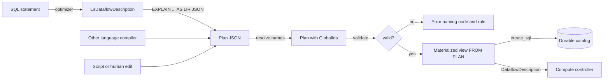

# User-provided LIR plans

Associated:
* [Pinning LIR plans](./20260826_pinned_lir.md)
* [Declared schemas for materialized views](https://github.com/MaterializeInc/materialize/pull/39596) (open)
* [Replacement materialized views](./20251111_replacement_materialized_views.md)

## The problem

Materialize accepts exactly one input language, SQL, and owns every step from SQL to the dataflow it runs.
Internally, SQL is lowered through HIR and MIR into LIR (`LirRelationExpr`), which corresponds roughly to the rendered dataflow.
Users cannot express a plan the optimizer does not find, and other query languages cannot target Materialize except by emitting SQL.
Three gaps motivate opening LIR as an input: plans the optimizer misses (for example an undecorrelated subquery or an avoidable cross join), facts the user knows but SQL cannot carry (keys, monotonicity), and frontends for languages other than SQL.
This design treats LIR as a second public input language next to SQL, built on the durable LIR format that pinned LIR introduces.

This is a skunkworks project.
Its deliverable is a terminal recording of a working prototype and a record of what was missing, not a production feature.

## Success criteria

The prototype is done when a recorded terminal session shows the following, end to end, against a locally running Materialize:

1. Create a SQL materialized view whose plan has a flaw the optimizer cannot fix.
2. Extract the full dataflow of that view as JSON.
3. Edit the JSON into a better plan with a script.
4. Submit a broken variant, which validation rejects with a readable error naming the node and the violated rule.
5. Install the improved plan as a new materialized view, query it, and show that it returns the same results as the SQL view.
6. Swap the improved plan under the original SQL view through the replacement path.
7. Compile a recursive query (transitive closure) written in a toy Datalog-like language to LIR JSON with a small Python program, install it, and query it.

No syntactically valid plan may crash a replica or `environmentd`.
Every plan that would misbehave at render time or evaluation time must be rejected at submission with an error.

## Out of scope

* Production readiness: compatibility guarantees for the plan format, migrations, docs, and a rollout.
* Query hints, or any way to influence the optimizer from SQL.
* Hand-tuning UX such as a text syntax for LIR. JSON is the only format.
* Pinned LIR itself: storing optimizer-produced plans, `CLONE OBJECTS`, and `EXPLAIN REPLAN`.
* User-asserted keys and monotonicity beyond what the plan's imports already carry (see [Keys and monotonicity](#keys-and-monotonicity)).
* Indexes defined by a plan.
  Materialized views come first because they own a persist shard and already support replacements.

## Anti-goals

The prototype fails, even if the demo runs, if any of the following hold:

* A plan that passes validation panics a replica or `environmentd`.
* The validator accepts a plan by trusting a property it could check.
* User plans fork the LIR format from the one pinned LIR stores.
  Every plan format change must go through the existing `LIR_VERSION` snapshot tests.

## Current state

The design builds on the following, all on `main`:

* **Stable LIR format.**
  `LIR_VERSION` and `LIR_VERSION_POLICY` live in `src/compute-types/src/plan.rs`.
  `tests/lir_schema.rs` snapshots the serde shape of `LirRelationExpr`, and `tests/func_registry.rs` snapshots scalar function properties.
  Rows and errors serialize as `StableRow` and `StableEvalError`, which are protobuf bytes inside JSON.
* **Serde everywhere.**
  `LirRelationExpr`, `LirScalarExpr`, `AvailableCollections`, the join, reduce and top-k plans, and `DataflowDescription` derive `Serialize` and `Deserialize`.
* **Explain.**
  `EXPLAIN PHYSICAL PLAN AS JSON` dumps each `LirRelationExpr` with serde but drops the dataflow envelope: imports with their types and monotonicity, exports, and the ids of the built objects (`src/expr/src/explain/json.rs`).
* **No validation.**
  The only check on LIR is `LirDataflowDescription::check_invariants`, which checks `LirId` uniqueness and runs as a soft assertion after lowering.
  Rendering trusts the plan and panics in about thirty places when it is wrong, for example on a missing arrangement (`src/compute/src/render/context.rs`), an out-of-range column (`LirScalarExpr::Column` evaluation in `src/compute-types/src/plan/scalar.rs`), or an unknown `Get` (`src/compute/src/render.rs`).
  The compute controller checks read holds and `as_of`, not plans (`Instance::create_dataflow` in `src/compute-client/src/controller/instance.rs`).
* **Catalog.**
  The durable catalog stores only `create_sql` for a materialized view and re-plans it on every boot (`bootstrap_dataflow_plans` in `src/adapter/src/coord.rs`), with a best-effort, version-keyed expression cache.
* **Replacements.**
  `CREATE REPLACEMENT MATERIALIZED VIEW ... FOR target` runs a read-only dataflow against the target's shard, and `ALTER MATERIALIZED VIEW ... APPLY REPLACEMENT` swaps it in.
  The replacement's `RelationDesc` must equal the target's.

## Solution proposal

The design has three parts, which share one JSON format: extract, validate, and install.



### Plan format

The user-facing format is a JSON envelope around the pinned-LIR serde form of the plan.
It carries what the user decides, the plan and how to read each input, and nothing the system can derive, such as input types or monotonicity.
Deriving those from the catalog at install time removes a whole class of lies the validator would otherwise have to catch.
The envelope looks roughly as follows; its exact shape is the builder's call:

```json
{
  "lir_version": 1,
  "imports": [
    { "id": {"Transient": 1}, "name": "materialize.public.edges", "access": "persist" },
    { "id": {"Transient": 2}, "name": "materialize.public.orders", "access": {"index": "materialize.public.orders_by_customer"} }
  ],
  "objects": [
    { "id": {"Transient": 3}, "plan": { "...": "LirRelationExpr in pinned-LIR serde form" } }
  ],
  "output": {"Transient": 3}
}
```

Imports bind placeholder ids to catalog names.
At install time, `environmentd` resolves each name to a `CatalogItemId` and the `GlobalId` of its current `RelationVersion`, and substitutes it for the placeholder throughout the plan, the same substitution pinned LIR's `CLONE OBJECTS` needs.
For an index import, `environmentd` fills in the `IndexImport` (key, type, monotonicity) from the catalog.
For a persist import, it fills in the `SourceImport` (`RelationDesc`, monotonicity).
A persist import may carry an optional `MapFilterProject` to push into the source, because optimizer-produced `SourceImport`s carry one and the round trip must preserve it.
`lir_version` must equal the running `LIR_VERSION`, otherwise installation fails with an error that names both versions.

Literal rows are the one place the pinned-LIR format is not writable by hand or by a simple compiler, because `StableRow` serializes as protobuf bytes.
The envelope therefore accepts literals in a readable JSON encoding of datums for the scalar types the demo needs, at least `int8`, `text`, `bool`, `numeric` and null.
The builder decides whether this is a separate serde mode of `StableRow` or a preprocessing step that rewrites readable literals into `StableRow` before deserialization.
Either way, extraction emits the readable form where the type is supported, so the round trip stays readable.

Scalar functions serialize by their Rust variant name, as in the pinned-LIR snapshot.
The prototype keeps that, since it is what pinned LIR stores, and records in the findings whether `FuncName::NAME` would be a better user-facing name.

### Extract

`EXPLAIN PHYSICAL PLAN AS LIR JSON FOR ...` (exact spelling is the builder's call) prints the envelope for any statement or object that `EXPLAIN PHYSICAL PLAN` accepts today.
It emits the full `LirDataflowDescription` content that the envelope needs: imports as names with their access path, every built object, and the output.
`GlobalId`s of imports are replaced by placeholders, and the built objects keep transient placeholder ids too, so the output is independent of the environment it came from.
The round-trip property is the main test: for every plan the optimizer produces in the test suite, extracting, then installing the extracted JSON, yields a `DataflowDescription` equal to the original up to id substitution.

### Validate

A validator in `mz_compute_types` checks a resolved `LirDataflowDescription` and returns either success or a list of errors.
Each error names the `LirId` of the offending node, its operator, and the rule it breaks.
The validator never panics, including on plans that fail every rule.
It checks the following, derived from what rendering trusts today:

1. **Scoping.**
   Every `Get` of a `GlobalId` refers to an import or an earlier built object, and every `Get` of a `LocalId` is bound by an enclosing `Let` or `LetRec`.
   `LirId`s are unique, and every export refers to a built object.
2. **Arity.**
   Every node has a computed arity, and every column reference in every scalar expression, key, permutation, thinning, join closure, group key and aggregate is in range.
3. **Arrangement availability.**
   The validator simulates the `AvailableCollections` each node produces, and checks every consumer's request against it, including raw-versus-keyed and exact key equality.
   This covers `GetPlan::PassArrangements`, join lookups, threshold, top-k and flat-map inputs, `LetRec` values, and index exports.
   The `(key, permutation, thinning)` triples must equal what `permutation_for_arrangement` produces.
4. **Types.**
   The validator infers a `ReprColumnType` for every column of every node, starting from the import types and literals, and checks every scalar function application against the function's input signature.
   It also checks aggregate input types, that a top-k limit is `int8`, and that filter and `If` conditions are `bool`.
   Exact input signatures exist only for functions generated by the `sqlfunc` macro (`FuncName::sqlfunc_input_types`).
   Hand-written functions and functions over `Datum` parameters, which include the polymorphic list, array, record, range, jsonb and map functions, have none.
   The validator therefore rejects any function not on an allowlist of functions with exact signatures, with an error naming the function.
   The excluded functions are recorded as a finding.
5. **Operator rules.**
   Reduce key and value plans have no predicates, monotonic reduce uses only aggregates that have a monoid, delta join paths start at relation zero, and a reduce's `must_validate` wiring matches its aggregates.
   The builder extends this list from the render-time assertions.
6. **Monotonicity.**
   Every operator variant that requires monotonic input (monotonic reduce and top-k) either has an input that the existing `physically_monotonic` analysis derives as monotonic from monotonic imports, or has `must_consolidate` set.
   The optimizer chooses these variants on logical monotonicity and lowering sets `must_consolidate` unless the input is physically monotonic (`relax_must_consolidate.rs`), so this rule accepts every optimizer-produced plan.
   With `must_consolidate` set, a false monotonicity claim surfaces as an error in the dataflow through `ensure_monotonic`, not as a panic.
   The builder verifies that no assertion downstream of `ensure_monotonic`, such as the positivity assertion in `ReductionMonoid::multiply`, is reachable with a negative diff.
7. **Output.**
   The output's inferred `RelationDesc` is compatible with the declared schema of the installed object (see [Install](#install)).

The validator also runs as a hard assertion on every optimizer-produced plan in tests, so the optimizer's output is the validator's first test corpus.
A rule that rejects an optimizer-produced plan is either a validator bug or an optimizer bug, and both are findings.

Type checking does not make evaluation total.
About 145 call sites in scalar function bodies call `Datum::unwrap_*` and panic on an unexpected datum.
Type checking against exact signatures keeps well-typed plans away from them, which is why rule 4 rejects functions without one.

Explaining a user plan is `EXPLAIN PHYSICAL PLAN` on the installed object, rendered from the stored plan with the existing text renderer.
`EXPLAIN PHYSICAL PLAN AS ... FOR PLAN '<json>'` (spelling is the builder's call) validates and renders a plan without installing it.

### Install

A new form of `CREATE MATERIALIZED VIEW` installs a plan:

```sql
CREATE MATERIALIZED VIEW reachable (src int8 NOT NULL, dst int8 NOT NULL)
  IN CLUSTER c
  FROM PLAN '<json>';
```

The column definitions come from the declared-schema design (#39596), and are required in this form, because there is no SQL query to infer a schema from.
The prototype implements the subset of #39596 it needs: names, types and `NULL`/`NOT NULL`, without keys.
LIR types are `ReprScalarType`s, which do not distinguish, for example, `text` from `varchar` or carry numeric scale, so the declared schema must equal the plan's inferred output type in arity and in the `ReprScalarType` of each column.
Types with modifiers (`numeric(p, s)`, `varchar(n)`, `char(n)`, `timestamp(p)`) are rejected in `FROM PLAN` schemas, because nothing in the plan would enforce the modifier on values written to persist.
A declared `NOT NULL` column becomes a non-null assertion on the sink, as in #39596, so the plan's inferred nullability need not be trusted.

The plan JSON lives inside `create_sql`, so the object survives restarts without pinned-LIR storage, and no durable catalog format changes.
Purification rewrites every import in the stored JSON from a name to its resolved `CatalogItemId` and `RelationVersion`, as it does for SQL references.
This is required, not cosmetic: `ALTER ... RENAME` rewrites dependents' `create_sql` through the SQL AST (`create_stmt_rename_refs` in `src/sql/src/ast/transform.rs`), which cannot see names inside a string literal, and a name could resolve to a different relation version after `ALTER TABLE ... ADD COLUMN`.
Every import, index imports included, is recorded as a dependency of the new object, so dropping an imported index or relation requires `CASCADE`.
On every boot, `environmentd` re-parses the statement, re-validates, and installs the stored plan instead of optimizing.
A stored plan that fails to load at boot then has only one cause left, an `LIR_VERSION` change, and panics `environmentd` the way invalid persisted SQL does today.
That is acceptable for the prototype, and the findings record what pinned LIR's best-effort replanning would need instead, since a user plan has no SQL to fall back to.

Everything after optimization is the existing materialized view path: timestamp selection, read holds, `create_collections` for the shard, and shipping the dataflow.
`CatalogItem::MaterializedView` requires a `raw_expr` and a `locally_optimized_expr`, which a plan-only view does not have.
The builder makes them optional or introduces a plan-only variant, and adjusts their readers.

Replacement reuses the existing mechanism.
`CREATE REPLACEMENT MATERIALIZED VIEW name (...) FOR target FROM PLAN '<json>'` creates a read-only dataflow writing to the target's shard, and `ALTER MATERIALIZED VIEW target APPLY REPLACEMENT name` swaps it in.
The declared schema must equal the target's `RelationDesc`, and the existing check compares keys as well as columns, types and nullability (`RelationDesc::diff`).
A `FROM PLAN` object has no keys, because LIR has no key analysis and the design accepts no key claims, so only a target without keys can be replaced.
The demo picks such a target, and the findings record that replacing keyed objects needs either checkable key claims or key inference on LIR.
Whether replacing a plan in place deserves its own syntax is a question for the findings.

All new syntax is gated behind a feature flag, `enable_lir_plans`, off by default, which the demo turns on.
The flag is also on for tests, so sqllogictest exercises the new path.

### Keys and monotonicity

The validator accepts no user claims about keys or monotonicity.
Monotonicity comes only from imports, through the existing analysis, and the output's keys come only from what the plan structurally implies.
A false monotonicity claim today produces an error in the dataflow and wrong results, not a panic, because `ensure_monotonic` routes negative diffs to the error stream.
A false key claim has no runtime check at all.
The findings should record which demo-relevant optimizations would need a trusted claim, and what a checkable form of each would be.

### Toy frontend

A Python program of a few hundred lines compiles a Datalog-like language to the plan envelope.
It supports rules with conjunctive bodies over named relations, equality joins and projection, and recursion through `LetRec`, enough to express transitive closure:

```
reachable(x, y) :- edges(x, y).
reachable(x, z) :- reachable(x, y), edges(y, z).
```

It emits imports by name, arrangements for joins, a `Reduce` for set semantics, and literals in the readable encoding.
It lives under `misc/` as a demo artifact and imports nothing from Materialize.
Its value is to show that the format can be targeted from outside the repository with only the documentation and the snapshot, and the findings record every place where that was not true.

### Demo

The demo is a terminal recording of the steps in [Success criteria](#success-criteria), driven by a script so it can be replayed.
The SQL examples are the builder's choice, as long as one shows a plan the optimizer cannot produce from the SQL and that is visibly better in `EXPLAIN` or arrangement sizes.
Candidates are a correlated subquery that decorrelates into a cross join, and an aggregate over an append-only source that the optimizer does not plan as monotonic.

## Minimal viable prototype

The prototype is the demo plus the following tests:

* The round-trip test over optimizer-produced plans.
* The validator as a hard assertion on every optimizer-produced plan in sqllogictest runs.
* Validator unit tests: one rejected plan per rule, each asserting the error names the rule.
* A sqllogictest file for `FROM PLAN`: install, query, restart survival, replacement, and rejection errors.
* A fuzz-style test that mutates valid plans (change a column index, drop an arrangement, swap a function) and asserts that the validator rejects the result or that rendering it does not panic.

## Findings to record

The skunkworks exists to learn what is missing.
The write-up at the end covers at least the following:

* What a persist shard as a first-class catalog object would look like, given that `FROM PLAN` is a materialized view with the plan split off.
* How plans should reference inputs once ids are written back: whether users ever need to see or write `CatalogItemId`s, and what extraction should print.
* Which scalar functions the allowlist excludes, and what exact signatures for them would take.
* What replacing a keyed object would need: key claims, and how to check them, or key inference on LIR.
* Which parts of the LIR format were hard to target from the toy compiler.
* What compatibility promise user plans would need, and how it conflicts with pinned LIR's best-effort replanning.
* Which key and monotonicity claims users would want, and whether any can be checked.
* Every rendering or evaluation panic the fuzz test found that the validator did not prevent.

## Alternatives

### A text syntax for LIR

A text syntax would be easier to write by hand than JSON, and `src/expr-parser` shows a starting point for MIR.
It is a large grammar for join, reduce and top-k plans, and hand-writing plans is not the goal.
Compilers emit JSON easily, so JSON is enough for the demo.

### Accept MIR instead of LIR

MIR is smaller and closer to SQL, and the headless test driver already accepts MIR text.
MIR is then optimized and lowered, which takes away exactly the control this design wants to give, and MIR serde is not stable across versions.
LIR is the level pinned LIR stores, so building on it keeps one durable plan format.

### Store the plan in a persist shard

Pinned LIR stores plans in a persist shard referenced from the catalog, which keeps the catalog small.
That storage does not exist yet, and building it is pinned LIR's work.
Storing the plan in `create_sql` needs no new durable state and is enough for a prototype.

### Trust the plan and catch panics

Running user dataflows inside a panic boundary would avoid the validator.
`mz_ore::panic::install_enhanced_handler` aborts the process on any panic not raised inside `mz_ore::panic::catch_unwind`, so today a render or evaluation panic takes down the whole replica.
Wrapping operator logic in `catch_unwind` would still leave the timely worker with a half-processed batch and a dataflow whose frontiers no longer mean anything, shared with the other dataflows on that worker.
Rejecting bad plans upfront keeps the replica's other dataflows unaffected without changing panic semantics.

## Open questions

* Should a plan replace an existing object's plan in place, or only define new objects?
  The prototype supports both through replacements, and the findings say which one users would want.
* What should happen at boot when a stored user plan no longer validates?
* Should declared keys from #39596 be accepted for `FROM PLAN` objects, checked against the keys the plan structurally implies?
