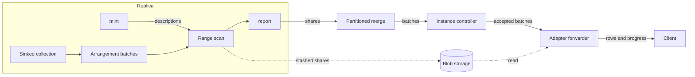

# BatchedSubscribe

* Associated: CPU-318 ("Subscribe considered broken"), the Linear project "Adapt peek optimizations to subscribes", the durable subscribe design (#38468).

This document guides the implementation and is not intended for review as a proposal. It records the protocol and the guarantees the implementation stack rests on, the code each decision depends on, and the facts that still need a test.

## The problem

A `SUBSCRIBE` cannot return a large result. An account extracting about 200 GB hit the limit twice: once on the snapshot, and again on the first batch of a follow-up `SUBSCRIBE AS OF T - 1` that had to catch up on every timestamp since `T`. A batch of that size fails at four places.

* The sink buffers every update in `rows_to_emit` (`src/compute/src/sink/subscribe.rs`) until the frontier passes its time. `ComputeState::process_subscribes` turns a response over `max_result_size` into an error (`src/compute/src/compute_state.rs:1480-1481`).
* The partitioned merge holds back updates until the merged frontier passes them and fails once their total exceeds `max_result_size` (`PendingSubscribe::stash`, `src/compute-client/src/service.rs`).
* `ActiveSubscribe::process_response` (`src/adapter/src/active_compute_sink.rs:263`) merges and materializes each batch on the coordinator loop.
* The client channel is unbounded, and the coordinator retires the subscribe when its backlog exceeds `subscribe_max_buffered_bytes`, 128 MiB by default.

The limits follow from the contract. Every batch is a collection sorted by time and then by the requested order, and it is resident at every hop. The ordering promise dates from 2020: `8252af9bbb` (#4718) made TAIL sort by time, `d4aea4d9e3` (#4752) added progress messages five days later, and `dd7c8a2768` taught clients to infer completeness from order. CPU-318 lists the places in the code that rely on it.

## Success criteria

* A subscribe that opts in delivers results of any size, including a single batch spanning many timestamps, without holding the batch in environmentd memory.
* environmentd memory per subscribe is bounded by a read buffer and a queue of batch descriptors.
* Losing a replica does not interrupt the subscribe while another replica serves it.
* Output is consolidated per batch, carries a progress row at each batch upper, and is otherwise in no particular order.
* Existing subscribes keep their behavior.

## Out of scope

* Changing the contract of existing subscribes.
* Envelopes (`UPSERT`, `DEBEZIUM`) and `WITHIN TIMESTAMP ORDER BY`. Both need an order within a timestamp.
* Resuming after an environmentd restart. The durable subscribe design resumes at an acknowledged timestamp, and an interrupted snapshot restarts from scratch.
* Reaping blobs that a dead replica or environmentd leaves behind. Peeks leak the same way today. The replica's channel adapter keeps responses owned until it forwards them to a connected client, and deletes their stashed batches when it drops them. Three leaks remain in the subscribe's stash shard.
  * Responses lost inside a dead transport's buffers, including a client that closes between the closed check and the send.
  * Uploads from a killed replica that were never reported.
  * Stashed shares held in a partitioned merge when its client is dropped. The peek path has the same gap.

  A shard-level sweep would close all three and needs a persist prefix-delete API.
* Delivering errors to the client. A later `WITH (ERROR)`-style option can emit error updates as rows with NULL data columns, following the `ENVELOPE UPSERT (VALUE DECODING ERRORS = INLINE)` precedent of a column `error record(description text)`, and should be designed together with the proposed `IGNORE ERRORS` (#38916). Clients then reconstruct each timestamp's error state from error rows and progress rows, so no extra taint column is needed. That works with a snapshot. Without one, an error that stands before the start and is never retracted stays invisible, which is inherent to subscribing without a snapshot.
* Bounding replica memory on the general path. Without an index, the sink holds a description's updates in its own arrangement until it writes the share, as today's sink holds them in `rows_to_emit`.

## Solution proposal

BatchedSubscribe is a new subscribe mode, selected by a `SUBSCRIBE` option, built as its own path through planning, the sink, the compute protocol, the controller, and the adapter. Its output is a sequence of batches. Each batch has a description `[lower, upper)`, carries consolidated updates in no particular order, and is followed by a progress row at `upper`.

The mode treats the subscribe's output as a sequence of appends rather than a stream of messages. Each replica writes down batches as time advances, and each batch's lower is the previous batch's upper. Replicas run the same deterministic dataflow, so any replica's batch for a description has the same contents. Replicas keep no state about what the controller accepted. The controller keeps one accepted upper, forwards whatever part of a batch lies beyond it, and drops the rest, so replicas can disagree about where batches end.



The name in code is BatchedSubscribe. The code avoids "collection" in names, because differential collections, compute collections, and storage collections already use the word. The SQL option name is a product decision, and the working name below is `BATCHED`.

### Protocol and guarantees

This section is the specification the rest of the design implements. `20261021_batched_subscribe/Cutover.lean` models it in Veil and checks the safety properties below, together with a proxy for liveness.

**Content.** A subscribe has an as-of `A` and a start `S`, which is `A` when the subscribe has a snapshot and `A + 1` when it does not. For a description `[l, u)`, the snapshot content `C*([l, u))` is the accumulation at `l` of all updates at times up to `l`, together with the updates at times `t` with `l < t < u`. The delta content `C([l, u))` is the updates at times `t` with `l <= t < u`. Updates are the dataflow's row updates `(row, time, diff)` and its error updates `(error, time, diff)`, and every statement about content covers both. Both contents are consolidated per `(time, row)` and per `(time, error)`. Restricting either to the times at or after some `U` with `l < U <= u` gives `C([U, u))`, and restricting `C*([l, u))` to the times at or after `l` gives it back unchanged.

**Definiteness.** Both contents depend only on the subscribe and the description, not on the replica that computes them, because replicas run the same deterministic dataflow on the same inputs. Inputs that differ per replica, such as introspection sources, break this, so a BatchedSubscribe over them must target one replica, as today's subscribes over introspection do. Errors are part of the content. The error collection is as deterministic as the rows, so every replica's batch for a description carries the same error updates, and the trim in C1 below applies to both. Failures that are not data, such as a failed stash write, differ between replicas and are not content (see Fatal errors below).

**Replica obligations.**

* R1. A replica renders the dataflow at an as-of `a` and always with the snapshot. Its first batch has lower `a` and carries `C*([a, u))`. Each later batch's lower is the previous upper and carries `C([l, u))`. Every upper is beyond its lower.
* R2. A replica that renders anew, after a restart, a reconfiguration, or a reconnect, renders at its replayed as-of. The replayed as-of is the subscribe collection's since, the frontier of its last `AllowCompaction` (`src/compute-client/src/protocol/history.rs:146`). The since is `A` until the controller accepts the first batch and at most `U - 1` afterwards (C2), so a replica's first lower is at or before `U`.
* R3. A replica that loses batches in flight renders anew (R2) instead of continuing its chain. Today this holds for subscribes because reconciliation never retains a dataflow that exports a subscribe (`src/compute/src/server.rs:1103`, through `DataflowDescription::subscribe_ids` in `src/compute-types/src/dataflows.rs:357`). `subscribe_ids` matches only `ComputeSinkConnection::Subscribe`, so the new connection variant must be added to it, or reconciliation retains a BatchedSubscribe dataflow across a reconnect whose batches in flight the controller dropped by epoch (`src/compute-client/src/controller/instance.rs:2038`), and the replica's chain has a gap. Reconciliation also replaces the replica's queue of unsent subscribe responses (`src/compute/src/server.rs:1257`), and the BatchedSubscribe queue must be replaced at the same point. Otherwise batches queued before the reconnect leave under the new connection, where the controller takes them as the start of the re-rendered chain.
* R4. A replica reports no `Frontiers` for a BatchedSubscribe, as for subscribes today (`src/compute/src/compute_state.rs:1086`). Its write frontier is the upper of its last batch. Reporting its output frontier would let the controller's write frontier, and with it the since, run ahead of `U`.
* R5. A replica keeps no state about a batch once it has sent it and learns nothing from the controller.

**Controller obligations.**

* C1. The controller keeps `U`, initially `S`, and processes each replica's batches in the order the replica sent them. A batch with `upper <= U` is dropped, and its stashed shares are deleted. A batch with `lower <= U < upper` is accepted with the effective description `[U, upper)`: the controller forwards it with a trim at `U`, so the client receives only its updates at times at or after `U`, and sets `U` to `upper`. A batch with `lower > U` cannot arrive, because each replica's chain starts at or before `U` (R2) and is processed in order (R3).
* C2. The subscribe's write frontier is `U`, set only from accepted batches. The implied read hold of a write-only collection follows one step behind the write frontier (`instance.rs:1920`), so the since is `A` until the first accept and at most `U - 1` afterwards, and the input read holds never pass it.

The first forwarded batch is a replica's first batch with `a = A`. With a snapshot, `A = S = U`, the trim keeps everything, and the client receives `C*([S, u))`, the snapshot followed by updates. Without a snapshot, `A < S = U`, and the trim removes the accumulation at `A`, so the client receives `C([S, u))`. A later forwarded batch from a re-rendered replica has `a <= U - 1 < U`, so the trim removes its accumulation at `a`. The trim treats errors like rows. Without a snapshot it removes the errors that stand before `S`, and after a re-render it removes the errors accumulated below `U`, which an earlier accepted batch already carried. Rendering every replica with the snapshot costs computing a snapshot that is then discarded, and skipping it would only be a performance optimization.

**Errors.** Whether an error stops the subscribe is policy, and the replica holds none of it. A replica reports error updates as content, keeps minting and scanning after them, and knows no start: its first description accumulates rows and errors before its as-of into the as-of, as a plain snapshot does. The cutover alone decides which errors reach the adapter, which applies the policy (see Adapter). History reduction raises the as-of of a BatchedSubscribe's dataflow as for any dataflow and leaves the sink connection unchanged.

**Fatal errors.** Some failures are not data: a worker receiving descriptions out of order, a failed stash write, and a share task that ends without an outcome. They have no time, differ between replicas, and cannot be retracted, so they travel in a separate fatal error on the batch instead of in its shares. A worker that hits one has released its held batches, so it reports the fatal error on that description and on every later one. A batch carrying a fatal error still carries its shares, so that a layer that can delete their stashed batches receives them. C1 drops such a batch like any other when its upper is at or below `U`, and the subscribe fails when it accepts one.

**Send order.** The order a replica sends batches in survives to the instance controller. Workers' responses are merged per process by `Partitioned` over FIFO parts (`src/cluster/src/client.rs:38`, `src/service/src/client.rs:158`), processes' responses are merged the same way (`src/compute-client/src/controller/replica.rs:42`), and each replica task uses one channel to the instance (`replica.rs:286`). The partitioned merge for BatchedSubscribe must emit descriptions in the order its parts send them, which the merge below provides.

**Guarantees.** Under these obligations the forwarded batches form one chain of descriptions from `S` to `U` with no gaps and no overlaps, and each forwarded batch carries `C*` for the subscribe's first description when the subscribe has a snapshot, and `C` otherwise. As long as one replica stays alive and keeps up with its inputs, `U` advances: every batch the controller processes either moves `U` or is dropped, and the replica's next batch again starts at or before `U`. The client sees each forwarded batch's updates followed by a progress row at its upper.

The model shows which obligations are load-bearing. Accepting only a batch with `lower = U` drops a straddling batch, after which a replica whose boundaries differ from those of the replica that set `U` never sends a batch starting at `U`, and the subscribe stalls when that replica fails. Forwarding a straddling batch untrimmed forwards overlapping batches. Processing a replica's batches out of order breaks the content of forwarded batches. A replica that loses batches in flight and continues its chain stalls. A since that reaches `U` lets a re-rendered replica send a snapshot where the client expects a delta. A replica that starts one step past its replayed as-of without a snapshot stalls before the first accept.

The protocol needs no atomicity across a replica's responses, because the controller acts on each batch independently.

**Cost.** Every replica writes every large batch. With `n` replicas that keep pace, the stash holds up to `n` copies of a batch until the controller drops all but one, and the duplicates are written and deleted. This is accepted.

### Contract

* `SUBSCRIBE ... WITH (BATCHED)` implies `PROGRESS`. Progress rows are the only completeness signal.
* Only plain diff output is allowed. The planner rejects envelopes and `WITHIN TIMESTAMP ORDER BY` with `BATCHED`.
* Updates within a batch are consolidated per `(time, row)` and carry no order. Batches arrive in order of their descriptions.
* Error updates are not output rows. By default an accepted batch with an error update fails the subscribe, as a plain `SUBSCRIBE` fails (see Adapter).
* `max_result_size` does not bound a BatchedSubscribe. It bounds only the inline bytes the partitioned merge holds, and inline shares stay below a per-worker threshold.
* `UP TO` bounds the output as today: no update at or after `up_to` is delivered, and the subscribe completes when `U` reaches `up_to`.
* The output relation is the one `describe_subscribe` builds with `PROGRESS` today (`src/sql/src/plan/statement/dml.rs:1568-1577`): `mz_timestamp`, `mz_progressed`, `mz_diff`, then the relation's columns as nullable.

### Planning and optimization

* The parser gains a `SubscribeOptionName` variant (`src/sql-parser/src/ast/defs/statement.rs:4048`), and `plan_subscribe` extracts it through `generate_extracted_config!` (`dml.rs:1542`).
* `SubscribePlan` gains a `batched: bool`. Planning sets `emit_progress` when `batched` is set and requires `SubscribeOutput::Diffs`.
* A feature flag gates the option through `require_feature_flag`, declared in `feature_flags!` (`src/sql/src/session/vars/definitions.rs`). It is on in CI through `misc/python/materialize/mzcompose/__init__.py`. The production default needs a human decision.
* The optimizer builds the dataflow as today (`src/adapter/src/optimize/subscribe.rs`) with a new sink connection, `ComputeSinkConnection::BatchedSubscribe`. The connection carries a `stash_id: Uuid`, from which every share of the subscribe derives its stash shard, and an optional non-temporal MFP. It carries no start, because the controller trims below `S` (C1). The adapter generates `stash_id`, because transient ids repeat across environmentd restarts.
* When the subscribed relation is a non-temporal map, filter, and project over a collection with an index on the cluster, and the projection keeps the index key columns, the optimizer sets the sink's `from` to the indexed collection and `from_desc` to that collection's schema, and moves the MFP into the connection. The detection mirrors the peek fast path, `create_fast_path_plan` in `src/adapter/src/coord/peek.rs`. Lowering then sets `from_arrangement` to the index arrangement, as it does for any sink whose source is only arranged (`src/compute-types/src/plan/lowering.rs:197-222`). The optimizer must not set `from_arrangement` itself: lowering overwrites it, and its MFP is defined to rebuild full rows of `from_desc` (`src/compute-types/src/sinks.rs:39-47`), which leaves no room for the query's MFP. Without this rewrite, the sink receives the flattened output of the view it is built over (`src/compute/src/render/sinks.rs:74`).
* A projection that drops index key columns can map rows on different workers to the same output row, so it takes the general path, which consolidates across workers through its exchange.
* The index import keeps its arrangement only when it reads a snapshot (`src/compute/src/render.rs:708-740`). The sink always renders with the snapshot (R1), so the arranged path always has its arrangement.

### Replica: the sink

The sink holds arrangement batches and computes each description's content with a range scan over them. It reuses the peek infrastructure for the scan, the offload, and the stash.

**Input.** On the arranged path, `export_sink` hands the sink the arrangement named by `from_arrangement` instead of flattening it (`sinks.rs:64-86`), and the sink reads its batch stream, including the batches an import replays for the snapshot. The range scan applies the connection's MFP after rebuilding rows with the `from_arrangement` MFP. Otherwise the sink arranges its input by hash of row, and keeps no trace. Either way it holds `ArcBatch` references (`src/row-spine/src/arc_batch.rs:34-38`), which are `Send + Sync`, so a scan can move off the worker. On the arranged path the batches are shared with the index's trace, and the trace merges them into new batches while the sink still holds the old ones, so a slow sink keeps both alive. Rows that can collide in the output sit on one worker, so each worker's share is disjoint from the others' after the MFP.

**Minting.** One worker, chosen by hashing the sink id as the materialized view sink does (`src/compute/src/sink/materialized_view.rs:520`), mints descriptions and broadcasts them. Its first lower is the rendered as-of (R1), so it depends only on the replica's own history. Its next upper is its input frontier, the meet of the ok and error frontiers, clamped to `up_to`. The mint worker reads only frontiers, so errors do not affect minting. Every worker receives the same broadcast sequence in order, so a worker that receives a description whose lower is not its previous upper reports a fatal error instead of skipping it. Skipping would leave the description without that worker's share and stall the merge.

**Scanning.** A worker scans a description `[l, u)` only once both its own input frontiers have reached `u`, as the materialized view sink waits for its desired frontier (`materialized_view.rs:1164-1169`). Without the wait, a lagging worker writes a share that misses updates no other share covers. The scan covers the held batches whose bounds overlap `[l, u)` and emits the updates with times in the description, retractions kept. For a replica's first description it also accumulates the updates before `a` into `a`, rows and errors alike. The scan reuses `PeekResultIterator::from_cursor` over a `CursorList` of the chosen batches (`src/compute/src/compute_state/peek_result_iterator.rs:210`) with its literal handling, MFP evaluation, and per-position fuel. It changes the time predicate from "at or before the peek time, summed" (`peek_result_iterator.rs:469`) to "inside the description, per time", drops the negative-diff check (`:475`), and yields several updates per position. For the current `(key, val)`, `CursorList::map_times` visits that pair's updates in every held batch (differential's `cursor_list.rs:154-158`). A projection can map several positions to one output row, so the scan consolidates each worker's share per `(time, row)` after the MFP. `ErrorScan` changes the same way and also walks past the first error, since a share carries every error update of its description. It consolidates per `(time, error)` within each hand-out to the share writer, and `DataflowErrorSer` orders by its canonical bytes (`src/compute/src/render/errors.rs:37-55`), so equal errors consolidate. Error bytes count toward the same size cut as row bytes, so a description whose every row errors streams its errors into the stash instead of holding them in worker memory.

**Release.** A worker drops the held batches a description covered once it has written that description's share (R5).

**Offload.** A large scan runs off the worker through the offload driver (`peek_offload.rs`), made generic over the scan and its result channel, and takes a permit from the process-wide `PeekPermits`. A small scan runs inline under the fuel budget.

**Shares.** A share holds a worker's row updates and error updates for one description. A worker's share below a threshold travels inline, its rows as an `UpdateCollection` and its errors as a list next to them. Past it, the worker writes a persist batch through a generalized `StashUpload` (`peek_stash.rs`) opened with the stash shard, the description's bounds, and real update times, accepting negative diffs. The stash already writes `SourceData`, which wraps `Result<Row, DataflowError>` (`src/compute/src/compute_state/peek_stash.rs:153-155`), so error updates go into the same batch as `SourceData(Err)` with no new format. Every share records `last_error_time`, an upper bound on the times of its error updates. It is the greatest time of any error update written, before error updates in different hand-outs consolidate away, so a share whose errors cancel may announce errors it does not hold. The bound lets the adapter skip reading shares that cannot hold an error after the trim. Small shares need no coalescing, unlike the materialized view sink's small batches, because subscribe output reaches environmentd through the compute protocol anyway, so the `SharedBatches` core does not apply. Every worker reports a response for every description, possibly with no share, because the partitioned merge counts responses to detect completion. A worker reports a data error once, in the share of the description it belongs to, and does not repeat it on later descriptions.

**Completion.** When `U` can reach `up_to`, the sink's last description has upper `up_to`, and the sink then reports completion with an empty upper, as today's sink does (`subscribe.rs:149-156`). The adapter emits a progress row at `up_to` before it completes the subscribe, which a plain subscribe does not do. It follows from a progress row at every accepted upper.

**Read-only replicas.** Stash writes go to scratch shards and are not gated by `AllowWrites`, as for peeks. A read-only environmentd serves no subscribes.

### Peek infrastructure reuse

| Component | Reused as | Change |
|---|---|---|
| `PeekResultIterator` | Range scan over held batches | Time predicate per description, per-time output, retractions |
| `ErrorScan` | Error range scan | Time predicate per description, per-time output, retractions, continues past the first error |
| `PeekScan` | Budget split and batch cut | A constructor not tied to `&Peek`, a batch type with time, no finishing, limit, offset, or thinning |
| Offload driver and `PeekPermits` | Off-worker scans | Generic over the scan and the result channel, visibility of the permit API |
| `StashUpload` and `StashTarget` | Stashed shares | Bounds and shard from the caller, real times, signed diffs, a constructor not tied to `&Peek` |
| `DeliveredBatch` and abandon cleanup | Cleanup of stashed shares | None |

The answer path (`PeekResponse`, `PendingPeek::absorb`) and the finishing do not transfer, because the subscribe protocol replaces them.

### Compute protocol

A new response carries batched subscribe output, leaving `SubscribeResponse` and `SubscribeBatch` untouched.

```rust
pub enum ComputeResponse {
    // ...
    BatchedSubscribeResponse(GlobalId, BatchedSubscribeResponse),
}

pub enum BatchedSubscribeResponse {
    Batch(BatchedSubscribeBatch),
    DroppedAt {
        frontier: Antichain<Timestamp>,
        orphans: Vec<Share>,
    },
}

pub struct BatchedSubscribeBatch {
    pub lower: Antichain<Timestamp>,
    pub upper: Antichain<Timestamp>,
    pub shares: Vec<Share>,
    pub fatal: Option<String>,
}

pub enum Share {
    Inline {
        rows: UpdateCollection,
        errors: Vec<(DataflowErrorSer, Timestamp, Diff)>,
    },
    Stashed {
        batches: StashedBatches,
        last_error_time: Option<Timestamp>,
    },
}
```

Error updates travel in the shares with the rows, and the trim, the stash, and the deletion of shares treat them like rows. `fatal` carries a failure that is not data (see Fatal errors). It is separate from `shares` so that a batch with a fatal error still carries its stashed shares to a layer that can delete them. `DataflowErrorSer` lives in `mz-compute` (`src/compute/src/render/errors.rs`), which `mz-compute-client` does not depend on, so the type moves to `mz-compute-types` for the protocol to name it.

`PartitionedComputeState` merges worker responses inside clusterd and process responses inside environmentd (`src/compute-client/src/service.rs:66`). For a BatchedSubscribe it keeps, per subscribe, the shares received for each description, and emits a description's batch once every part has reported it, in description order. It needs no frontier meet and no split. A single process cannot rehydrate alone: a timely communication error halts the process (`src/timely-util/src/panic.rs:28-36`), and the controller reconnects all processes of a replica as one client, so parts agree on descriptions. The merge carries a part's fatal error into the merged batch together with every part's shares.

The merge ends a subscribe like today's merge does (`service.rs:272-356`): it counts a batch with an empty upper or a `DroppedAt` per part, forwards one completion or `DroppedAt` once every part has reported, then drops its state. On `DroppedAt` it does not delete the stashed shares of descriptions it never completed. It forwards them as the orphans of the merged `DroppedAt`, together with the orphans its parts reported, and the receiver owns their deletion.

### Instance controller

The controller implements C1 and C2. Per-replica write, input, and output frontiers come from batch uppers only, as for subscribes today (`instance.rs:2241-2246`). It trims the rows and errors of inline shares itself by filtering on time, since shares carry no order, and attaches the trim to stashed shares for the adapter to apply when it reads them.

Deletion needs a persist client in the controller, which it lacks today. The instance gets one opened on the stash location. A stashed share is held as an owned handle that deletes its batch when dropped, at every hop: in the instance, in the coordinator's queue, and in the forwarder. Forwarding moves the handle. This covers the coordinator dropping a response for a sink it no longer tracks (`src/adapter/src/coord/message_handler.rs:716-719`).

A replica-targeted BatchedSubscribe fails with the same error as today when its target replica goes away (`instance.rs:1339-1351`).

### Adapter

* The coordinator registers an `ActiveComputeSink::BatchedSubscribe` next to `ActiveComputeSink::Subscribe` in `implement_subscribe` (`src/adapter/src/coord/sequencer/inner/subscribe.rs:544`), which both the coordinator and the frontend paths reach. The client channel stays `mpsc::UnboundedSender<PeekResponseUnary>`, so pgwire, `DECLARE ... CURSOR FOR SUBSCRIBE` with `FETCH`, and the WebSocket API need no change.
* `message_controller` (`message_handler.rs:716`) hands each accepted batch to a forwarder task per subscribe. The coordinator loop touches only batch descriptors.
* The forwarder processes batches in order. It formats inline shares into rows. It reads stashed shares through the coordinator's `PersistClient` (`src/adapter/src/coord.rs:1867`), formats rows in chunks of `min(compute_peek_response_stash_read_batch_size_bytes, subscribe_max_buffered_bytes / 4)`, and deletes the batches when done. It then emits the progress row at `upper`.
* The stashed read needs a persist API that keeps times. `read_batches_consolidated` reads with `FetchBatchFilter::Snapshot { as_of }`, which drops every update beyond the as-of and advances the rest to it (`src/persist-client/src/fetch.rs:387-393`, `src/persist-client/src/read.rs:1224-1226`). `FetchBatchFilter::Compaction { since }` advances only times before `since` and keeps the rest (`fetch.rs:413-416`), so a consolidated read with filter `Compaction { since: lower }` returns a batch's updates with times intact. A share trimmed at `U` reads with `FetchBatchFilter::Listen { as_of: U - 1, lower: U }` instead, which drops times before `U` and advances nothing (`fetch.rs:395-411`). A trim happens only with `lower < U`, so `U - 1` exists. `FetchBatchFilter` is crate-private, so persist exposes a variant of `read_batches_consolidated` that takes the range.
* The forwarder applies the error policy to each accepted batch after the trim. The default matches plain `SUBSCRIBE`, which fails on any error update it ships, regardless of sign, and counts only error updates at or after its start (`src/compute/src/sink/subscribe.rs:115-122` and `:252-267`). So the subscribe fails when an accepted batch holds any error update, of either sign, and the trim at `U >= S` already removed every error update before the start. Batches partition time and are consolidated per `(time, error)`, so whether the subscribe fails, and on which error, does not depend on batch boundaries. Error updates raised by the subscribe's MFP on different workers do not consolidate with each other, as in the plain sink, so an insertion and a retraction of the same error on different workers both count.
* The forwarder decides before it forwards any row of a batch, so the client receives no row of a failing batch, as with a plain subscribe. An inline share shows its error updates directly. A stashed share can hold an error update after the trim only when its `last_error_time` is at or beyond the trim. The forwarder reads such candidate shares for errors before it forwards any row, and a candidate without errors counts as clean and is forwarded from the same batches. Shares below the bound are read once, for their rows.
* The adapter reports the first error, the one with the least `(time, error)`, as the plain sink reports the first of its consolidated error updates (`subscribe.rs:252-260`). A fatal error on an accepted batch fails the subscribe with that error.
* Shares are disjoint by row across workers after the MFP, so the forwarder needs no merge across shares.
* Row format reuses `ActiveSubscribe`'s packing for `Diffs` with progress (`active_compute_sink.rs:234` and the `push_row` closure in `process_response`).
* The forwarder waits on `SubscribeBacklogAccounting` before reading the next chunk, which bounds environmentd memory by the read buffer and the backlog limit. Inline shares queued in the forwarder are memory, so the coordinator retires the sink with `SubscribeFellBehind` once `backlog + unread inline bytes > subscribe_max_buffered_bytes`. Each queued batch is charged at least the 1 KiB per-message overhead of plain subscribes, which bounds a flood of empty batches, and the batch being formatted is excluded. Unread stashed bytes live in blob storage and have their own bound, `batched_subscribe_max_unread_stash_bytes`, 128 GiB by default, which also retires the sink with `SubscribeFellBehind`. The forwarder reports completion, errors, and both overruns to the coordinator, which retires the sink through `retire_compute_sinks` as `message_controller` does today with the result of `process_response` (`message_handler.rs:720-740`).
* Statement logging records the rows the forwarder sends, as it records rows of today's subscribes.
* Cancellation drops the forwarder, whose handles delete the stashed shares it still holds.

### Observability

* Counters of accepted, trimmed, and dropped batches per subscribe and replica show how often replicas race and how often a cutover trims.
* Counters of inline and stashed share bytes show how often the stash carries a batch.
* The new subscribe appears in `mz_subscriptions` like any other.

## Implementation stages

Each stage is a pull request. The stack branches from `upstream/main` independently of this design document.

1. Generalized stash core: `StashUpload` and `StashTarget` with a caller-supplied shard id, bounds, real times, and retractions, and a persist read of stashed batches over a time range. Peek behavior is unchanged.
2. Stash ownership: a persist client in the instance, an owned handle that deletes on drop at every hop, and deletion at the existing peek leak points.
3. Range scan: `PeekResultIterator` and `ErrorScan` with a description mode, and the offload driver made generic over the scan.
4. SQL surface and planning behind the feature flag, with user docs.
5. Protocol: the new response type, the partitioned merge with its completion and `DroppedAt` rules, delivery through the controller crate, the new variant in `subscribe_ids`, and no `Frontiers` for it.
6. Sink: its own arrangement on the general path, minting, the frontier wait, release after each share, the range scan, inline and stashed shares with error updates, fatal errors, `up_to`, and rendering with the snapshot at the replayed as-of.
7. Instance controller: in-order processing, dropping, trimming, frontiers from batch uppers, and deletion of dropped shares.
8. Adapter: the forwarder, the stashed read, the error policy, progress rows, backpressure, retirement, statement logging, and cancellation.
9. Arranged input path: the optimizer rewrite, the MFP in the connection, and `export_sink` handing the arrangement to the sink.
10. Coverage: several workers and replicas, a catch-up range spanning many timestamps, retractions, a projection that collides rows, a replica killed mid-range, a replica reconnecting with batches in flight, a cutover that trims a straddling batch, `UP TO`, and a scaled-down large result.

## Alternatives

* **Relax the contract of every subscribe.** It changes behavior under clients that rely on order, and every existing consumer would need review.
* **Raise `max_result_size` and `subscribe_max_buffered_bytes`.** environmentd would hold the batch.
* **Chunk subscribe batches at timestamp boundaries.** A batch legitimately spans many timestamps, and a catch-up range is many small ones that each stay inline.
* **One stashed batch per timestamp.** It leaves a catch-up range inline for the same reason.
* **Accept only a batch with `lower = U`, and feed `U` back to replicas.** Feedback acts like a since that the writer would have to track, and replicas would have to retain data from the last `U` they learned and rewind to it. Trimming in the controller needs neither.
* **Skip the snapshot when a replica renders past the start.** It saves computing a snapshot the trim discards, at the price of a second start rule that is easy to get wrong. It is a later optimization.
* **Buffer rows in the sink.** Holding arrangement batches shares memory with an index and lets the peek scan, offload, and stash serve the write.
* **Serve each subscribe from one replica.** Batch boundaries are natural cutover points, so any replica can serve any batch.
* **Read a materialized view's shard from environmentd.** It reads physical contents, so its merge fan-in is the shard's run count, and it covers only subscribes to materialized views.
* **A durable cursor into a snapshot keyed on persist's order.** It would make persist's sort order part of the API.

## Open questions

* How large does a description grow on a busy input before the minting worker cuts it, and should minting cut early when a worker's held bytes pass a threshold? It is the only lever on replica memory on the general path.
* How does a client buffer a batch? The client SDK design (#37463) assumes the server caps a batch at `max_result_size`. A BatchedSubscribe batch has no cap and no order, so a client cannot close any of its timestamps before the batch's progress row. Either clients spill, or the mint cuts descriptions by size.
