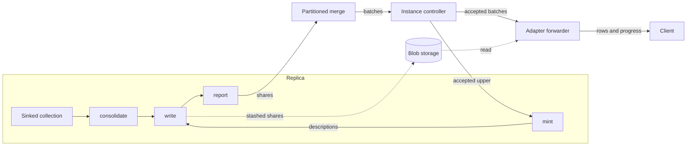

# BatchedSubscribe

* Associated: CPU-318 ("Subscribe considered broken"), the Linear project "Adapt peek optimizations to subscribes", the durable subscribe design (#38468).

This document guides the implementation and is not intended for review as a proposal. It records the decisions the implementation stack rests on, the code each decision depends on, and the facts that still need a test.

## The problem

A `SUBSCRIBE` cannot return a large result. An account extracting about 200 GB hit the limit twice: once on the snapshot, and again on the first batch of a follow-up `SUBSCRIBE AS OF T - 1` that had to catch up on every timestamp since `T`. A batch of that size fails at four places.

* The sink buffers every update in `rows_to_emit` (`src/compute/src/sink/subscribe.rs`) until the frontier passes its time. `ComputeState::process_subscribes` turns a response over `max_result_size` into an error (`src/compute/src/compute_state.rs:1479`).
* The partitioned merge holds back updates until the merged frontier passes them and fails once their total exceeds `max_result_size` (`PendingSubscribe::stash`, `src/compute-client/src/service.rs`).
* `ActiveSubscribe::process_response` (`src/adapter/src/active_compute_sink.rs:266`) merges and materializes each batch on the coordinator loop.
* The client channel is unbounded, and the coordinator retires the subscribe when its backlog exceeds `subscribe_max_buffered_bytes`, 128 MiB by default.

The limits follow from the contract. Every batch is a collection sorted by time and then by the requested order, and it is resident at every hop. The ordering promise dates from 2020: `8252af9bbb` (#4718) made TAIL sort by time, `d4aea4d9e3` (#4752) added progress messages five days later, and `dd7c8a2768` taught clients to infer completeness from order. CPU-318 lists the places in the code that rely on it.

## Success criteria

* A subscribe that opts in delivers results of any size, including a single batch spanning many timestamps, without holding the batch in environmentd memory.
* environmentd memory per subscribe is bounded by a read buffer and a queue of batch descriptors.
* Losing a replica does not interrupt the subscribe while another replica serves it.
* Output is consolidated per batch, carries a progress row at each batch upper, and is otherwise in no particular order.
* Existing subscribes keep their behavior.

## Out of scope

* Changing the contract of existing subscribes.
* Envelopes (`UPSERT`, `DEBEZIUM`) and `WITHIN TIMESTAMP ORDER BY`. Both need an order within a timestamp.
* Resuming after an environmentd restart. The durable subscribe design resumes at an acknowledged timestamp, and an interrupted snapshot restarts from scratch.
* Spilling the sink's buffer before a batch is minted. A batch must fit in cluster memory until the sink can write it.
* Reaping blobs that a dead replica or environmentd leaves behind. Peeks leak the same way today.

## Solution proposal

BatchedSubscribe is a new subscribe mode, selected by a `SUBSCRIBE` option, built as its own path through planning, the sink, the compute protocol, the controller, and the adapter. Its output is a sequence of batches. A batch covers `[lower, upper)`, carries consolidated updates in no particular order, and is followed by a progress row at `upper`.

The mode treats the subscribe's output as a sequence of appends rather than a stream of messages. Replicas run the same deterministic dataflow, so any replica's batch for a range has the same contents after consolidation. That makes batch boundaries the points where one replica can take over from another, and it lets the controller accept a batch from whichever replica delivers it first.



The name in code is BatchedSubscribe. The code avoids "collection" in names, because differential collections, compute collections, and storage collections already use the word. The SQL option name is a product decision, and the working name below is `BATCHED`.

### Contract

* `SUBSCRIBE ... WITH (BATCHED)` implies `PROGRESS`. Progress rows are the only completeness signal.
* Only plain diff output is allowed. The planner rejects envelopes and `WITHIN TIMESTAMP ORDER BY` with `BATCHED`.
* Updates within a batch are consolidated per `(time, row)` and carry no order. Batches arrive in order of their bounds.
* The output relation is the one `describe_subscribe` builds with `PROGRESS` today (`src/sql/src/plan/statement/dml.rs:1568`): `mz_timestamp`, `mz_progressed`, `mz_diff`, then the relation's columns as nullable.
* Delivery from the last progress row a client saw is at least once, which matters only together with the durable subscribe design.

### Planning

* The parser gains a `SubscribeOptionName` variant (`src/sql-parser/src/ast/defs/statement.rs:4048`), and `plan_subscribe` extracts it through `generate_extracted_config!` (`dml.rs:1542`).
* `SubscribePlan` gains a `batched: bool`. Planning sets `emit_progress` when `batched` is set and requires `SubscribeOutput::Diffs`.
* A feature flag gates the option through `require_feature_flag`, declared in `feature_flags!` (`src/sql/src/session/vars/definitions.rs`). It is on in CI through `misc/python/materialize/mzcompose/__init__.py`. The production default needs a human decision.

### Optimization and the sink input

The optimizer builds the dataflow as today (`src/adapter/src/optimize/subscribe.rs`) with a new sink connection, `ComputeSinkConnection::BatchedSubscribe(BatchedSubscribeSinkConnection { stash_id: Uuid })`. The adapter generates `stash_id`, because transient ids repeat across environmentd restarts and the stash shard id must not. The sink has two input paths, chosen when the sink renders.

* **General path.** The sink receives the flattened collection, exchanges it by hash of row, and consolidates with a merge batcher through `consolidate_pact` (`src/timely-util/src/operator.rs:580`), as `copy_to_s3_oneshot.rs:65` does. Identical rows then land on one worker, and each worker's updates are consolidated.
* **Arranged path.** When the subscribed relation is a safe map, filter, and project over a collection with an index on the cluster, and the projection keeps the index key columns, the optimizer points the sink at the indexed collection. It sets `from` to that collection and `from_arrangement` to the index key and the MFP permuted around the index, which `export_sink` already handles (`src/compute/src/render/sinks.rs:75`). The detection mirrors the peek fast path, `create_fast_path_plan` and `permute_oneshot_mfp_around_index` in `src/adapter/src/coord/peek.rs`. Output rows that collide share a key, and so sit on the worker that owns the key. The sink skips the exchange and consolidates per worker, which it still needs because a replayed index import delivers the trace's spine batches separately and advancing their times to the as-of can make rows from different batches collide.

Both paths feed the same consolidated, per-worker-disjoint stream to the rest of the sink. The arranged path saves the exchange and is an optimization stage, so the general path ships first.

### Replica: minting

One worker mints batch descriptions `(lower, upper)` and broadcasts them, so every worker writes its share under the same bounds. The shape follows the materialized view sink's `mint` operator (`src/compute/src/sink/materialized_view.rs:520`), which runs on one worker and reaches the others through timely's `broadcast()`.

* The minting worker is worker 0. The controller sends `AllowCompaction` for a write-only collection to shard 0 only (`PartitionedComputeState::split_command`, `src/compute-client/src/service.rs:371`), which reaches worker 0 of process 0. Running mint there lets it read the feedback described below without forwarding it.
* `lower` starts at the as-of. Each description's `lower` is the previous `upper`, advanced to the accepted upper when feedback is ahead of it.
* `upper` is the meet of the consolidated ok and error frontiers at minting time. Mint emits a description only when `upper` is beyond `lower`.
* Mint emits at most one description per frontier advance and keeps `lower` strictly increasing. Receivers skip a description whose `lower` is not the next expected one, as `write::absorb_batch_description` does in the materialized view sink (`materialized_view.rs:1146`).

### Replica: writing

Each worker buffers its consolidated updates and, for each description it receives, extracts the updates with times in `[lower, upper)` once its own frontier has passed `upper`.

* A share whose encoded size is below a threshold travels inline as an `UpdateCollection`.
* A larger share goes through a generalized `StashUpload` (`src/compute/src/compute_state/peek_stash.rs`). The upload takes a shard id derived from `stash_id`, the description's bounds, and real update times, and accepts negative diffs. Writing happens in an async operator, since it awaits persist.
* Every worker emits a share for every description, including an empty one, because the partitioned merge counts shares to detect completion.
* An error in the error stream poisons the subscribe: the share carries the error, and later shares repeat it, matching today's sink.
* When the replayed as-of is beyond the original as-of, the sink renders without a snapshot. `rehydrate_replica` replays the command history with the as-of advanced to the allowed compaction, and the existing sink keeps `with_snapshot` set and resends the full state.
* The writer applies `up_to` the way today's sink does (`subscribe.rs:115`) and reports completion with an empty upper.

### Compute protocol

A new response carries batched subscribe output, leaving `SubscribeResponse` and `SubscribeBatch` untouched.

```rust
pub enum ComputeResponse {
    // ...
    BatchedSubscribeResponse(GlobalId, BatchedSubscribeResponse),
}

pub enum BatchedSubscribeResponse {
    Batch(BatchedSubscribeBatch),
    DroppedAt(Antichain<Timestamp>),
}

pub struct BatchedSubscribeBatch {
    pub lower: Antichain<Timestamp>,
    pub upper: Antichain<Timestamp>,
    pub shares: Vec<Share>,
    pub error: Option<String>,
}

pub enum Share {
    Inline(UpdateCollection),
    Stashed(StashedBatches),
}
```

`error` is separate from `shares` so that a poisoned batch still carries its stashed shares to a layer that can delete them.

### Partitioned merge

`PartitionedComputeState` merges worker responses inside clusterd and process responses inside environmentd (`service.rs:66`). For batched subscribes it keeps, per subscribe, the shares received for each `(lower, upper)` and emits one batch once every part has delivered. It needs no frontier meet and no split, because every part writes under the same minted bounds.

* `max_result_size` applies to the inline bytes of a batch only. Stashed shares are not held in environmentd memory.
* The merge never drops a stashed share. It forwards poisoned batches with their shares, so only the instance controller and the adapter delete blobs.
* `DroppedAt` follows the existing rule: forward it once, when the first part reports it.

### Instance controller

The controller keeps the accepted upper `U` for each batched subscribe, starting at the as-of. For each batch from a replica, in the order that replica sends them:

* If `upper <= U`, it drops the batch and deletes its stashed shares.
* If `lower <= U < upper`, it accepts the batch, sets `U` to `upper`, and delivers it upward. When `lower < U`, it attaches a read filter on times at or after `U`. This happens only when the replica that was ahead fails partway through a range.
* `lower > U` cannot happen, because each replica's batches are contiguous from the as-of and the replica that delivered `U` sent a batch ending there. The controller reports it with `soft_panic_or_log`.

The subscribe's write frontier is `U`, so read holds follow it through `maybe_update_global_write_frontier` (`src/compute-client/src/controller/instance.rs:1900`) as today. That function steps the implied read hold back to `U - 1`, and `apply_read_hold_change` sends `AllowCompaction` with the collection's new since (`instance.rs:2007`). The since is the meet of the implied hold and the warmup hold, so it is at most `U - 1`. Mint treats one step past the since as a lower bound for its next `lower`, which is the feedback: a slower replica skips ranges another replica already delivered and does not write stashed shares for them.

Deletion needs a persist client in the controller, which it lacks today (no `PersistClient` field in `src/compute-client`). The instance gets one opened on the stash location. A stashed share is held as an owned handle that deletes its batch when dropped unless the controller forwards it, mirroring `DeliveredBatch` in `peek_stash.rs`.

A replica-targeted batched subscribe fails with the same error as today when its target replica goes away (`instance.rs:1342`).

### Adapter

* The coordinator registers an `ActiveComputeSink::BatchedSubscribe` next to `ActiveComputeSink::Subscribe` in `implement_subscribe` (`src/adapter/src/coord/sequencer/inner/subscribe.rs:541`), which both the coordinator and the frontend paths reach. The client channel stays `mpsc::UnboundedSender<PeekResponseUnary>`, so pgwire and the WebSocket API need no change.
* `message_controller` (`src/adapter/src/coord/message_handler.rs:716`) hands each accepted batch to a forwarder task per subscribe. The coordinator loop touches only batch descriptors.
* The forwarder processes batches in order. It formats inline shares into rows. It reads stashed shares with `read_batches_consolidated` at as-of `lower` through the coordinator's `PersistClient` (`src/adapter/src/coord.rs:1867`), applies the cutover filter, formats rows in chunks of `compute_peek_response_stash_read_batch_size_bytes`, and deletes the batches when done. It then emits the progress row at `upper`.
* Row format reuses `ActiveSubscribe`'s packing for `Diffs` with progress (`active_compute_sink.rs:234` and the `push_row` closure in `process_response`).
* The forwarder waits on `SubscribeBacklogAccounting` before reading the next chunk, which bounds environmentd memory by the read buffer and the backlog limit. The coordinator retires a subscribe whose queue of unread stashed bytes passes a new limit, reusing `SubscribeFellBehind`.
* Cancellation drops the forwarder and deletes the stashed shares it still holds.

### Observability

* A counter of batches accepted with a cutover filter, per subscribe and replica, shows how often the leading replica fails mid-range.
* Counters of inline and stashed share bytes show how often the stash carries a batch.
* The new subscribe appears in `mz_subscriptions` like any other.

## Implementation stages

Each stage is a pull request. The stack branches from `upstream/main` independently of this design document.

1. Generalized stash core: `StashUpload` with a caller-supplied shard id, bounds, and retractions. Peek behavior is unchanged.
2. Stash ownership in the controllers: a persist client in the instance, an owned handle that deletes on drop, and deletion at the existing peek leak points.
3. SQL surface and planning behind the feature flag, with user docs.
4. Protocol: the new response type, its partitioned merge, and its delivery through the instance controller and the controller crate.
5. Sink, general path: exchange, consolidation, mint on worker 0, writing inline and stashed shares, poison, `up_to`, and rendering without a snapshot on replay.
6. Instance controller cutover: the accepted upper, the read filter, and feedback through the since.
7. Adapter: the forwarder, the stashed read, progress rows, backpressure, retirement, and cancellation.
8. Arranged input path in the optimizer and the sink.
9. Coverage: several workers and replicas, a catch-up range spanning many timestamps, retractions, a replica killed mid-range, and a scaled-down large result.

## Alternatives

* **Relax the contract of every subscribe.** It changes behavior under clients that rely on order, and every existing consumer would need review.
* **Raise `max_result_size` and `subscribe_max_buffered_bytes`.** environmentd would hold the batch.
* **Chunk subscribe batches at timestamp boundaries.** A batch legitimately spans many timestamps, and a catch-up range is many small ones that each stay inline.
* **One stashed batch per timestamp.** It leaves a catch-up range inline for the same reason.
* **Consolidate in environmentd by merging inline and stashed shares.** Unnecessary once replicas consolidate and shares are disjoint by row.
* **Hold stashed batches until the merged worker frontier passes them.** Unnecessary once one worker mints bounds for all.
* **Serve each subscribe from one replica.** Batch boundaries are natural cutover points, so any replica can serve any batch.
* **Read a materialized view's shard from environmentd.** It reads physical contents, so its merge fan-in is the shard's run count, and it covers only subscribes to materialized views.
* **A durable cursor into a snapshot keyed on persist's order.** It would make persist's sort order part of the API.

## Open questions

* Does `read_batches_consolidated` at as-of `lower` return every time in `[lower, upper)` unchanged? An as-of only advances earlier times, so it should, but stage 1 needs a test.
* Does every worker receive minted descriptions in mint order? The materialized view sink tolerates stale and reordered descriptions instead of relying on order, and BatchedSubscribe does the same.
* How large does a batch grow between mints on a busy input, and should mint cut a range early when buffered bytes pass a threshold?
* How much duplicate stash writing happens on multi-replica clusters before feedback reaches the slower replica?
* Does `ComputeSinkDesc::from_desc` need to describe the MFP output on the arranged path, given that `from` names the indexed collection?
