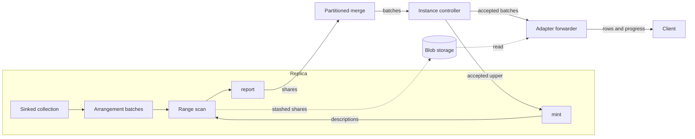

# BatchedSubscribe

* Associated: CPU-318 ("Subscribe considered broken"), the Linear project "Adapt peek optimizations to subscribes", the durable subscribe design (#38468).

This document guides the implementation and is not intended for review as a proposal. It records the protocol and the guarantees the implementation stack rests on, the code each decision depends on, and the facts that still need a test.

## The problem

A `SUBSCRIBE` cannot return a large result. An account extracting about 200 GB hit the limit twice: once on the snapshot, and again on the first batch of a follow-up `SUBSCRIBE AS OF T - 1` that had to catch up on every timestamp since `T`. A batch of that size fails at four places.

* The sink buffers every update in `rows_to_emit` (`src/compute/src/sink/subscribe.rs`) until the frontier passes its time. `ComputeState::process_subscribes` turns a response over `max_result_size` into an error (`src/compute/src/compute_state.rs:1479`).
* The partitioned merge holds back updates until the merged frontier passes them and fails once their total exceeds `max_result_size` (`PendingSubscribe::stash`, `src/compute-client/src/service.rs`).
* `ActiveSubscribe::process_response` (`src/adapter/src/active_compute_sink.rs:266`) merges and materializes each batch on the coordinator loop.
* The client channel is unbounded, and the coordinator retires the subscribe when its backlog exceeds `subscribe_max_buffered_bytes`, 128 MiB by default.

The limits follow from the contract. Every batch is a collection sorted by time and then by the requested order, and it is resident at every hop. The ordering promise dates from 2020: `8252af9bbb` (#4718) made TAIL sort by time, `d4aea4d9e3` (#4752) added progress messages five days later, and `dd7c8a2768` taught clients to infer completeness from order. CPU-318 lists the places in the code that rely on it.

## Success criteria

* A subscribe that opts in delivers results of any size, including a single batch spanning many timestamps, without holding the batch in environmentd memory.
* environmentd memory per subscribe is bounded by a read buffer and a queue of batch descriptors.
* Losing a replica does not interrupt the subscribe while another replica serves it.
* Output is consolidated per batch, carries a progress row at each batch upper, and is otherwise in no particular order.
* Existing subscribes keep their behavior.

## Out of scope

* Changing the contract of existing subscribes.
* Envelopes (`UPSERT`, `DEBEZIUM`) and `WITHIN TIMESTAMP ORDER BY`. Both need an order within a timestamp.
* Resuming after an environmentd restart. The durable subscribe design resumes at an acknowledged timestamp, and an interrupted snapshot restarts from scratch.
* Reaping blobs that a dead replica or environmentd leaves behind. Peeks leak the same way today.

## Solution proposal

BatchedSubscribe is a new subscribe mode, selected by a `SUBSCRIBE` option, built as its own path through planning, the sink, the compute protocol, the controller, and the adapter. Its output is a sequence of batches. Each batch has a description `[lower, upper)`, carries consolidated updates in no particular order, and is followed by a progress row at `upper`.

The mode treats the subscribe's output as a sequence of appends rather than a stream of messages. Each replica writes down batches as time advances, and each batch's lower is the previous batch's upper. Replicas run the same deterministic dataflow, so any replica's batch for a description has the same contents. The controller keeps one accepted upper and accepts exactly the batch that starts there, from whichever replica delivers it first.



The name in code is BatchedSubscribe. The code avoids "collection" in names, because differential collections, compute collections, and storage collections already use the word. The SQL option name is a product decision, and the working name below is `BATCHED`.

### Protocol and guarantees

This section is the specification the rest of the design implements. `20261021_batched_subscribe/Cutover.lean` models it in Veil and checks the safety properties below, together with a proxy for liveness.

**Content.** A subscribe has a start `S`, which is its as-of when it has a snapshot and one step past its as-of when it does not. For a description `d = [l, u)` with `S <= l < u`, the content `C(d)` is the consolidated set of updates of the subscribed relation with times `t` such that `l <= t < u`. When `l = S` and the subscribe has a snapshot, `C(d)` also contains, at time `S`, the accumulation of all updates at times before `S`.

**Definiteness.** `C(d)` depends only on the subscribe and `d`, not on the replica that computes it, because replicas run the same deterministic dataflow on the same inputs. Inputs that differ per replica, such as introspection sources, break this, so a BatchedSubscribe over them must target one replica, as today's subscribes over introspection do.

**Replica obligations.**

* R1. A replica sends batches whose descriptions are contiguous: the first lower is the replica's start lower, each later lower is the previous upper, and every upper is beyond its lower. A batch for `d` carries exactly `C(d)`.
* R2. A replica learns the accepted upper `U` through feedback. On learning a `U` that differs from its next lower, it sets its next lower to `U`. When the replica is behind, this skips work another replica already delivered. When it is ahead with batches that the controller rejected, this rewinds it, which is what keeps the subscribe live when the replica that set `U` fails.
* R3. A replica keeps the data needed to compute `C(d)` for every `d` whose lower is at or after the last `U` it learned. Data in a rejected batch is not gone, it is reissued from `U`. Discarding data below its own last minted upper instead would leave it unable to mint from `U`.
* R4. A replica that renders the dataflow anew, after a restart or a reconfiguration, starts at the later of the subscribe's start and one step past its replayed as-of, and without a snapshot when that is past `S`.

**Controller obligations.**

* C1. The controller keeps `U`, initially `S`. It accepts a batch iff its lower equals `U`. On acceptance it sets `U` to the batch's upper and forwards the batch. It drops every other batch and deletes its stashed shares.
* C2. The controller tells every replica `U` whenever it advances.
* C3. The subscribe's write frontier is `U`, so its input read holds follow `U` through the existing write-only collection logic and never pass it.

**Guarantees.** Under these obligations the forwarded batches form one chain of descriptions from `S` to `U` with no gaps and no overlaps, and each forwarded batch carries `C(d)` for its description. As long as one replica stays alive, keeps up with its inputs, and keeps receiving feedback, `U` advances. The client sees each forwarded batch's updates followed by a progress row at its upper.

The model shows which obligations are load-bearing. Accepting a batch with `lower <= U < upper` forwards overlapping batches. A replica that discards data at its own last upper cannot mint from `U`. A replica that only jumps forward on feedback, and never rewinds, never mints a batch starting at `U` once its own boundaries straddle `U`, so the subscribe stalls when the replica that set `U` fails.

### Contract

* `SUBSCRIBE ... WITH (BATCHED)` implies `PROGRESS`. Progress rows are the only completeness signal.
* Only plain diff output is allowed. The planner rejects envelopes and `WITHIN TIMESTAMP ORDER BY` with `BATCHED`.
* Updates within a batch are consolidated per `(time, row)` and carry no order. Batches arrive in order of their descriptions.
* The output relation is the one `describe_subscribe` builds with `PROGRESS` today (`src/sql/src/plan/statement/dml.rs:1568`): `mz_timestamp`, `mz_progressed`, `mz_diff`, then the relation's columns as nullable.

### Planning and optimization

* The parser gains a `SubscribeOptionName` variant (`src/sql-parser/src/ast/defs/statement.rs:4048`), and `plan_subscribe` extracts it through `generate_extracted_config!` (`dml.rs:1542`).
* `SubscribePlan` gains a `batched: bool`. Planning sets `emit_progress` when `batched` is set and requires `SubscribeOutput::Diffs`.
* A feature flag gates the option through `require_feature_flag`, declared in `feature_flags!` (`src/sql/src/session/vars/definitions.rs`). It is on in CI through `misc/python/materialize/mzcompose/__init__.py`. The production default needs a human decision.
* The optimizer builds the dataflow as today (`src/adapter/src/optimize/subscribe.rs`) with a new sink connection, `ComputeSinkConnection::BatchedSubscribe`. The connection carries a `stash_id: Uuid`, from which every share of the subscribe derives its stash shard, the subscribe's start `S`, and an optional non-temporal MFP. The adapter generates `stash_id`, because transient ids repeat across environmentd restarts.
* When the subscribed relation is a non-temporal map, filter, and project over a collection with an index on the cluster, the optimizer sets the sink's `from` to the indexed collection and `from_desc` to that collection's schema, and moves the MFP into the connection. The detection mirrors the peek fast path, `create_fast_path_plan` in `src/adapter/src/coord/peek.rs`. Lowering then sets `from_arrangement` to the index arrangement, as it does for any sink whose source is only arranged (`src/compute-types/src/plan/lowering.rs:208`). The optimizer must not set `from_arrangement` itself: lowering overwrites it, and its MFP is defined to rebuild full rows of `from_desc` (`src/compute-types/src/sinks.rs:40`), which leaves no room for the query's MFP. Without this rewrite, the sink receives the flattened output of the view it is built over (`src/compute/src/render/sinks.rs:74`).
* The index import keeps its arrangement only when the import reads a snapshot. With `SNAPSHOT = false`, `import_index` imports a flattened collection instead (`src/compute/src/render.rs:710`), so such a subscribe takes the general path.

### Replica: the sink

The sink holds arrangement batches and computes each description's content with a range scan over them. It reuses the peek infrastructure for the scan, the offload, and the stash.

**Input.** On the arranged path, `export_sink` hands the sink the arrangement named by `from_arrangement` instead of flattening it (`sinks.rs:75`), and the sink reads its batch stream, including the batches an import replays for the snapshot. The range scan applies the connection's MFP after rebuilding rows with the `from_arrangement` MFP. Otherwise the sink arranges its input by hash of row. Either way it holds `ArcBatch` references (`src/row-spine/src/arc_batch.rs`), which are `Send + Sync`, so a scan can move off the worker. On the arranged path the batches are shared with the index's trace and cost no copy. Identical rows land on the worker that owns their key, so each worker's share is disjoint from the others'.

**Minting.** One worker, chosen by hashing the sink id as the materialized view sink does (`src/compute/src/sink/materialized_view.rs:520`), mints descriptions and broadcasts them. Its next lower follows R1 and R2. Its next upper is the sink's input frontier, the meet of the ok and error frontiers. Receivers skip a description whose lower is not the next one they expect, as the materialized view sink's `write` does (`materialized_view.rs:1146`).

**Feedback.** The controller sends `U` as a new compute command. Commands reach every worker: the controller sends them to worker 0 of process 0 (`PartitionedComputeState::split_command`, `src/compute-client/src/service.rs:363`), which broadcasts them over the command channel (`src/compute/src/server.rs:558`). The command history keeps the latest `U` per subscribe, so a replayed dataflow learns it. Feedback is not `AllowCompaction`: compaction moves a reader's since, while `U` is the writer's progress.

**Retention.** A worker drops held batches whose upper is at or before the last `U` it learned (R3). It does not drop batches at its own last minted upper.

**Range scan.** For each description a worker scans the held batches whose bounds overlap `[l, u)` and emits the updates with times in the description, consolidated per `(row, time)`, retractions kept. For the first description of a subscribe with a snapshot, it also accumulates the updates before `S` into `S`. The scan reuses `PeekResultIterator::from_cursor` over a `CursorList` of the chosen batches (`src/compute/src/compute_state/peek_result_iterator.rs:210`) with its literal handling, MFP evaluation, and per-position fuel. It changes the time predicate from "at or before the peek time, summed" (`peek_result_iterator.rs:469`) to "inside the description, per time", drops the negative-diff check (`:475`), and yields several updates per position. For the current `(key, val)`, `CursorList::map_times` visits that pair's updates in every held batch (differential's `cursor_list.rs:154`). Each batch is consolidated, and held batches have disjoint bounds, so a time repeats across batches only where the scan advances times into `S` for the snapshot. The scan therefore consolidates the times of each position before emitting them. `ErrorScan` changes the same way, and any error in the range poisons the subscribe.

**Offload.** A large scan runs off the worker through the offload driver (`peek_offload.rs`), made generic over the scan and its result channel, and takes a permit from the process-wide `PeekPermits`. A small scan runs inline under the fuel budget.

**Shares.** A worker's scan output below a threshold travels inline as an `UpdateCollection`. Past it, the worker writes a persist batch through a generalized `StashUpload` (`peek_stash.rs`) opened with the stash shard, the description's bounds, and real update times, accepting negative diffs. Workers of one process coalesce their stashed parts for one description through the `SharedBatches` core (`src/storage-operators/src/persist.rs:48`), keyed by the description, so a description yields one stashed batch per process in the common case. Only the last worker to finish receives the coalesced batch. Every worker still reports a share for every description, empty or joined, because the partitioned merge counts shares to detect completion.

**`up_to`.** The sink stops minting at `up_to` and reports completion with an empty upper, as today's sink does (`subscribe.rs:148`).

### Peek infrastructure reuse

| Component | Reused as | Change |
|---|---|---|
| `PeekResultIterator` | Range scan over held batches | Time predicate per description, per-time output, retractions |
| `ErrorScan` | Error range scan | Time predicate, poison on error |
| `PeekScan` | Budget split and batch cut | A constructor not tied to `&Peek`, a batch type with time, no finishing, limit, offset, or thinning |
| Offload driver and `PeekPermits` | Off-worker scans | Generic over the scan and the result channel, visibility of the permit API |
| `StashUpload` and `StashTarget` | Stashed shares | Bounds and shard from the caller, real times, signed diffs, a constructor not tied to `&Peek` |
| `SharedBatches` core | One stashed batch per description per process | A shared id per description, delivery by the last finisher |
| `DeliveredBatch` and abandon cleanup | Cleanup of stashed shares | None |

The answer path (`PeekResponse`, `PendingPeek::absorb`) and the finishing do not transfer, because the subscribe protocol replaces them.

### Compute protocol

A new response carries batched subscribe output, leaving `SubscribeResponse` and `SubscribeBatch` untouched.

```rust
pub enum ComputeResponse {
    // ...
    BatchedSubscribeResponse(GlobalId, BatchedSubscribeResponse),
}

pub enum BatchedSubscribeResponse {
    Batch(BatchedSubscribeBatch),
    DroppedAt(Antichain<Timestamp>),
}

pub struct BatchedSubscribeBatch {
    pub lower: Antichain<Timestamp>,
    pub upper: Antichain<Timestamp>,
    pub shares: Vec<Share>,
    pub error: Option<String>,
}

pub enum Share {
    Inline(UpdateCollection),
    Stashed(StashedBatches),
}
```

`error` is separate from `shares` so that a poisoned batch still carries its stashed shares to a layer that can delete them.

`PartitionedComputeState` merges worker responses inside clusterd and process responses inside environmentd (`service.rs:66`). For batched subscribes it keeps, per subscribe, the shares received for each description and emits one batch once every part has reported. It needs no frontier meet and no split. `max_result_size` applies to the inline bytes of a batch only. The merge never drops a stashed share: it forwards poisoned batches with their shares, so only the instance controller and the adapter delete blobs.

### Instance controller

The controller implements C1 to C3. It processes each replica's batches in the order the replica sends them, although the model shows the protocol does not depend on that order.

Deletion needs a persist client in the controller, which it lacks today. The instance gets one opened on the stash location. A stashed share is held as an owned handle that deletes its batch when dropped unless the controller forwards it, mirroring `DeliveredBatch` in `peek_stash.rs`.

A replica-targeted BatchedSubscribe fails with the same error as today when its target replica goes away (`src/compute-client/src/controller/instance.rs:1342`).

### Adapter

* The coordinator registers an `ActiveComputeSink::BatchedSubscribe` next to `ActiveComputeSink::Subscribe` in `implement_subscribe` (`src/adapter/src/coord/sequencer/inner/subscribe.rs:541`), which both the coordinator and the frontend paths reach. The client channel stays `mpsc::UnboundedSender<PeekResponseUnary>`, so pgwire and the WebSocket API need no change.
* `message_controller` (`src/adapter/src/coord/message_handler.rs:716`) hands each accepted batch to a forwarder task per subscribe. The coordinator loop touches only batch descriptors.
* The forwarder processes batches in order. It formats inline shares into rows. It reads stashed shares through the coordinator's `PersistClient` (`src/adapter/src/coord.rs:1867`), formats rows in chunks of `compute_peek_response_stash_read_batch_size_bytes`, and deletes the batches when done. It then emits the progress row at `upper`.
* The stashed read needs a persist API that keeps times. `read_batches_consolidated` reads with `FetchBatchFilter::Snapshot { as_of }`, which drops every update beyond the as-of and advances the rest to it (`src/persist-client/src/fetch.rs:387`). Read at `lower`, it would lose every time after `lower`. `FetchBatchFilter::Compaction { since }` advances only times before `since` and keeps the rest (`fetch.rs:413`), so a consolidated read of batches with filter `Compaction { since: lower }` returns their updates with times intact, since every update of a batch for `[lower, upper)` is at or after `lower`. Persist exposes it as a variant of `read_batches_consolidated` that takes the filter.
* Shares are disjoint by row across workers, so the forwarder needs no merge across shares.
* Row format reuses `ActiveSubscribe`'s packing for `Diffs` with progress (`active_compute_sink.rs:234` and the `push_row` closure in `process_response`).
* The forwarder waits on `SubscribeBacklogAccounting` before reading the next chunk, which bounds environmentd memory by the read buffer and the backlog limit. The coordinator retires a subscribe whose queue of unread stashed bytes passes a new limit, reusing `SubscribeFellBehind`.
* Cancellation drops the forwarder and deletes the stashed shares it still holds.

### Observability

* Counters of accepted and dropped batches per subscribe and replica show how often replicas race and rewind.
* Counters of inline and stashed share bytes show how often the stash carries a batch.
* The new subscribe appears in `mz_subscriptions` like any other.

## Implementation stages

Each stage is a pull request. The stack branches from `upstream/main` independently of this design document.

1. Generalized stash core: `StashUpload` and `StashTarget` with a caller-supplied shard id, bounds, real times, and retractions, and a persist read of stashed batches that keeps times. Peek behavior is unchanged.
2. Stash ownership in the controllers: a persist client in the instance, an owned handle that deletes on drop, and deletion at the existing peek leak points.
3. Range scan: `PeekResultIterator` and `ErrorScan` with a description mode, and the offload driver made generic over the scan.
4. SQL surface and planning behind the feature flag, with user docs.
5. Protocol: the new response type, the feedback command and its history handling, the partitioned merge, and delivery through the controller crate.
6. Sink: held arrangement batches on the general path, minting, retention, the range scan, shares with `SharedBatches`, poison, `up_to`, and the replay start (R4).
7. Instance controller: acceptance, feedback, and deletion of dropped shares.
8. Adapter: the forwarder, the stashed read, progress rows, backpressure, retirement, and cancellation.
9. Arranged input path: the optimizer rewrite, the MFP in the connection, and `export_sink` handing the arrangement to the sink.
10. Coverage: several workers and replicas, a catch-up range spanning many timestamps, retractions, a replica killed mid-range, a rewind after a rejected batch, and a scaled-down large result.

## Alternatives

* **Relax the contract of every subscribe.** It changes behavior under clients that rely on order, and every existing consumer would need review.
* **Raise `max_result_size` and `subscribe_max_buffered_bytes`.** environmentd would hold the batch.
* **Chunk subscribe batches at timestamp boundaries.** A batch legitimately spans many timestamps, and a catch-up range is many small ones that each stay inline.
* **One stashed batch per timestamp.** It leaves a catch-up range inline for the same reason.
* **Accept a batch that straddles `U` with a read filter.** `lower = U` is simpler and, with rewinding, keeps the subscribe live.
* **Feedback through `AllowCompaction`.** Compaction is the reader's progress, not the writer's.
* **Buffer rows in the sink.** Holding arrangement batches shares memory with an index and lets the peek scan, offload, and stash serve the write.
* **Serve each subscribe from one replica.** Batch boundaries are natural cutover points, so any replica can serve any batch.
* **Read a materialized view's shard from environmentd.** It reads physical contents, so its merge fan-in is the shard's run count, and it covers only subscribes to materialized views.
* **A durable cursor into a snapshot keyed on persist's order.** It would make persist's sort order part of the API.

## Open questions

* How large does a held batch set grow on a busy input before feedback lets a worker drop it, and does the general path's own arrangement need a trace at all?
* How much duplicate stash writing happens on multi-replica clusters before feedback reaches a slower replica, and should a replica delay stashing while it is behind?
