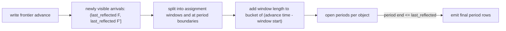

# Tick-aware freshness

* Associated: Linear project P-CPU-328 (Granular Freshness Monitoring), spike notes in the "Spiking ideas" Notion database ("Tick-aware freshness: assignment bound and staleness from TimeDependence").
* Audience: this document records decisions between the author and the implementer. It is not a team-facing design and does not belong in an implementation stack.

## The problem

Accounts want to measure p99.9 freshness over a day and p99.99 over a week, at millisecond precision, against targets such as 5s.
Today Materialize cannot answer that question.
The per-minute history records the worst lag of each minute, which overstates.
It rounds lag up to whole seconds, which hides millisecond freshness even after a source ticks faster.
The global histogram stores power-of-two second buckets per day, so a p99.9 reads as either 8s or 16s.

The 1s rounding is not noise.
Sources assign timestamps at f Hz: an event that arrives at wall-clock time t gets timestamp t' = ceil(t, 1/f).
The delay t' - t is bounded by 1/f, and has to be assumed to be 1/f, so any reading below one tick is a measurement artifact.
This design generalizes that floor to every object, including joins of sources with different, even coprime, tick intervals, refresh schedules and intervals that change over time.
It then records the full latency distribution in a form that the Console can query, without ever correcting a written value.

## Goals

* Report freshness in milliseconds as max(D, S), where D is the worst-case on-time delay of the object and S the measured staleness. This replaces the 1s ceiling of the current per-minute value.
* Record an arrival-weighted latency histogram per object and period in a new introspection relation, from which the Console can compute any percentile over any window and draw a timeline.
* Support objects ticking at 1 Hz today and up to 10 Hz, with cost growing with the tick rate.
* Support REFRESH EVERY materialized views in the first iteration, at a higher row cost.
* Make buckets per octave, the virtual arrival rate, the period length and the retention configurable.

## Non-goals

* Console views. The relation is the interface, the Console picks it up separately.
* An hourly or daily rollup. It is a later performance optimization.
* Exporting to Prometheus or OpenTelemetry. The bucket scheme keeps that possible without loss.
* Exact per-event latency inside an assignment window, and per-input arrival streams.

## Anti-goals

* Reporting values below an object's assignment bound for healthy objects. They are artifacts.
* Correcting or retracting a histogram row after writing it.
* Counting any arrival twice, including across ALTER, replica reconnects and restarts.
* Changing the existing relations' schemas or breaking their consumers.

## Model

### Arrivals, ticks and visibility

Time is in integer milliseconds.
A source with timestamp interval i assigns an arrival at t the timestamp ceil(t, i), and its write frontier at wall-clock time w covers floor(w, i).
A downstream object follows the `TimeDependence` tree of its dataflow: leaves are wall clock, inner nodes take the minimum of their inputs and round up to a refresh schedule.
An arrival at t is visible in an object once every leaf's timestamp for it is below the object's frontier.
This is the joint-arrival model: an arrival is a moment of the whole world, consistent with how S and D are defined below.
It is pessimistic for a record that only lands in one input, which becomes visible once the other inputs reach that record's timestamp, not the joint one.

Leaves carry a ticker that describes their grid:

* Sources: aligned to the epoch at the ingestion's `TIMESTAMP INTERVAL`, looked up live so `ALTER SOURCE` takes effect without rebuilding downstream dependence. The probe ticker in `src/storage/src/source/probe.rs` rounds probe times down to interval multiples, and the upper after a tick at T is T + 1.
* Compute introspection collections: aligned to the introspection interval. The interval can differ between replicas of a cluster, and introspection is read through replica-targeted queries, so per-replica freshness rows are the meaningful ones and the global aggregate is not. The controller keeps one tree per collection, using the interval of the most recently added replica with logging, so a replica with a different interval records against the wrong grid. That wrinkle is documented, not solved.
* Webhook sources and other storage-managed collections: an unaligned 1s tick. They have no timestamp interval: a write is visible once its batch is appended, and when idle the collection manager advances the upper every `DEFAULT_TICK_MS` (1s), resetting the timer after each write (`src/storage-controller/src/collection_mgmt.rs`).
* Tables: an unaligned 1s tick. Tables can tick irregularly, up to 1 kHz when inserts bump them, and their freshness otherwise depends on the txn-wal tick. Recording treats them as an epoch-aligned 1s grid for window boundaries, an accepted quirk, while D uses the unaligned bound so it never underestimates.
* Anything else: continuous wall clock.

Today a leaf of `TimeDependence` has no identity, and `merge` collapses all wall-clock inputs into one leaf, so a 7s x 11s join loses both intervals.
`TimeDependence` is part of `DataflowDescription`, which is sent to clusterd and drives dataflow expiration there (`determine_dataflow_expiration` in `src/compute/src/compute_state.rs`).
Extending it would change the compute protocol and freeze intervals at dataflow creation, which conflicts with the live lookup above.
So the serialized type stays unchanged, and the controllers keep a separate freshness tree per collection that names its leaves by `GlobalId` and resolves their tickers when evaluated.
Dataflow expiration, as-of selection and load-generator behavior stay exactly as they are today.
Objects without a time dependence (constants, non-epoch timelines) keep today's reported value and get no histogram rows.

### D, the assignment bound

D is the worst-case delay from arrival to visibility when every tick and refresh is on time.
A single source has D = i.
A join of aligned inputs has $D = \max_{k \ne m} (i_k + i_m - \gcd(i_k, i_m))$, so a 7s x 11s join has D = 17s.
A refresh schedule with period r adds roughly r.
The proof for joins is in the appendix, and `misc/lean/Mz/Freshness.lean` checks the two-input case.

D depends only on the tree and its current intervals, not on time, so it is computed once per object and recomputed when an interval changes.
For plain joins of aligned leaves the closed form applies.
Trees with refresh schedules or an unaligned leaf need a search over the points where the expected frontier changes, or a conservative bound: an unaligned leaf of interval u joined with an aligned leaf of interval i contributes i + u, without the gcd term.
The spike's search missed peaks for aligned-by-unaligned joins (it read 6999 ms for a 7s source joined with a table, against 7979 ms) and capped the search at a week, which underestimated `REFRESH EVERY '30 days'`.
D must never be lower than the true bound, so the search has to be exact or conservative, and tested against a brute-force oracle.

### S, the measured staleness

S is the age of the oldest arrival that is not yet visible: S = now - last_reflected(frontier).
`last_reflected` inverts the tree on the actual frontier: the largest complete output time, rounded down to the last complete refresh, then down to each leaf's grid, minimized over leaves.
A healthy object has S at most D, and a stalled object has S growing without bound until it recovers.
S is a lower bound on latency, never a latency value, so it never enters the histogram.

## Reporting

Three consumers read the same per-sample lag today (`refresh_wallclock_lag` in `src/compute-client/src/controller/instance.rs`): the per-minute lag history, the existing global histogram in power-of-two seconds, and the Prometheus wallclock lag metric.
Under the reporting flag, the per-minute history and the Prometheus metric report max(D, S) in milliseconds, the maximum over the recording interval for the history.
This replaces the 1s ceiling in `WallclockLagFn`.
The existing global histogram keeps its samples and buckets, since the new histogram replaces it.
For a 1 Hz source the value stays about 1s, so existing consumers see the same numbers.
Objects whose freshness today reads too low change: a REFRESH EVERY 1 minute view reads about 60s instead of 0s, and a 7s x 11s join about 17s instead of 11s.
Unreadable collections stay Undefined.

## Recording

### What a histogram row counts

The recorder assumes a virtual arrival process with one arrival at every multiple of the virtual arrival interval, 1 ms by default.
A window counts the virtual arrivals it contains, so counts are integers for any interval and windows that tile a span count every arrival exactly once.
The real data rate is unknown to the controller and irrelevant to freshness, and the virtual process makes counts comparable across objects regardless of tick rate.
A latency becomes known exactly when the write frontier advances past an arrival, so values are written only then and never guessed.
During a stall, the latency of the stalled arrivals falls over the stall (the first arrivals wait longest), and the histogram records that shape once the object recovers.

At each write frontier advance from F to F', arrivals in (last_reflected(F), last_reflected(F')] become visible at the advance time.
The recorder splits that span into assignment windows, the common refinement of all leaves' grids.
Arrivals in one window get identical timestamps from every leaf and cannot be told apart, so each takes the window's worst case: advance time minus window start.
This is the 1/f rule generalized, and it is why healthy objects never read below their assignment bound.

Per-advance work must not depend on the length of the span, because a 1000 ms x 1001 ms join stalled for a day covers about 86 million windows.
Window boundaries are the union of the leaves' grids, so the arrival time whose worst-case latency lands in a bucket $(\ell, h]$ is $\beta(A - \ell) - \beta(A - h)$, clamped to the span, where $A$ is the advance time and $\beta(z) = \min_k \lceil z \rceil_{i_k}$ is the next boundary at or after $z$.
This needs one evaluation per touched bucket and leaf.

### Periods and attribution

Each arrival is charged to the period, one minute by default, in which it arrived.
A period is emitted only once last_reflected of the object's frontier has passed the period's end, so every emitted row is final and never corrected.
Windows that straddle a period boundary are split, and both parts carry the same latency.
Open periods stay in memory until they close, which bounds memory by the longest stall plus D.
Completeness of an object is the maximum emitted period end, derived from the histogram itself.
A separate progress relation would be written in a different append than the histogram rows, so a crash between the two would either double count or lose a period.
A period missing below the maximum is a hole, which the Console can see.
Arrivals after the maximum are not yet recorded, and each of them is at least now - t late, so a percentile over a window that includes an ongoing stall has to count that uncovered time as at least as slow as its age.

### Buckets

Buckets are exponential with b buckets per octave, b a power of two (default 4).
Bucket k covers latencies in (2^((k - 1) / b), 2^(k / b)] ms, the convention of Prometheus native histograms and OpenTelemetry exponential histograms with scale log2(b).
At b = 4 the relative error is about 9%.
Rows store b, so a configuration change does not mix incompatible rows within a period.

### Relations

All relations live in `mz_internal` next to the existing wallclock lag relations, which stay unchanged.
Implementer's call: follow the pattern of `mz_wallclock_global_lag_histogram_raw`, a raw builtin source whose update diff is the count in virtual arrivals, plus a view that exposes `count`.

* A global histogram, written from the global write frontier: `period_start`, `period_end`, `object_id`, `measure` (`'end_to_end'`, `'local'` or `'skew'`), `buckets_per_octave`, `bucket`, `labels`, and `count` in the view.
* A per-replica histogram with the same columns plus `replica_id`, as a diagnostic.
* A progress view with `object_id`, nullable `replica_id` (null for global) and `covered_until`, the largest emitted end-to-end period end, computed from the histograms. If the view is expensive for the Console, it can become a maintained index.

Histograms are retained for a configurable interval, 30 days by default like the existing relations, and truncated on `period_start` by the existing metrics-history truncation.
That truncation runs only when the collection's write task starts (`partially_truncate_metrics_history` in `src/storage-controller/src/collection_mgmt.rs`), so between restarts the relation grows past the retention interval, as the existing relations do.
As today, exactly one controller writes the global rows of an object: the compute controller for compute collections including materialized views, the storage controller for storage-owned collections.

The recorder hooks every `Frontiers` response, not the 1s maintenance tick, and the advance time is when the controller observes the response.
The measured latency therefore includes the protocol hop to the controller, which the reported value includes today as well.

### Local delay and skew

End-to-end latency shows how stale an object is, but not which hop in a chain of sources, views and indexes adds the lag.
Each arrival's end-to-end charge splits into three parts, which sum to it exactly:

* Upstream: from the window start until the slowest direct input showed the arrival. This is that input's own end-to-end latency, so following the slowest input hop by hop walks the critical path.
* Skew: from then until every direct input's frontier passed the timestamp the object needs for the arrival, $T(a)$ under the object's tree without its own refresh node, capped at the wait the inputs' grids alone cause. With every input on time, input $k$'s frontier passes a timestamp $t$ at $p_k(t)$ and shows the arrival at $s_k(a)$, both from its own tree, so the cap is $g(a) = \max_k p_k(T(a)) - \max_k s_k(a)$. For a join of plain sources this is $\max_k \lceil T(a) \rceil_{i_k} - T(a)$ with $T(a) = \max_k \lceil a \rceil_{i_k}$. An input that is itself a join or a refresh view shows arrivals later than $T(a)$, and measuring from its showing time keeps that input's own wait out of the cap.
* Local: from then until the object showed the arrival. This is what the hop itself adds.

The cap keeps lateness out of skew.
Without it, an input that shows an arrival and then stalls before its frontier passes $T(a)$ makes the object wait out the stall after every input has shown the arrival, and that stall would read as skew.
A join of a 1 s source with a view that refreshes once a day would then charge a 5 minute source stall around the refresh as skew to a whole day of arrivals.
With the cap, skew is the delay mismatched grids cause when every input ticks on time, and any wait beyond $g(a)$ stays upstream, where the late input's own histogram shows it.
An input whose ticks drift from its grid moves the drift to upstream, which understates skew.
Unaligned leaves, such as tables and webhooks, tick at a phase the controller does not know, so their on-time times are only known within one interval.
The cap takes the earliest time an unaligned leaf can pass the timestamp and the latest time it can show the arrival, wherever the leaf sits in an input's tree, so the cap never overstates. It understates skew by at most one interval for an unaligned direct input, and by more when the unaligned leaf is nested inside a join, whose show time then also covers the other leaves' grids.

Skew is the wait that combining inputs causes without any input being late.
A join of a 7 s and an 11 s input shows an arrival only once the 7 s input's frontier passes the 11 s timestamp, which happens at the 7 s input's next tick.
On staging this wait was 1 s to 10 s per arrival for such a join, while the join's own processing took 30 to 130 ms.
Charging the wait to local made healthy joins look like slow hops, and charging it to upstream would claim a delay that no input has.
A join with one stalled input records the stall as upstream, and its local stays at its processing time.

Local and skew use the same virtual arrivals, windows, periods and finality as the end-to-end histogram and are stored in the same relations with `measure = 'local'` and `measure = 'skew'`, so per period the counts of the measures an object records are equal.
An object with a single direct input has no skew, because that input's frontier passes the needed timestamp exactly when it shows the arrival, so only objects with two or more direct inputs record skew rows.
Upstream is not stored, because it is the slowest input's end-to-end latency for the same arrivals.
Each collection keeps a visibility log of entries (frontier timestamp, reflected arrival time, observation time), and a consumer reads its inputs' logs.
Upstream readiness uses the reflected arrival time, which keeps a refresh wait on the refreshing view, because a REFRESH view's frontier passes leaf timestamps before its data is visible.
Skew readiness uses the frontier timestamp.
All three use the controller's observation time, not the advance time clamped to the frontier, which overstated local when a frontier ran ahead of the wall clock.

Local delay and skew may understate and never overstate.
An input without a freshness tree is skipped, an input whose log cannot answer an arrival counts as ready at the observation, and an input with an empty frontier logs that it is complete from then on.
Storage-owned collections have no inputs inside Materialize, so their local delay equals their end-to-end latency and their skew is 0.

A log keeps what its consumers have not recorded yet, for as long as the consumer exists, including a consumer whose recording has not started.
Expiring consumers by age lost the outage it was meant to measure: on staging, a view's replica was dropped for 10.5 minutes, its claim on its input's log expired at 10 minutes, and every arrival of the outage recorded the 5 s the new replica took to hydrate as its local delay.
Instead, entries older than one period are thinned geometrically by age, keeping one entry per half histogram bucket of age, so a log holds about $2 b \log_2(\text{age} / \text{period})$ old entries plus the recent ones, about 125 for 30 days at 4 buckets per octave and one minute periods.
A thinned entry answers with a later observation time, so thinning never overstates and understates by at most one bucket.
One entry per bucket is not enough, because two kept entries only merge once their ages share a bucket, which leaves gaps of up to two buckets.
Entries older than the histogram retention are dropped, consumer marks are cleared when their recording stops, and logs are not restored across restarts.

### Cost

Rows per object and period depend on how many octaves the latencies span.
In the spike at 4 buckets per octave, a healthy 1s source used 1 to 3 buckets per minute, a 100 ms source 3 to 5, a 7s x 11s join 5, a 100 ms x 1s join about 14 and a REFRESH EVERY 1 minute view 20.
The existing per-minute history writes one row per object and replica, so typical objects cost 2 to 5 times as many rows, and refresh views and mixed-rate joins more.
A rollup would cap the cost of long windows and is the first optimization if the Console's queries get expensive.

## Correctness requirements found by the spike and its validation

* Keep a high-water mark of recorded arrivals per collection (and per replica id for the diagnostic), and start every span at max(high-water mark, last_reflected(F)). Without it, ALTER of an interval recomputes last_reflected of the old frontier on the new grid and re-covers arrivals, and a reconnecting replica, whose frontier regresses, re-covers up to its as-of.
* A replica that is removed with open periods loses them, which leaves a hole in its diagnostic histogram.
* On environmentd restart, the in-memory open periods are lost, and a dyncfg selects what happens to the arrivals they and the outage covered:
  * `hole` (default): start from each object's current frontier. The lost arrivals are not recorded, which the histogram shows as missing periods: we failed to record, and the only known bound on their latency is trivial.
  * `charge`: seed the high-water mark from the maximum emitted period end, and count the lost arrivals when the frontier is next observed. A long outage then reads as a freshness degradation, which matches what queries saw, but arrivals of the open period before the crash, which were already visible, are inflated by up to one period plus the outage.
* A new object starts recording at its creation time: arrivals before creation are not counted, and arrivals during hydration count with their real latency. A new replica's diagnostic starts at the replica's creation time.
* An empty frontier means the object is complete forever. The recorder emits the open periods up to the last arrival and stops. A dropped object discards its open periods.
* Sources assign timestamps by the clusterd clock, while the controller observes advances by the environmentd clock. When they disagree, an advance can appear to land before its window ends. Clamp the latency to at least the window's length.
* Carry the live tick interval through `StorageCollections`. The spike used a process-global map.

## Configuration

Two feature flags gate the work separately, both on in CI and off in production:

* One switches the reported value from the 1s ceiling to max(D, S) in milliseconds.
* One enables recording the histograms.

The reporting flag changes numbers that people and alerts already consume.
REFRESH EVERY 1 minute views move from about 0s to about 60s and slow joins rise by seconds, although nothing got worse.
The new values are the correct ones, so the plan keeps the existing column and announces the change before enabling the flag in production, instead of adding a parallel column that keeps the understated numbers alive.

The recorder's parameters are dyncfgs:

* Buckets per octave, default 4.
* Virtual arrival interval, default 1 ms.
* Period interval, default 1 minute.
* Retention interval, default 30 days.
* Restart policy, `hole` or `charge`, default `hole`.

## Decisions made during implementation

* D is unbounded (`None`) for refresh schedules without `REFRESH EVERY`, and `REFRESH AT` points next to `REFRESH EVERY` are ignored. Such objects keep today's reported value.
* When the scan for D is infeasible, the fallback is the refresh period plus the largest assignment and frontier-lag terms of its input, about 62 s for a 1 minute refresh over a table.
* A recorder starts at the later of its as-of and its creation time. Collections that exist when the controller starts (a restart) start at their first observed frontier under policy `hole`.
* Materialized views hand their freshness tree to the storage side for reporting, but only the compute controller writes their histogram rows.
* Resolved trees are cached behind a generation counter, and D is cached per collection.
* Each assignment window is charged its worst case, so a 1 s source records about 1 s plus processing for every arrival, not a spread from 0 to 1 s. Staging confirmed this, with a 100 ms source at 108 to 128 ms and a 1 s source at 1.0 to 1.2 s.

The implementation is the stack #40330 to #40338.

## Left to the implementer

* Whether D for trees with refresh schedules uses an exact search or a conservative bound, as long as it never underestimates.
* How the storage controller computes D and S for storage-owned collections, and how both controllers share the code.
* Data structures for open periods and the window arithmetic.
* Test strategy, which should include property tests of D, `last_reflected`, window splitting and count conservation against a brute-force oracle, and a deterministic end-to-end test of a stall.

## Appendix: the assignment bound of a join

Write $\lfloor w \rfloor_i$ for the largest multiple of $i$ at or below $w$ and $\lceil t \rceil_i$ for the smallest multiple of $i$ at or above $t$.
The setup has aligned inputs with intervals $i_1, \dots, i_n$, every tick on time, no propagation delay, and continuous wall-clock time.
Input $k$'s frontier at $w$ is $\lfloor w \rfloor_{i_k}$, and a join tree without refresh schedules has the flat minimum of its leaves as its frontier, $o(w) = \min_k \lfloor w \rfloor_{i_k}$.
An arrival at $t$ gets timestamp $\lceil t \rceil_{i_k}$ on input $k$ and is visible at $w$ when $T(t) = \max_k \lceil t \rceil_{i_k} \le \lfloor w \rfloor_{i_m}$ for every $m$.
Since $\lfloor w \rfloor_i \ge T$ holds exactly when $w \ge \lceil T \rceil_i$, the visibility time and the worst-case delay are

$$V(t) = \max_m \lceil T(t) \rceil_{i_m} = \max_{k, m} \left\lceil \lceil t \rceil_{i_k} \right\rceil_{i_m}, \qquad D = \sup_t \bigl(V(t) - t\bigr).$$

**Lemma.** Let $g = \gcd(i, j)$ and $a$ a multiple of $i$.
Then $\lceil a \rceil_j - a \le j - g$, and some multiple of $i$ attains $j - g$.

*Proof.* $\lceil a \rceil_j - a = (-a) \bmod j$.
The residues $\{-m i \bmod j : m \in \mathbb{Z}\}$ form the subgroup of $\mathbb{Z}/j$ generated by $i$, which by Bézout is generated by $g$.
Its elements are $0, g, \dots, j - g$, so the maximum is $j - g$. $\square$

**Theorem.** For $n \ge 2$ inputs,

$$D = \max_{k \ne m} \bigl(i_k + i_m - \gcd(i_k, i_m)\bigr),$$

and $D = i_1$ for a single input.

*Proof.* $V(t) - t = \max_{k,m} C_{km}(t)$ with $C_{km}(t) = \lceil \lceil t \rceil_{i_k} \rceil_{i_m} - t$, and the supremum of a finite maximum is the maximum of the suprema.
The diagonal terms are $C_{kk}(t) = \lceil t \rceil_{i_k} - t < i_k$.
For $k \ne m$, let $a = \lceil t \rceil_{i_k}$ and $g = \gcd(i_k, i_m)$.
Then $C_{km}(t) = (a - t) + (\lceil a \rceil_{i_m} - a) < i_k + (i_m - g)$ by the lemma: an assignment term below $i_k$, then an alignment term of at most $i_m - g$.
Choosing $a$ with $(-a) \bmod i_m = i_m - g$ and $t \downarrow a - i_k$ approaches the bound, and the off-diagonal bounds dominate the diagonal ones because $i_m \ge g$. $\square$

Consequences:

* The supremum is not attained in continuous time. On the integer millisecond grid the largest single-arrival latency is $D - 1$, and the histogram, which measures from a window's exclusive start, records $D$.
* An unaligned leaf of interval $u$ has an arbitrary phase, so its alignment term approaches $u$ instead of $u - g$, and the bound becomes $i + u$. This design models tables as aligned instead and accepts a deviation of at most $\gcd(i, u)$.
* Refresh schedules add an outer rounding, which this closed form does not cover.

`misc/lean/Mz/Freshness.lean` proves the two-input case on the integer grid: the rounding adjunction (`le_floorTo_iff`), the visibility characterization (`visible_iff`), the bound (`latency_le`) and its tightness (`latency_tight`, which needs Bezout, proved in the file since the core library lacks it), plus the 7s x 11s instance.
The n-input generalization was checked by brute force over 2 to 5 inputs and 200 random interval sets, not in Lean.
