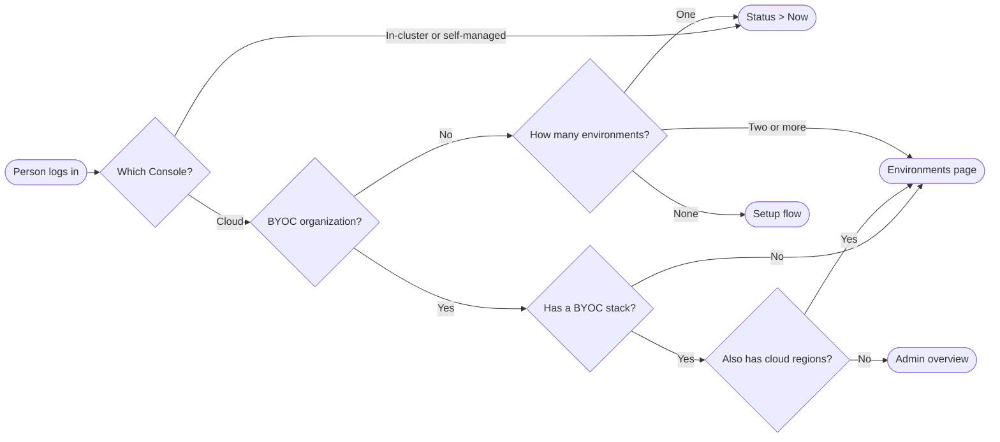
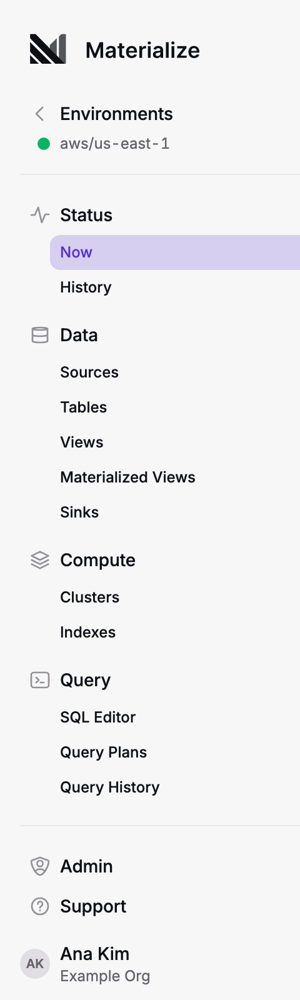
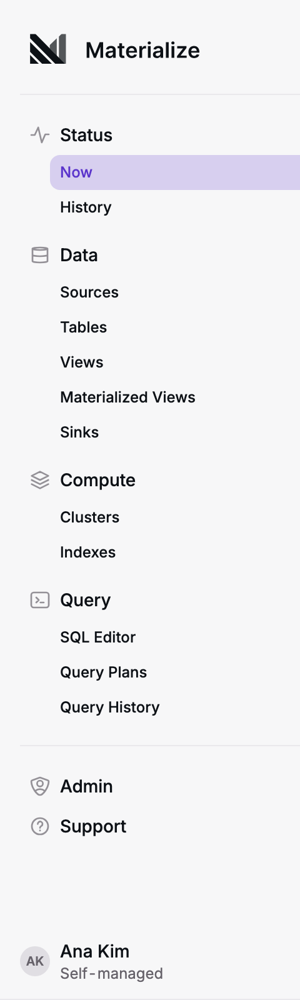

# Console Information Architecture

Nov 2, 2026 · @Jeremy Donelson

- Associated: [Object explorer design](https://github.com/MaterializeInc/materialize/blob/main/console/doc/design/20240516_object_explorer.md) · [Freshness design](https://github.com/MaterializeInc/materialize/blob/main/console/doc/design/20241004_freshness.md) · [BYOC console design](https://github.com/MaterializeInc/materialize/blob/main/console/doc/design/20260927_byoc_console.md) · [Sync engine design](https://github.com/MaterializeInc/materialize/blob/main/console/doc/design/20260902_sync_engine.md) · Cluster Detail redesign stack ([#39509](https://github.com/MaterializeInc/materialize/pull/39509)) · Object browser beside the editor ([#36048](https://github.com/MaterializeInc/materialize/pull/36048))

## The Problem

The organizational philosophy of the utilities in the Console application has become muddled over time. The navigation structure could do a better job of guiding the user towards the tools they need to achieve their goals. This is a common state for applications at this point in their lifecycle; features are added that don't quite fit into the mental model that informed the original information architecture, leading to a disjointed experience for the new user who comes to the application with fresh eyes.

In the context of this project, information architecture refers to the grouping, naming, and organization of the tools that the Console offers.

### The Mission of the Console

The Console is a utility that provides administrative and observational user interfaces for the Materialize product. Users arrive at the Console with a question and leave when it is answered. The goal of our IA is to lead them to the answer.

**The Console is uniquely positioned to connect usage metrics to the objects in an environment and the dependencies between them.** Observability of the system is primarily expressed via metrics collected by Prometheus and displayed in Grafana dashboards. This subsystem provides a highly customizable view of the system's performance over time and at the current moment. The Console reads similar data from a different source: SQL queries against the environment's system catalog. Giving the Console access to Prometheus is possible, but recreating Grafana in the Console would be an easy trap to fall into.

### Who Uses the Console

- **Prospects.** These users are evaluating Materialize in a trial (alone), a proof of concept (with a field engineer), or an expansion to another team within a current customer organization.
- **Practitioner.** A customer or an internal Materialize user, doing one of five activities: exploring, configuring, monitoring, diagnosing, optimizing. Often, one person is doing some or all of these jobs.

Each arrives with a specific need:

- **Find out why Freshness is below expectations.** A practitioner whose view is stale needs to trace it to the cause, ideally without help from Materialize staff. Potential causes include a slow upstream source, a resource-hungry object on the same cluster, a restart, or an incident at Materialize.
- **Look at historical usage data.** A problem that recovered before anyone looked still needs an explanation. After a user makes a change, we would like to show them a before-and-after comparison.
- **Confirm at a glance that everything is healthy.** This can be expressed via the freshness of a cluster and its constituent objects; CPU and Memory usage metrics; and status of Sources and Sinks.
- **Optimize compute.** A customer who wants to keep costs in line should be able to tell whether they need to upsize or if there are opportunities to optimize their dataflows via query efficiency. By helping customers understand the product, we empower them to make these changes on their own.
- **Change things with confidence.** Create and resize clusters, connect sources, and manage who has access without flailing around or crossing fingers. See the results of the change.
- **Build something new.** Find the data that already exists and its structure while writing SQL to query it.
- **See the benefit.** A trial user needs to see their own data staying fresh. A champion needs to show a second team that Materialize is working.
- **Share deep links, for diagnosis or for championing the product.** Send a link to a colleague, a support engineer or an AI tool. The linked view could reveal a bottleneck or demonstrate the value of the Materialize product.

Monitoring and diagnosing must be fast and free of detours. The other activities can allow for discovery, as long as a short path exists for the primary task.

### Example Use Case Scenarios

Each is a real situation from interviews, incidents or the trial funnel.

1. **A bulk load upstream.** A materialized view falls behind. The user finds that its Postgres source received a large load, without knowing in advance which input to check.
2. **A noisy neighbor.** A view falls behind while its inputs are fresh. The user finds the unrelated new object on the same cluster that is taking its CPU.
3. **A restart.** Everything on a cluster is behind at once. The user learns the replica restarted and is rehydrating, and why it restarted.
4. **Materialize's own incident.** Freshness decreases across the whole environment. The user learns "it is not you, and Materialize knows" without investigating healthy objects.
5. **Three hours later.** The problem recovered before the user looked. They can still find what happened and why.
6. **A CPU-bound cluster.** The cause is inefficient SQL patterns that are costly in Materialize. The user finds the bottleneck and learns why it was costly without engaging Materialize staff.
7. **A resize.** An operator resizes a cluster running short of memory, sees the cost before committing, and confirms the result.
8. **A new view.** A developer builds a view on data already in Materialize, finding its inputs' columns while writing SQL.
9. **A first source.** A trial user connects their first Postgres source and sees their own data staying fresh.

Every destination in these scenarios has a stable URL, including a moment in the past. A colleague, a support reply or an LLM skill can link straight to it.

## Success Criteria

There are two primary measures by which this project can succeed.

1. **From the perspective of the users.** Is it easier for them to find the information that answers their question or the tool that solves their problem?
2. **From the perspective of the internal Materialize team.** Is the new architecture extensible enough to provide logical, intuitive homes for new features?

### Pre-Build Testing

Fortunately, we can evaluate the effectiveness of our IA design to some extent before we ever merge a line of code. Methods such as [Tree Testing](https://www.nngroup.com/articles/tree-testing/) and [Card Sorting](https://www.nngroup.com/articles/card-sorting-definition/) use low- or no-tech tools to uncover whether our navigation hierarchy and labels lead users to their destinations.

Before modifying any code, we will run these tests with internal and, ideally, external users. Each session would be brief; ideally no more than 15 minutes. Simple tools exist, or can be built, that enable remote testing. Tests can also be run in person with pen and paper.

In order to get quantitative results, we would want 30 to 50 participants. The low end of that range seems like the upper bound of what we could realistically get. We could still get qualitative value from the tests with a smaller pool of people; this would require longer moderated sessions where we collect feedback as we run the tests.

The Field Engineering and Product Team could be enlisted to run these tests with their customer contacts.

### Post-Launch Measurements

Once the code is written and the revamped architecture is launched, we can test its effectiveness for users through analytics, task testing, and business outcomes. The combination of these approaches would give the fullest possible view of whether the Console is meeting the users' needs.

- **Analytics.** Tracking specific patterns such as navigation-abandonment and pogo-sticking between pages will tell us whether the structure itself is clear. These metrics are sensitive to bad taxonomy decisions. The Console does not currently have an application-wide search feature, but one argument in favor of it would be its value in auditing the IA. Zero-results queries, high reformulation rates, and repeated searches for the same content are strong signals of taxonomy gaps. Tracking IA success via analytics would require much wider instrumentation coverage than The Console has today (See [Open Questions](#open-questions)).
- **Task testing.** Similar to Tree Testing, we would assign a task to users and observe them while they try to complete it. Task-success rate, time to content, and clicks to completion would be the metrics to track in this scenario. These numbers are very difficult to obtain accurately from analytics alone. A starting place for sample tasks would be the [Example Use Case Scenarios](#example-use-case-scenarios). As with the Pre-Build tests, customer-facing staff would be the best people to run the tests or recruit external volunteers.
- **Business Outcomes.** Anecdotal evidence would probably be the most meaningful and realistic signal for measuring second-order effects of a new IA. We have the Feedback channel in Slack as well as contact with customer-facing staff. Quantitative effect would be difficult to disentangle from other factors. The current user base might be too small to generate statistically significant metrics.

Measuring success of the architecture along the second axis (extensibility for new features) can be proven by running these same tests periodically after launch, on a cadence of every 6 or 12 months. Anecdotal evidence from engineers and product would be the earliest signal we could collect.

For each metric we collect, benchmarks would be established according to industry-standard guidelines. Success would be evaluated according to these benchmarks.

## Out of Scope

- **Visual design.** This proposal covers structure and behavior only, except in cases where visual design cannot be teased apart from the user flow. Any sketch in the document is intended to show the content of a screen, not prescribe its position in the layout.
- **Feature design.** This document proposes where tools live and the questions that each page must answer. Specific functionality and interaction details are excluded. Through the process of research and design, many feature gaps were identified. These gaps are captured and included in an appendix. In many cases they are integral to the proposed architecture, but their designs are only touched upon here in broad strokes.
- **Trial download use case.** The trial download user is an important persona that is underserved by the current Console in multiple ways, including the IA. The use case is distinct enough from the operator's use cases that it can be split off into its own separate project.

## Solution Proposal

Organize each environment by what things are: **Status**, **Data**, **Compute**, and **Query**. Every object and cluster gets one home. Tools that cut across homes become lenses. A lens is a view that can be opened on top of a page, displaying a particular view of the page's scope. Examples include Freshness, Advice, and Critical Path.

The cloud Console adds an Environments page, which lists every environment.

In all Console modes, a **Utility** area offers **Admin** and **Support**.

The sitemap below shows all three areas and their pages.

```text
Console
├── Environments (cloud Console only)
│   ├── Environment list ......... lands here: several environments, or BYOC with no stack yet
│   ├── Setup flow ............... lands here: no environment
│   └── Add an environment
├── An environment (same sections in every Console)
│   ├── Status
│   │   ├── Now .................. lands here inside an environment
│   │   │   └── lenses: Freshness, Advice, Critical Path
│   │   └── History
│   ├── Data
│   │   ├── Sources
│   │   ├── Tables
│   │   ├── Views
│   │   ├── Materialized views
│   │   ├── Sinks
│   │   └── Add a source
│   ├── Compute
│   │   ├── Clusters
│   │   └── Indexes
│   └── Query
│       ├── SQL editor
│       ├── Query plans
│       └── Query history
└── Utility
    ├── Admin (every Console)
    │   ├── Overview ............. lands here: BYOC with a stack, no cloud regions
    │   ├── Login and SSO (cloud)
    │   ├── Roles and users (environment menu in cloud)
    │   ├── App passwords (cloud)
    │   ├── Usage and billing (cloud)
    │   ├── License (self-managed)
    │   └── Connections and secrets
    └── Support (every Console, opens on help and support)
        ├── Getting started
        ├── Integrations directory
        └── Connect
```

### Three areas

- **Environments (cloud Console only).** This hub page lists every environment the organization has, grouped by where it runs: cloud regions or BYOC stacks.
- **The selected environment.** Within the selected environment, we have four sections: Status, Data, Compute and Query. This section is consistent across all deployment modes.
- **Utility.** Consists of two sections: Admin and Support. Admin holds access, billing and license. Support holds help, getting started, the integrations directory and a page for connecting other tools. Some of these views are specific to environments; in those cases, an environment menu will be provided.

### Landing pages

Where a person lands after login depends on which Console they open and how many environments they have.

| Who | Lands on |
| --- | --- |
| Cloud customer with one environment | Status > Now |
| Cloud customer with several environments | Environments page |
| Organization with no environment yet | The setup flow |
| BYOC customer with no stack yet, cloud Console | Environments page |
| BYOC customer with a stack and no cloud regions, cloud Console | The Admin overview |
| Any customer, in-cluster or self-managed Console | Status > Now |



**Status > Now replaces the SQL Shell as the landing page inside an environment.** It is the only page that serves monitoring and diagnosing on arrival. It can say that something is wrong before anyone goes looking.

**Admin has an overview page in every Console.** It links to each admin feature that Console offers. A BYOC customer with a stack and no cloud regions lands there in the cloud Console, because the cloud Console cannot reach a BYOC environment's database. The overview gives them a front door to account management.

### The environment sitemap

| Section | Answers | Holds |
| --- | --- | --- |
| Status > Now | Is anything wrong right now? | objects ranked by how far behind they are, each with its slowest input; hydration exceptions; Materialize service status; active alerts; resource use across clusters |
| Status > History | What happened? | recent changes (DDL, restarts, out-of-memory kills); incident and maintenance history; alert history |
| Data | What is my data, and is it healthy? | sources and tables, views and materialized views, sinks; each object's columns, definition, upstream path, freshness, errors; adding a source |
| Compute | What runs, and what does it cost? | clusters with size, replicas, hydration, CPU and memory, largest objects, worker skew, restarts; indexes; cost; create and resize |
| Query | Let me ask something. | the SQL editor with an object browser beside it; query plans; query history |
| Admin | Who can do what, and what are we billed? | the overview; login and SSO; roles and users; app passwords; license; usage and billing; connections and secrets |
| Support | Where do I get help? | help and support; getting started; the integrations directory; connecting other tools to an environment |

### Navigation Structure

Here is a sample of the proposed navigation, styled in accordance with the existing design system.

| Cloud Console | Self-managed or in-cluster Console |
| --- | --- |
|  |  |

### The rules that decide placement

- **Each object has one home, organized by type.** A user who wants to explore a particular Source will find it under Data > Sources. A particular cluster will be found under Compute > Clusters. When an object is referenced elsewhere, for example from the Status > Now page, that reference will link to the object's home.
- **Data is the section for objects that can be queried.** Data holds things you can query from any cluster: Sources, Tables, Views, and Materialized Views. The one exception to this framing is Sinks. They are included in this section because they complete the logical flow: Sources to Dataflows to Sinks.
- **Database and schema are a filter, not a navigation structure.** Today's Object Explorer files each object under its database, then its schema, then its type. In this proposal, an object's type decides its home. The database/schema hierarchy will be represented as navigational or filtering elements, for example in menus on list pages.
- **A particular facet of a selected scope is a Lens.** A lens is a view of a particular facet or property of an object. It can be launched from an object's home. Each lens will also have a standalone page under Status > Now that can be shared via durable URLs. Freshness, for example, is a property of an object or group of objects. A user can access a Freshness view of a Cluster whose page they are looking at. Alternatively, they can go to the standalone Freshness page and select a cluster.
- **URLs are a public interface.** Every destination, including a moment in the past, has a stable, documented address. A colleague, a support reply or an LLM skill can link to any finding.

### How the scenarios walk

| Scenario | Path |
| --- | --- |
| Bulk load upstream | Status > Now names the slowest input → that source's page in Data shows the volume jump |
| Noisy neighbor | Status > Now: view behind, inputs fresh → view's page → its cluster in Compute: CPU by object and recent changes name the new object |
| Restart | Status > Now: cluster hydrating since 10:02 → cluster's hydration tab in Compute shows the restart and its reason |
| Materialize incident | Status > Now: everything behind at once, service status names the incident |
| Three hours later | Status > History: alert history, if rules exist; otherwise the object's freshness history in Data, then its upstream path at that moment |
| CPU-bound cluster | Compute: cluster CPU by object → view's page in Data: advice names the costly pattern → editor opens with `EXPLAIN ANALYZE` filled in |
| Resize | Compute: cluster's memory and largest objects → resize, with cost shown → confirm with CPU, memory and a change marker |
| New view | Query: object browser shows inputs' columns → write and run → the new view appears in Data with hydration progress |
| First source | Data > Add a source. The source can be viewed in Data > Sources and opening the Freshness lens. |

The scenario walks were a review by insiders, not a test with users. Their main value was the content and requirements they surfaced. Some placements depend on content that does not exist yet. Those gaps are listed in [Appendix: Feature Gaps](#appendix-feature-gaps).

## Minimal Viable Prototype

This IA has not been tested with customers. The first prototype would be a text-only Tree test with internal and, ideally, customer users.

A tree test gives each participant a sitemap as plain text, with no visual design, and asks where they would look to do a task. It measures whether they find the right place and whether they go straight there or wander. Text only matches this proposal's scope, since visual design is excluded.

- **Two trees, compared between people.** Each participant sees either this proposal's tree or the Verbs tree from Alternatives, not both.
- **Ten tasks across every activity**, not only diagnosis. Tasks never use a label from either tree. For example: "Your app's order totals are a few minutes old. Where do you start?"
- **Moderated and qualitative.** About 330 people used the Console in ten weeks, so a quantitative test of around 50 people per tree is not realistic.

The test runs after reviewers settle what lives where, page by page, so sessions test a fixed tree and do not turn into brainstorming.

## Alternatives

### Verbs: organize by activity

Health / Optimize / Configure / Query, with the same Admin and Support section. Content follows the activity it serves, so one cluster appears in Health with freshness and hydration columns, in Optimize with cost, and in Configure with size and replicas.

**Where it is stronger.** When users arrive knowing their goal, the label matches it. In the CPU-bound cluster scenario, "Optimize" says what the user came to do, and CPU by object sits beside advice. "Compute" names the thing, not the goal.

**Why it was not chosen.**

- **No single home for an object.** A view's health, cost and definition sit in three sections. A similar problem of ambiguity has been identified as a point of confusion in today's IA.
- **The split falls in the middle of a diagnosis.** In the noisy neighbor scenario, the user starts in Health and must cross to Optimize to find CPU by object, a section whose name suggests a deliberate activity, not a 3am one. Nouns keeps CPU, CPU by object and recent changes on one cluster page.
- **Acting takes one more hop.** In the CPU-bound scenario, fixing a view means crossing to Configure for its definition. With the Nouns layout, the definition is on the view's page.

The other scenarios walked the same in both layouts.

### Organize by the data model at the top level

Sources / Views / Sinks / Clusters as top-level sections. It teaches how Materialize works, but it has no home for "is anything wrong" and diagnosis crosses sections. Its strength survives inside this proposal: it is how Data is grouped.

### A whole-environment flow map as the spine

A map of every object and how data flows between them, as the main way in. Ruled out by measurement: across 43 live production environments, the smallest holds 606 objects and the largest 26,581. No size makes a whole-environment map legible. A dependency graph survives as an answer to "what is this waiting on", reached from one object.

### A header environment switcher

Today's model, extended to BYOC stacks. Rejected for the Environments page. The in-cluster Console cannot switch environments across identity domains.

The switcher is rarely used today. From July 20 to September 26, 2026, 11 of the 327 people outside Materialize who used the Console switched between two of their organization's environments. As of October 2026, 1 of 39 organizations outside Materialize with an active cloud environment had a second region, and none ran their own clusters in both. In-cluster and self-managed Consoles have no switcher, because each shows one environment.

## Open Questions

Which new features are hard requirements for the new IA?

Will we build gradually or fork the Console and build towards a major relaunch?

How will we handle URL forwarding/redirects?

## Appendix: Feature Gaps

The Scenarios presented in this document expose some gaps in the Console's current Feature set. Because these features fall outside the scope of an Information Architecture design, they are captured in this appendix.

| Feature | Scenarios | State |
| --- | --- | --- |
| Objects ranked by lag, with slowest input | Status > Now | data exists (`mz_materialization_lag`), no UI |
| CPU by object, over time | noisy neighbor, CPU-bound cluster | current and cumulative only (`mz_scheduling_elapsed`), no history |
| Lag per table of a source | a source's page | data exists, no UI |
| "Not keeping up" versus "inputs stale" | any object page | data exists (local versus global lag), no UI |
| Advice that recognizes more costly SQL patterns, such as `row_number() OVER` where a first-value pattern fits | CPU-bound cluster | advice data exists for four planner patterns and group size; none detects this pattern |
| Active alerts and alert history | Status | not verified the Console can read alerts |
| Incident history | Materialize incident | public status page only; feed not verified |
| Who manages a cluster (Terraform, mz-deploy) | resize | not recorded; a Console resize can be silently reverted |
| Credit rate shown when choosing a cluster size | resize | data exists (`mz_catalog.mz_cluster_replica_sizes.credits_per_hour`), read only to sort sizes; credits, not dollars |
| Analytics that measure the Success Criteria | time to answer, time to cause, task finished, change made | page views on every page change, cloud only; named events currently cover getting started, not daily operation |
