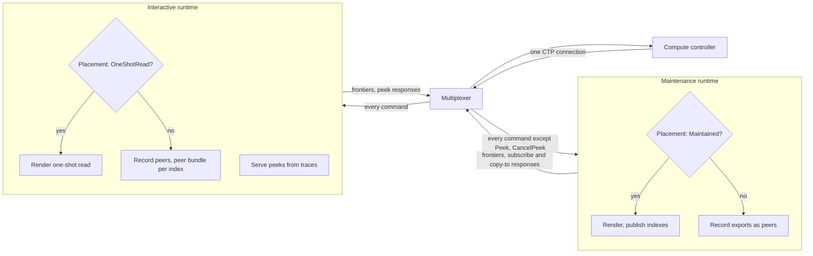
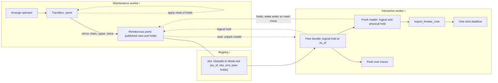
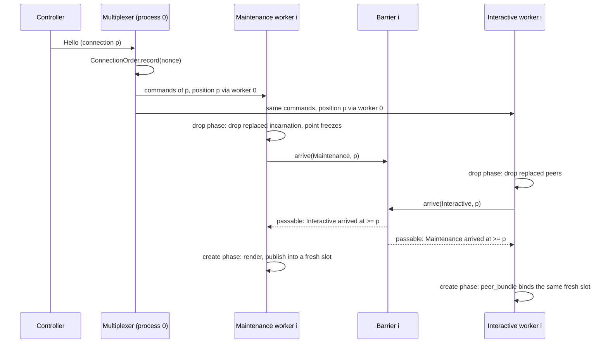

# Interactive compute runtime

* Associated:
  * CPU-215 (sharable arrangements), CPU-216 (interactive runtime), CPU-222 (introspection of the interactive runtime), CPU-298 (persist fetch budget for transient reads).
  * Pull requests, in stack order: #40512 (owned trace agent), #40513 (rendezvous primitive and its model), #38386 (shared trace), #38387 (sharing registry), #38388 (multiplexer and dataflow class), #38389 (publish), #38390 (import), #38391 (interactive runtime), #40558 (reconcile barrier and channel adapter), #38393 (enable in tests), #38676 and #38678 (benchmarks), #38736 (hold-gap metrics), #40559 (this document).
  * Protocol model: [`20261105_rendezvous_protocol/README.md`](./20261105_rendezvous_protocol/README.md).

## The problem

A compute replica serves reads on the same timely workers that maintain its dataflows.
A worker runs one operator at a time and handles commands and peeks only between steps, so every read waits for whatever operator activation is in progress, and a peek dataflow waits for several progress rounds of a runtime that is busy elsewhere.
On a replica that hydrates a large index, single operator activations run for seconds, and reads queue behind them.
The replica's own introspection is served by the same workers, so the moment a replica is in trouble is the moment it stops answering questions about itself.

The symptoms are measured.
On a staging replica of 31 workers hydrating a large index with its CPU saturated, fast-path index peeks took up to 24 s and peek dataflows over an introspection view 47 to 68 s, caused by operator schedulings of 2 to 8 s in the hydrating arrangement (staging experiment on an `M.1-4xlarge` replica, 2026-10).
On a 400cc staging replica hydrating 600M rows, introspection queries took 4.4 to 7.5 s and `EXPLAIN ANALYZE CLUSTER MEMORY` up to 13.3 s (staging, 2026-08).
The same experiment showed why this matters operationally: hydration memory is a sawtooth that peaked at 35.7 GiB of arrangement bytes to settle at 13.2 GiB, and a replica sized for steady state can die during hydration.
That sawtooth was observable only because introspection stayed answerable on the two-runtime arm, while a polled single-runtime replica reports a smooth ramp.

A merged mitigation, peek offload (`enable_compute_index_peek_offload`), moves long index walks off the worker.
It removes the walk from the worker but not the wait for the worker: the snapshot is taken in `process_peeks`, which runs only after `step_or_park` returns.
It also does not apply to peek dataflows or introspection reads that build a dataflow, since those need operator scheduling, not a walk.
The design below gives reads a scheduler of their own.

## Success criteria

* Point lookups and per-replica introspection reads on a replica whose maintenance workers are saturated by hydration answer in time independent of the hydration's operator schedulings.
* Peek dataflows (temporary dataflows) on a busy replica do not wait for maintenance work, and do not hold back the freshness of maintained collections on the same replica.
* A read through the interactive runtime returns the same result as the same read on a single-runtime replica, including error results and reads at `Timestamp::MAX`.
* The idle cost of the second runtime is small and per replica, not per index: memory in megabytes, CPU in a few percent of a core.
* Publishing an arrangement for cross-runtime reads does not copy it, and a reader does not change the publisher's merge schedule.
* A replica without the flag behaves exactly as before.

The benchmarks in #38676 and #38678 measure these, and the nightly comparison against the previous build is the regression signal.
`IntrospectionUnderHydration` and `ReadIsolationUnderHydration` measure reads under hydration churn, `TemporaryDataflowFloor` and the feature benchmark `PeekDataflowJoin` measure the fixed cost of a peek dataflow, `FreshnessUnderPeekDataflows` and `MaintenanceUnderPeekSaturation` measure freshness under read load, and `ManyIndexesIdle`, `ManyIndexesRestart` and `ManyReexportsIdle` price publication with nobody reading.
The contended loops gate at 1.5 times the previous build on `qps`, `avg`, `p50` and `p95` (`CONTENDED_THRESHOLDS`), and p99 stays reported but ungated.
The gates bound regressions, not absolute latency, and the reference numbers are in [Evaluation](#evaluation).

## Out of scope

* **Long-lived reads on the interactive runtime.** `SUBSCRIBE`, `COPY TO` with an open `until`, and maintained collections stay on the maintenance runtime. A long-lived import sheds history only by adopting the publisher's merged batches, which needs a per-reader logical hold downgraded from the reader's own frontier, and its dataflow would have to survive reconnects across runtimes. Neither is built. The interactive runtime serves single-time reads only: peeks and one-shot dataflows whose `until` is one step past the `as_of`.
* **Introspection of the interactive runtime's own work (CPU-222).** The interactive runtime installs no compute logging, so the peeks and peek dataflows it serves are missing from compute introspection.
* **A cost model for peek dataflows.** An expensive peek dataflow competes with fast-path peeks on the interactive runtime. `enable_compute_interactive_dataflows` is the only control.
* **Cancellation of a parked shared peek** beyond what `CancelPeek` already does.
* **CPU isolation between the runtimes.** Both runtimes share the replica's cores, with no per-runtime limit.
* **Sharing across processes.** Batches are shared within a process. A multi-process replica coordinates across processes only through timely exchange, as before.
* **Persist-backed reads under hydration.** A peek dataflow that reads persist waits on the process-wide persist fetch semaphore, which a hydrating source can exhaust. CPU-298 tracks a reserved budget for transient fetches.

## Solution proposal

Each replica process runs a second timely runtime, the interactive runtime, next to the existing one, which becomes the maintenance runtime.
Both runtimes receive the controller's command stream through a multiplexer behind the one controller endpoint.
The maintenance runtime renders maintained work as today and publishes every index arrangement it maintains.
The interactive runtime renders one-shot reads and serves every peek, reading the maintenance runtime's arrangements in place through a shared trace instead of copying them.
Three mechanisms keep this correct: a publication primitive with one writer for its life, holds that keep a published arrangement from compacting past any reader's `as_of`, and a barrier that orders the two runtimes' reconciliations of identical command histories.

### Runtime layout

`clusterd` starts the interactive runtime when it receives `--interactive-compute-timely-config`, which the controller passes only when `enable_compute_interactive_runtime` resolves to true for the replica.
The second runtime takes the process ordinal of the first and must run equally many workers per process over equally many processes, which `clusterd` asserts.
The roles are `ComputeRuntimeRole::Maintenance` and `ComputeRuntimeRole::Interactive`, and a process without the flag runs one runtime in the `Solo` role, unchanged.
A role is turned into components once, when `ComputeState` is built: `Placement` names the dataflow classes the runtime renders, and `ProcessGlobals` says whether it applies process-global settings or inherits them.
The worker derives one more component from the role, its barrier side, which says where it waits on reconnect and whether its commands carry connection positions.
Shared functions branch on these components, never on the role itself.

The controller decides placement and the runtimes follow it.
`DataflowDescription` carries a `DataflowClass`: `Maintained` for indexes, materialized views, sinks, subscribes and copy-tos, and `OneShotRead` for a dataflow that exists to answer one read.
The adapter sets `OneShotRead` where it already sets `until = as_of + 1` for a peek dataflow, so a read at `Timestamp::MAX`, with no finite `until`, stays maintained.
The compute controller soft-asserts that a `OneShotRead` dataflow has the shape the interactive runtime can serve (transient exports, single time, no subscribe, no copy-to), and rewrites a misfit to `Maintained`.
With `enable_compute_interactive_dataflows` off it also rewrites every `OneShotRead` to `Maintained`, so the maintenance runtime renders the dataflow and publishes its index, and the interactive runtime serves the peek from the published index.

The class is a class, not a destination.
The command history is shared by replicas with different layouts, and a `Solo` replica renders every class.
The class travels in the command, so every runtime and every reconnect sees the same placement.
`compatible_with` ignores the class, so a class change across a reconnect does not rebuild a dataflow a runtime already renders.

### Command flow

The `Multiplexer` in `mz_compute_client::multiplex` presents one compute client over the two runtimes and decides nothing about placement.
It forwards every command to both runtimes, except `Peek` and `CancelPeek`, which go only to the interactive runtime.
It sends a command to both runtimes back to back, and the clients behind it push into unbounded channels, so both runtimes receive the same commands of a connection in the same order.
Each runtime consumes its commands at its own rate, so the order of the two sends guarantees nothing about which runtime applies a command first, and no mechanism below relies on it.
Each runtime checks `Placement` against a `CreateDataflow`'s class before anything else, and the runtime that renders the class builds the dataflow while the other records the dataflow's exports as peers, so `Schedule`, `AllowWrites` and `AllowCompaction` mean the same thing on both.

Peers never enter `collections`, so each runtime reports frontiers only for the collections it renders, and the multiplexer forwards responses from both verbatim.
Exactly one `PeekResponse` reaches the controller per peek, because peeks reach only the interactive runtime and the existing per-process merging below and above the multiplexer is unchanged.
Logging is maintained work: the maintenance runtime installs the logging dataflows and publishes their indexes, and the interactive runtime records them as peers at the minimum time.

Process-global settings (lgalloc, the memory limiter, the columnation lgalloc region, the overflowing behavior, the pager and its buffer pool, dictionary compression, and the metrics workload class) are applied by the maintenance runtime only, because the interactive runtime would double-apply effects that are not idempotent.
Both runtimes still receive every `UpdateConfiguration`, so the applied values are the controller's once the maintenance runtime handled them.
Until then the interactive runtime runs with the values in effect before, so on a process's first connection it can render one-shot reads before the maintenance runtime applied the connection's first configuration, as `process_globals.rs` documents.

### Arrangement sharing

An arrangement's trace handle is `Rc<RefCell<..>>` and pinned to its worker, and its spine does merge work whenever it is touched.
Its batches, though, are immutable and reference counted, so a chain of spans plus the trace's frontiers is a self-describing view any thread can read.
The shared trace publishes exactly that view.
After every mutation its writer makes, the trace box mirrors the span chain, `upper`, and compaction frontiers into a publication point, holding the point's lock for a vector swap and never for merge work.
A merge-effort activation reads the readers' holds only when a reader moved a meet, and publishes only when the spine's frontiers or chain changed, so an activation that changes nothing takes no lock.
A trace nobody published pays no mirror cost and takes no lock.

The layers, bottom up:

* `mz_timely_util::arrange_agent` (#40512) is a Materialize-owned copy of differential's `TraceAgent`, `TraceWriter`, `TraceBox` and the operators that construct an agent, with every deviation marked. Owning the agent lets it publish its trace without a differential change.
* `mz_timely_util::rendezvous` (#40513) is the synchronization: a `Rendezvous` point carries one writer's published view, one hold accumulation per hold kind, and subscriber queues seeded under the point's lock.
* `mz_timely_util::shared_trace` (#38386) gives the view its meaning: items are spans, hold kinds are logical and physical compaction, and `SharedReader` implements `TraceReader` and an `import_frontier_core` over a point.
* `mz_compute::sharing` (#38387) is the per-worker-pair `ArrangementSharingRegistry` that maps an index id to its published points.
* Rendering publishes every maintained index (#38389), and the interactive runtime imports published indexes as `IndexTrace::Shared` bundles that the existing join, reduce and peek code reads through one set of bodies (#38390).

The registry is per worker pair.
A process holds one registry per local worker ordinal, and worker `i` of each runtime holds registry `i`.
Pairing by local ordinal is sound because both runtimes run the same number of workers per process at the same process ordinal, so both shard keys by the same `key.hashed() % peers`, and worker `i` of the interactive runtime needs exactly the shard that worker `i` of the maintenance runtime maintains.
The registry records the one thread attached as its publisher and the one attached as its reader, and panics on a second.

### The publication protocol

A rendezvous point takes one writer in its life.
A second `attach` panics, because its view could regress below the `upper` that subscribers already acknowledged, and a subscriber cannot follow a regression.
When the writer closes or drops, the point freezes: the view stays as last published, and readers never advance to the empty frontier.
The empty frontier is withheld because `drop_dataflow` reclaims a dataflow without letting it finish its computation, so a writer's drop is no evidence that its collection is complete, and a reader advanced to the empty frontier would complete work on times that never happened.
The writer keeps applying hold changes after it closes, so holds registered on a frozen point still release.

A point's chain only grows while it is open, which is what makes an import safe.
A subscriber receives the published view as a seed and then every span the writer appends, and the seed and the set of live subscribers are chosen under the point's lock, so a subscriber sees no gap and no duplicate.
An import reads one writer's chain for its life.
A later incarnation of the same index publishes into a point of its own and cannot overwrite the chain an earlier one's readers hold.
Each delivery to a subscriber activates its import through the `SyncActivator` it subscribed with, so an import learns of a seal without polling.

Readers hold a published arrangement with two kinds of holds.
Logical compaction decides which times stay distinguishable, and physical compaction decides which batches may merge.
A reader needs the logical hold at the times it reads, and needs a span boundary only where it cuts the chain, which is where a join cuts it with `cursor_through`.
The trace box applies the meet of its own agents' holds and the readers' holds to the spine, so a shared arrangement compacts no faster than its slowest reader, and a reader that moves the meet wakes the arrange operator through a `SyncActivator`.
A reader that moves its hold without moving the meet costs the writer nothing.
The trace box publishes the `since` it is about to apply before it applies it, under the same lock that reads the holds, so a reader registering concurrently is either counted in the meet or refused below the new `since`.
The point can therefore advertise a `since` briefly ahead of the spine's, which refuses a reader the trace could still serve, the safe direction.

Three holders matter:

* **The peer bundle.** For each index the maintenance runtime renders, the interactive runtime records a peer bundle in `compute_state.traces`, created by `ArrangementSharingRegistry::peer_bundle`. It holds the index logically at the join of the index's `as_of` and the published `since`, and holds nothing physically, so the publisher keeps merging. `AllowCompaction` on the interactive runtime moves this hold, and the empty frontier drops the bundle.
* **The reserved hold.** The two runtimes drain the command stream at different rates, so the maintenance runtime can apply `AllowCompaction(t2)` for an index before the interactive runtime renders a read at `t1 < t2`. The controller drops its read hold for a cancelled read before the reader renders it, so the controller alone does not prevent this. `publish` therefore registers a hold at the index's `as_of` before the publishing runtime can apply any compaction for it, and `peer_bundle` takes that hold over. A peer recorded before its publication leaves a marker instead, and the publication reserves nothing.
* **The import.** An import mints a fresh reader from the peer bundle that also holds the chain physically, starting at the chain's coverage when minted, where a seeded import makes its first cut. The import's source operator downgrades both holds as its acknowledged frontier advances, and is the only possible owner of a hold that survives dataflow construction for consumers other than a join.

`SharedReader::fresh_reader` panics if the published `since` is beyond the reader's logical hold.
That needs a hold registered on a point before any trace attached, below the `since` of the trace that later attaches.
Compute registers a peer's hold at its index's `as_of`, and the publishing trace's `since` is at or below that `as_of` when it attaches, because the controller selects a dataflow's `as_of` at or beyond its inputs' `since` and allows no compaction past a read hold.
The trace box joins the meet of holds with the spine's `since` before applying it, so a hold below it constrains nothing rather than rewinding the spine.
`fresh_reader_panics_below_the_attaching_since` and `a_hold_below_the_attaching_since_does_not_rewind_it` in `shared_trace/tests.rs` exercise both halves.

Peeks need no extra mechanism.
An index peek on the interactive runtime reads `compute_state.traces` like on any runtime, finds the peer bundle, and pins the shared trace at its timestamp the same way it pins a local one.
A peek whose index has not sealed its timestamp waits in `queued_peeks` and is re-read on every sweep.
Every publication, seal and unpublication unparks the interactive worker of the pair, on both the `oks` and the `errs` arrangement, because an error result rides on `errs`.

The [protocol model](./20261105_rendezvous_protocol/README.md) checks this layer, the registry, and the reconcile barrier together.
It states that an import reads one writer's chain without missing updates and that every reader is bound to its own incarnation, proves those clauses inductive with SMT, and deletes each design guard in turn to show which clause breaks.
Its limits matter for reading its results:

* It checks safety only. That the barrier wait ends, and that a reader parked on a frozen point is eventually cancelled, are argued in prose, not checked.
* It excludes an empty `upper` published by a live writer. In the code, an index whose input completes, such as one over a constant, can legitimately publish the empty frontier while its writer lives. Only the narrower property, that a closed writer never publishes it, carries over.
* It gives each writer one fresh point. A re-exported index publishes an existing trace under a second point, which attaches with a non-empty chain and an advanced `since`. Those points are not modeled, and neither are the `errs` arrangement and the logging dataflow's extra points. [Re-exports](#re-exports) argues their lifecycle in prose and tests it.

### Incarnations and the registry key

The registry keys slots by `GlobalId`, and each slot stores the `as_of` of the dataflow that exports the index.
`get_or_create(id, as_of)` returns the slot in the map if it is alive, has an equal `as_of`, and is not frozen, and otherwise creates a fresh slot and replaces the map entry.
Whichever runtime touches an incarnation first creates its slot, and the other adopts the same `Arc`, so a reader that bound a slot before the publisher rendered is backed in place.
The registry holds slots weakly: a slot lives as long as the publisher's `PublishToken`, a peer bundle, or an importing dataflow's tokens hold it, so dropping a publication needs no removal call.
A slot whose traces closed or dropped is replaced, because its points refuse a second writer, and its readers keep its final view.
`publish` panics if the slot it adopts is live, not frozen, and already backed by a trace, and soft-panics if the same trace backs it.

Keying by id alone means incarnations of one id evict each other's map entry.
That is safe only if at most one incarnation of an id is ever wanted through the map at once, and the reconcile barrier is what guarantees it.
An `as_of` mismatch protects the case where a reconnect recreates an index below the old incarnation's `since`.
It does not protect a reconnect that recreates an index at the same `as_of`: without coordination the interactive runtime could bind the new incarnation's peer to the old incarnation's live slot while the maintenance runtime still runs it, and once the old writer drops, imports through that peer read a frozen chain that never advances.

### Re-exports

An index that re-exports another index's arrangement publishes the other index's trace under its own id, as a further point of that trace.
The point is backed by a trace that outlives the re-exporting index, so it does not freeze when the re-exporting index's `PublishToken` drops.
The frozen-slot rule therefore does not cover it: `get_or_create` returns the live old slot to a recreated re-export at the same `as_of` for as long as anything holds it, and the second attach then soft-panics (same trace) or `Rendezvous::attach` panics (different trace).
A recreated re-export gets a fresh slot only if every holder of the old slot is gone before either runtime creates.

The holders in the code are the `PublishToken` in the maintenance runtime's `TraceBundle` and its clones in dataflows importing the index, the interactive runtime's peer bundle and its clones in importing dataflows, and queued or pending index peeks, which hold a `TraceBundle`.
Reconciliation replaces every dataflow whose dependency it replaces (`dependencies_retained` in `Worker::reconcile`), and it clears queued and pending peeks before the drop phase.
An offloaded walk holds only a `SharedReader`, which holds the point but not the slot.
With the barrier, both runtimes dropped all of these before either creates, so the next incarnation gets a fresh slot.
A NOTE on `ArrangementSharingRegistry::publish` records this, `a_recreated_reexport_publishes_into_a_fresh_slot_once_its_holders_dropped` in `sharing/tests.rs` checks the fresh slot, and `a_held_reexport_slot_is_not_replaced` pins the limit: a holder that survives reconciliation makes the second attach panic.
Freezing a re-export's points when its token drops would remove the dependency on reconciliation, but it changes the primitive (a non-writer freezing a point) and the model, and is not built.

### Reconnects

Each runtime reconciles a new controller connection on its own, and both must decide retain or replace identically.
Both discard peeks from their command history, reduce it, and compare it with the new connection's commands.
`Worker::reconcile` retains a dataflow when the old one is `compatible_with` the resent one, its exports are not compacted past the new `as_of` (the `uncompacted` check), it has no subscribe or copy-to, and every index it imports was retained (`dependencies_retained`).
Each runtime applies the rule to every dataflow in its history, the ones it renders and the ones it records as peers, and `retain_ids` on the interactive side includes the peers.
So the two runtimes keep and replace the same dataflows exactly when their histories agree apart from `Peek` and `CancelPeek`, and the barrier below depends on that invariant.

The multiplexer and the channel adapters establish it.
The multiplexer delivers the same commands of a connection to both runtimes, as [Command flow](#command-flow) describes, and each runtime's channel adapter (`channel_adapter` in `server.rs`) forwards a connection's commands until the connection's command sender is dropped, and takes the next connection only then.
After a response send to the connection failed, the adapter discards the connection's `Peek` and `CancelPeek` commands, which reconciliation discards anyway, and forwards every other command.
The forwarding ends, because the command sender and the receiver of the failed send live in the same client, so a failed send means the sender is dropped too, and the adapter forwards what is queued and moves on.
The price is that both runtimes apply a dead connection's tail, which is bounded by what the controller sent before the connection closed, and the next connection's reconciliation corrects it.

An adapter used to stop serving a connection at its first failed response send and drop the queued commands.
Each runtime's adapter hits that failure at its own moment, whenever its worker has a response pending, so a trailing `CreateDataflow` or `AllowCompaction` could reach one runtime only.
At the next connection the runtimes then decided differently: if maintenance retained an incarnation the interactive runtime never saw, the interactive peer called `get_or_create` with the new `as_of` and bound a fresh slot no writer publishes into, and peeks on the index parked.
In the reverse case, a peer the interactive runtime retains stays bound to the old slot while maintenance recreates the incarnation, and that slot freezes when its writer drops.
`after_a_dropped_connection_the_interactive_runtime_reads_the_incarnation_maintenance_retained` in `server/tests.rs` reproduces the first case through a real adapter and checks that the read is now served.

The same rule decides what a reconnect does to peek dataflows.
The controller's history keeps every `CreateDataflow` until its exports are allowed to compact to the empty frontier, including the transient dataflow of a pending peek, and every `Peek` that has not finished, since finishing a peek sends a `CancelPeek` (`ComputeCommandHistory::reduce`), and `Instance::add_replica`, which `rehydrate_replica` calls, replays that history to the replica.
A reconnect within one `environmentd` therefore retains a pending peek's dataflow on the interactive runtime without re-rendering it, and only the `Peek` is re-issued, because reconciliation drops every queued and pending peek and the resent history carries it again.
After an `environmentd` restart, the new controller's history starts empty, the previous process's peek dataflows are not resent, and reconciliation drops them.
A connection that changes before its `InitializationComplete` loses its commands on both runtimes alike, because `reconcile` returns on the nonce change and discards what it collected.

### The reconcile barrier

`Worker::reconcile` splits the work into a drop phase (compactions and drops of existing dataflows), the barrier, and a create phase.
At the barrier, maintenance worker `i` and interactive worker `i` each record their arrival and wait until the other side arrived at a connection position at least their own.
Only then does either create anything.
Without the barrier, the interactive runtime could reconcile a connection that recreates an index at the same `as_of` before the maintenance runtime dropped the old incarnation, bind the new peer to the old incarnation's live slot, and read its frozen chain once the old writer drops.

Positions come from one order per replica.
The multiplexing client in process 0 records each connection in a `ConnectionOrder` when it forwards the connection's `Hello`, before either runtime receives a command of it, and the transport serves one connection at a time, so the recorded order is the accept order.
Global worker 0 of each runtime runs in process 0, looks up a connection's position when it sequences the connection's first command, and the command channel delivers the position with every command to every worker of its runtime.
Positions are never looked up in another process's order, because the controller sends `Hello` and `UpdateConfiguration` to every process but the other commands to process 0 only, so another process can record a connection after its workers received the commands, or never.
Both runtimes' worker 0 read the same order, so the two workers of a pair agree on every position.

The barrier argument has five parts.

* **Waiting does not diverge a runtime.** A waiting worker steps its timely worker and reads no commands. The workers of its runtime that already passed are not held up, and since passing is the only way out, every worker of a runtime executes the same commands in the same order, which timely's dataflow construction requires.
* **The drop phase waits on nobody.** `AllowCompaction` moves this worker's holds or drops a collection, and `drop_dataflow` releases capabilities and channels into worker-local state without exchanging anything. A worker cannot block in the drop phase on a peer that waits at the barrier.
* **A later position counts.** The barrier's `arrived` keeps only the latest position per side. The other side can pass connection `p`, serve it, receive connection `p+1`, and overwrite its arrival with `p+1` before the waiting side rechecks, and an equality test would then wait forever. Counting a later position is safe: the other side has dropped everything its later history replaces, and it creates nothing for `p+1` until the waiting side arrives at `p+1` too, which the waiting side does only after it finished `p`.
* **Both sides wait.** If only the interactive runtime waited, the maintenance runtime could create connection `p+1`'s incarnation at the same `as_of` while the interactive runtime still creates connection `p`'s peer, which would then bind `p+1`'s live slot and take over its reserved hold. The two-sided wait bounds the skew between the runtimes to one connection's drops.
* **No cycle.** Positions per side only grow, so of two waiting workers the one at the earlier position passes. With identical histories, the other side reconciles every connection the waiting side reconciles, so it arrives there.

`Solo` runtimes skip the barrier.
It blocks on every reconciliation, including the first connection, whose drop phase is empty, so an interactive worker waits for maintenance's drop phase before it serves the connection.
After reconciliation the live command stream needs no barrier, because a connection never reuses an id for a new incarnation.

### Shared fate

A panic on either runtime aborts the process, because the panic hook installed at the top of `clusterd`'s `main` covers both runtimes' threads.
This bounds every cross-runtime hold to the life of the replica without a lease or a timeout.
Workers exit only by panicking, but a runtime that stalls without panicking is not detected, and it holds the other runtime's compaction back for as long as it stalls.

## Resource model

Two runtimes are twice the timely threads on the same cores.
The interactive runtime gets as many workers as the maintenance runtime, its threads are named `interactive`, and an idle interactive thread costs 0.7 to 0.9% of a core (nightly divergence hunt, 2026-10-03).
mzcompose sets no CPU limit, so the benchmarks run with idle cores unless a scenario saturates the host on purpose, which `MaintenanceUnderPeekSaturation` does with one worker per core.
How production CPU requests and limits interact with the doubled thread count is not measured.
Offloaded peek walks are bounded per runtime (`PeekPermits` is per `serve` call), and the pager's spill threads are process-global and shared by both runtimes.

Sharing does not copy arrangements.
Publication cost was nothing measurable: `mz_dataflow_arrangement_sizes` was identical with the flag off and on at 1, 1k, 100k and 1M rows on a 16-worker replica, 39,071,746 bytes in 288 allocations at 1M rows (local spike, 2026-09).
On staging, 48 concurrent interactive full scans over a 95 MiB published index moved RSS by +4.5 MiB and +1.4 MiB (staging, 2026-08).
The interactive runtime does keep the full plan of every maintained `CreateDataflow` in its command history, which it needs to record peers and reconcile, so command-history memory per process roughly doubles for plan-heavy environments.

A reader couples the publisher's compaction to its own progress.
Merge work on the maintenance runtime doubled under an interactive reader over a 2M-row index under UPDATE churn, from 0.080 to 0.160 CPU-s/s, and saturated at the first reader, a fixed 6 to 10% of one core on an 8-worker replica, while the merge schedule (batches, size, capacity) stayed byte-identical (local spike, 2026-09).
The publisher's mirror must stay cheap on the paths differential exercises constantly: `TraceManager::maintenance` sets physical compaction on every trace every 10 ms, and an earlier version that republished on every such call cost 30 to 38% more CPU in a nightly workload replay (nightly 18417).
Three rules keep the steady state cheap.
A hold change publishes only when it moves a meet, and a reader wakes the writer only when it moves one.
A merge-effort activation in which no reader moved a meet, no point became unreachable, and the chain kept its shape takes one atomic swap and one reference-count load per point and compares span descriptions, with no lock and no allocation.
`TraceManager::maintenance` skips peer bundles, which hold nothing physically, so the interactive runtime's maintenance tick takes no publication lock.

`mz_compute_shared_arrangement_hold_gap_ms` and `mz_compute_shared_arrangement_held_count` (#38736) make the coupling observable.
They are reported at most once a second per maintenance worker, because a report takes the registry lock and up to four point locks per published index.
Per maintenance worker, the gap is the largest difference between the logical compaction frontier the publishing trace's own handles allow and the `since` the trace applied, so it measures exactly what cross-runtime readers add.
Zero is the healthy reading, because both runtimes receive the same `AllowCompaction` and a promptly draining interactive runtime leaves the frontiers equal.
Under continuous churn on an 8-worker replica, the gap read zero with no reader and peaked at one compaction round (1000 ms) with 31 arrangements held while 509 interactive joins ran, then returned to zero.
The metric covers logical holds only: physical holds that stall merges and chains pinned by a reader's clone are not measured, and a frozen point stops publishing its frontiers, so a reader of a frozen slot that still holds the trace back is invisible to it.

## Rollout

Two flags control the feature.

* `enable_compute_interactive_runtime`, `ParameterScope::Replica`, default off. The controller reads it when it provisions a replica, which happens when the replica is created and when `environmentd` restarts, so it is not a live toggle and a flip takes effect on reprovisioning. Replica scope allows an environment-wide base with per-replica and per-size-family overrides. It is resolved in `environmentd`, because the controller decides the service's ports, including the `interactive` port, before the replica exists.
* `enable_compute_interactive_dataflows`, `ParameterScope::Environment`, default on. The compute controller reads it when a dataflow is created, so a change applies to dataflows created after it. Off keeps peek dataflows on the maintenance runtime and leaves only fast-path peeks on the interactive runtime.

The stack lands inert: every PR before #38391 constructs nothing, and #38391 adds the runtime with the flag off everywhere.
Until #40558 adds the barrier and makes the channel adapters forward a dead connection's commands, two runtimes can bind a recreated index's peer to the old incarnation's slot or reconcile from different histories, which the flag being off keeps unreachable.
#38393 makes `enable_compute_interactive_runtime` a variable system parameter defaulting to on in tests, so sqllogictest, testdrive and the mzcompose suites provision two-runtime replicas, and parallel-workload flips both flags.
Production keeps the dyncfg default, off.
The production rollout sequence is not decided, see the open questions, and the signals to watch per replica are the hold-gap gauges, clusterd memory, and idle CPU.
Rollback is turning the flag off and reprovisioning the affected replicas.

## Evaluation

Numbers come from local experiments, staging experiments in an internal region, and the nightly benchmarks.

* **Peek behind a long operator activation** (local, 1 worker, 500k-row inserts, an earlier prototype of the design): point-lookup p90 129.5 ms inline, 148.2 ms with offload, 4.5 ms with two runtimes. Under strict serializable, two-runtime p99 rose to 185.8 ms, because the read then waits for the index frontier, which only the maintenance runtime moves.
* **Peek tails behind scans** (staging, 400cc): the point-lookup maximum behind three concurrent walks of 2170 ms was 5784 ms inline and 180 ms with offload, and offload alone captured this with the second runtime off. The second runtime buys nothing for walk-induced peek tails.
* **Temporary dataflows under hydration** (staging, one 60M-row hydration): late-materialization p90 fell from 2942 to 1672 ms, introspection maximum from 428 to 115 ms. A lighter load that never saturated 8 workers showed no difference. Temporary dataflow creation has an 850 to 950 ms floor in every arm.
* **Introspection under a 600M-row hydration** (staging, `serializable`): 4.4 to 7.5 s single-runtime against 158 to 162 ms two-runtime, `EXPLAIN ANALYZE CLUSTER MEMORY` up to 13.3 s against 0.3 to 0.8 s, at the same staleness of about 1 s.
* **Saturated 31-worker replica** (staging, 2026-10): with the interactive runtime, fast-path peeks and introspection peek dataflows stayed at the 2.2 to 2.7 s client floor through hydration, against up to 24 s and 47 to 68 s without. Persist-backed peek dataflows still took 40 to 56 s, waiting on the persist fetch semaphore (CPU-298).
* **Nightly comparison, flag on against off** (2026-10-03): introspection isolation improved by 97% to 99.98%, `SelectCount` and `SelectUnionAll` scalability by 60 to 153% at concurrency 16 and above, and `console_cluster_tabs` p95 by 67%. In `MaintenanceUnderPeekSaturation` with an open loop on a 16-CPU agent (nightly 18427), join p50 fell 89%, materialized-view freshness improved 47%, and INSERT latency moved 4.2%, within noise.
* **Idle cost** (same comparison): clusterd memory +5 to 20 MB, idle CPU +9% at 0 indexes and +4.7% at 300 indexes.

Large peek results, `SUBSCRIBE`, and peek cancellation are not covered by any measurement.

## Testing

* **Protocol model.** The [Veil model](./20261105_rendezvous_protocol/README.md) of the rendezvous primitive, the shared trace, and the lifecycle around them, with the mutation table that shows what each guard prevents. No CI job builds it, so it can drift from the code.
* **Unit tests per layer.** `rendezvous/tests.rs` (holds balance under random operations, monotone upper, freezing, single attach, the wake rule), `shared_trace/tests.rs` (chain mirroring, holds, imports over merged chains), `sharing/tests.rs` (slot lifetime, frozen-slot replacement, re-export slots, peer-hold pairing in both orders), `render/tests.rs` (imports hold after construction, peer bundles), `multiplex/tests.rs` (routing and per-runtime order), `reconcile_barrier/tests.rs` (a side passes once the other finished the same connection's drops, a later arrival releases an earlier connection but not the reverse, also when it overwrote the arrival the waiter needs, the order keeps a connection's first position, and an arrival wakes a parked waiter), and `server/tests.rs`. The latter runs two runtimes' reconciliations and checks that the interactive runtime creates only after maintenance dropped the old incarnation, that a worker whose process never recorded the connection reconciles, that an adapter forwards a dead connection's commands except its peeks after a failed response send, and that after a dropped connection the interactive runtime reads the incarnation maintenance retained.
* **clusterd-test-driver specs**, run with one and two workers: an index read, a query dataflow scheduled before its index produced anything, a read through a re-export, a query dataflow over a re-export, a reconnect that recreates an index at the same `as_of` with another key, and the reconciliation spec against two runtimes. The recreate spec bounds its peek with `timeout-secs`, so a read bound to a frozen incarnation fails instead of hanging. These run in one process. The multi-process position delivery is covered only by the unit test above.
* **sqllogictest.** `interactive_runtime.slt` pins the flag on a two-worker replica and covers duplicate indexes across drops, error results on the fast path and through a peek dataflow, `enable_compute_interactive_dataflows` off, strict serializable reads, and re-provisioning. `read_at_max_timestamp.slt` covers the one read that stays maintained.
* **The existing suites** with the flag on, and parallel-workload flipping both flags.
* **Benchmarks** as listed under [Success criteria](#success-criteria).

## Alternatives

**Peek offload alone.**
Offload is merged and captures walk-induced peek tails, as the staging comparison showed.
It cannot help a read that needs the worker to schedule operators, which is every peek dataflow and most introspection, and it cannot help a peek that waits for an operator activation to finish before `process_peeks` runs.
The interactive runtime is justified by those reads, not by walks, and the two mechanisms compose: the interactive runtime offloads its own long walks.

**A separate replica or cluster for reads.**
A read replica would need its own copy of every index it serves, doubling memory and hydration work, while the interactive runtime reads the maintenance runtime's batches in place.
Per-replica introspection describes one replica and cannot be answered by another, which is why the adapter refuses to auto-route queries with per-replica introspection dependencies to the catalog server.

**Dedicated reader workers in one timely runtime.**
Every worker of a timely runtime constructs every dataflow in the same order and takes part in its progress tracking, so a reader worker would still be scheduled into maintained dataflows and would wait on runtime-wide progress.
A second runtime is the unit timely offers for an independent schedule.

**Finer scheduling in one runtime.**
Cooperative slicing cut a freshness peak caused by an inline walk from 2340 ms to 365 ms in a local experiment, but it bounds only operators that yield.
The 2 to 8 s operator schedulings in a hydrating arrangement are single activations, and a read still waits for them.

**A spine behind a mutex.**
`roll_up` and `complete_at` finish merges synchronously, so a lock around the spine would be held for whole merges.
Measured on an earlier version of the publisher, writer mutations took 19 to 276 ms at their maximum against 100 to 209 ns for the publish lock, and a reader's cursor p99 was about 1.5 µs.
Mirroring the chain keeps the lock to a vector swap.

**Copying arrangements to the reader.**
A copy costs the arrangement's size per reader runtime and its own merge work.
Shared batches cost the staging scan experiment a few MiB of RSS.

**Hooks in differential instead of an owned agent.**
Trace-construction hooks that would let compute wrap the agent were proposed upstream and not accepted, so #40512 copies the agent, writer and constructing operators with every deviation marked, which keeps a differential bump a mechanical re-derivation.

**Cutting subscribers when a point's writer changes.**
An earlier design allowed a second writer per point and sent its subscribers a cut event.
A downstream read could miss updates before the import observed the cut.
One writer per point removes the cut entirely, at the price of a fresh slot per incarnation, which the barrier makes safe.

**Holds owned by the controller or the multiplexer.**
Earlier prototypes kept a cap in the multiplexer, and a separate acquire and release command pair.
A model check showed that a release must go to the runtime that renders the holder and an acquire to the runtime that owns the collection, or the release overtakes a queued create.
The reserved peer hold taken at publish puts the bound on the governing runtime's own command order without a new command.

**Keying the registry by incarnation instead of a barrier.**
Adding the `as_of` to the key does not separate two incarnations at the same `as_of`.
A connection-scoped key would split a dataflow that reconciliation retains across connections, since a retained incarnation keeps its slot.
The barrier keeps the key small and puts the ordering where the drops happen.

**Coordinating the runtimes through timely progress.**
Coordinating the two runtimes through timely progress instead of the barrier is being explored separately and is not part of this design.
The interactive runtime would replay the maintenance runtime's command progress through capture and replay, and readers' holds would reach the maintenance runtime as a hold stream per export.
It could remove the blocking of interactive commands during maintenance's drop phase, make waits visible as frontier lag, reclaim compacted state earlier, and remove reader-created slots.
No design or decision follows from it here.

## Open questions

* **Equal `as_of` on recreation.** Whether the controller ever recreates an index at the `as_of` of the incarnation it replaces is not settled by the code. The model checks the worst case, where it always does.
* **Liveness.** The barrier wait and the wait of a reader parked on a frozen point are argued, not checked. A peek parked on a frozen point waits until the controller cancels it or drops its dataflow, and no bound on that wait is stated.
* **Maintenance-side trace lifetime.** The barrier is correct only if a maintenance drop freezes the old point before the maintenance worker arrives. That holds if no maintenance-side `TraceAgent` of a dropped index outlives `drop_dataflow`. None was found, but the search was not exhaustive, and the model's stray holder holds a slot, not a writer-side agent.
* **First-connection globals.** On a process's first connection the interactive runtime can render a one-shot read before the maintenance runtime applied the connection's process-global settings, such as dictionary compression. Whether arrangements built in that window matter is not verified.
* **Production rollout.** The sequence from tests to production defaults, and which replicas go first, is a product decision not yet made.
* **Production CPU.** How the doubled thread count behaves under production CPU requests and limits is not measured.
* **Network policy.** Whether the cloud network policy admits replica-to-replica traffic on the new `interactive` port is not shown by the code.
* **Plan memory on the interactive runtime.** Whether to keep a digest of maintained plans instead of the full plans in the interactive runtime's command history.
* **Long-lived imports.** Whether to build per-reader logical holds and cross-runtime retention for `SUBSCRIBE` and the coordinator's introspection subscribes, which a local spike priced at about 5% of a core per idle 8-worker replica on the maintenance runtime.
