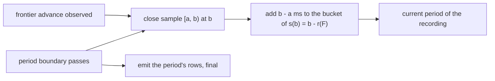

# Wall-clock staleness

* Associated: Linear project P-CPU-328 (Granular Freshness Monitoring), spike notes in the "Spiking ideas" Notion database ("Tick-aware freshness: assignment bound and staleness from TimeDependence").
* Audience: this document records decisions between the author and the implementer. It is not a team-facing design and does not belong in an implementation stack.
* Supersedes the per-arrival latency design in #40320 and its implementation, stack #40330 to #40338. The section on rejected alternatives says why it was replaced.

## The problem

Accounts want to measure p99.9 freshness over a day and p99.99 over a week, at millisecond precision, against targets such as 5s.
Today Materialize cannot answer that question.
The per-minute history records the worst lag of each minute and rounds it up to whole seconds, which hides millisecond freshness even after a source ticks faster.
The global histogram samples lag once per second into power-of-two second buckets per day, so a p99.9 reads as either 8s or 16s.
Sampling once per second also phase-locks to 1s ticks and misses short stalls: in the spike, a 0.7s stall of a 100ms source read as 214ms.

The 1s rounding exists because single events cannot be measured below one tick.
Sources assign timestamps at f Hz, so an event that arrives at wall-clock time t gets timestamp t' = ceil(t, 1/f), and its delay t' - t has to be assumed to be 1/f.
This design measures staleness instead, the age of the data a reader sees, which needs no assumption about single events.
Taking the worst case of each sample, defined below, reproduces the 1/f floor for healthy objects without any knowledge of tick intervals.

## Goals

* Record a histogram of staleness over wall-clock time per object and period, from which the Console can compute any percentile over any window and draw a timeline.
  A percentile here is over time: a p99.9 of 2s means staleness exceeded 2s during at most 0.1% of the window.
* Write every row once, at the end of its period, so a stall shows up while it lasts.
* Report freshness in milliseconds, replacing the 1s ceiling of the current per-minute value.
* Support any tick rate, joins of different intervals and interval changes without modeling tick grids.
* Make buckets per octave, the period length and the retention configurable.

## Non-goals

* Console views. The relation is the interface, the Console picks it up separately.
* Attribution of staleness to the hop that adds it. The schema leaves room for it, see the section on attribution.
* An hourly or daily rollup. It is a later performance optimization.
* Exporting to Prometheus or OpenTelemetry. The bucket scheme keeps that possible without loss.

## Anti-goals

* Correcting or retracting a histogram row after writing it.
* Counting any wall-clock time twice for one recording.
* Changing the existing relations' schemas or breaking their consumers.

## Model

### Reflected time and staleness

Time is in integer milliseconds.
An object with write frontier F reflects the world up to its reflected time r(F), the latest wall-clock time whose data the object contains in full.
For an object in an epoch-based timeline without refresh schedules on its path, r(F) = F - 1.
This holds for sources, tables, webhooks and joins alike, because a join's frontier is the minimum of its inputs' frontiers.

A REFRESH view's frontier sits at its next refresh while its contents date from the last one, so F - 1 overstates what it reflects.
The existing `TimeDependence` of a collection describes the refresh schedules on its path, and `apply(t)` is the frontier the object reaches for wall-clock time t.
The reflected time inverts it, r(F) = max { t : apply(t) < F }.
The type stays unchanged, and no tick intervals are added to it.
If REFRESH EVERY is deprecated, this inversion reduces to F - 1.

Staleness at wall-clock time w is s(w) = w - r(F(w)), clamped at 0, where F(w) is the frontier the controller has observed by w.
Between two observed frontier advances, r is constant and s rises with slope 1.
Objects without a time dependence, such as constants and objects in non-epoch timelines, keep today's reported value and get no histogram rows.

### Samples and their worst case

The recorder sees events: frontier advances, as the controller observes them in `Frontiers` responses, and period boundaries.
A sample is the wall-clock interval [a, b) between two consecutive events of one recording.
Staleness rises over the sample, from s(a) to its maximum s(b), just before the event at b.

Each sample is charged its worst case: the whole interval weighs b - a milliseconds, all in the bucket of s(b).
For a healthy 1s source, a sample runs from one advance to the next, and its worst case is one tick plus the time until the controller observes the advance.
The previous implementation recorded 1.0 to 1.2s for such a source and 108 to 128ms for a 100ms source, and the worst case per sample yields the same values, because both measure from the last reflected time to the next observed advance.
For a stall, the samples are cut at period boundaries, so each period of the stall is charged the staleness at its end.

Spreading a sample uniformly over [s(a), s(b)] is the exact staleness distribution and is kept as an alternative for later.
It puts a healthy 1s source into every bucket from 1ms to 1s, about 40 rows per period at 4 buckets per octave, against one or two for the worst case.

## Reporting

Three consumers read the same per-sample lag today (`refresh_wallclock_lag` in `src/compute-client/src/controller/instance.rs`): the per-minute lag history, the existing global histogram in power-of-two seconds, and the Prometheus wallclock lag metric.
Under the reporting flag, the per-minute history reports the maximum worst case of the samples in the minute, in milliseconds, which replaces the 1s ceiling in `WallclockLagFn`.
The Prometheus metric reports the larger of the last closed sample's worst case and the current staleness s(now), so healthy objects read their last peak and a stall grows live.
The existing global histogram keeps its samples and buckets, since the new histogram replaces it.

For a 1Hz source the reported value stays about 1s, so existing consumers see the same numbers.
A REFRESH EVERY 1 minute view, which reads 0s today, reads up to about 60s.
A 7s x 11s join peaks at about 11s, as today, since staleness counts the slower input's interval once.
Unreadable collections stay Undefined.

## Recording

### Periods

Every sample is charged to the period, one minute by default, that contains it, and a sample that straddles a boundary is split there, so a period boundary is an event.
A period's rows are written once the controller's wall clock passes the period's end, at the next frontier response or maintenance tick.
Rows are final when written, since no later event changes a closed sample.
A recording's samples tile wall-clock time, so each full period of a recording sums to the period length, 60,000ms by default.
A period with less is a hole, and the progress view shows how far recording reached.

The recorder keeps one open sample and one period of buckets per recording, so its memory does not grow with the length of a stall.
The in-progress period is the only staleness not yet in the histogram, and the reported value shows it live.

### Buckets

Buckets are exponential with b buckets per octave, b a power of two (default 4).
Bucket k covers staleness in (2^((k - 1) / b), 2^(k / b)] ms, the convention of Prometheus native histograms and OpenTelemetry exponential histograms with scale log2(b), and staleness of at most 1ms counts in bucket 0.
At b = 4 the relative error is about 9%.
Rows store b, so a configuration change does not mix incompatible rows within a period.

### Relations

All relations live in `mz_internal` next to the existing wallclock lag relations, which stay unchanged.
The existing global histogram stores whole seconds in daily periods, and its `labels` carry the workload class, so writing milliseconds into it would change the meaning of columns that existing Console queries read.
Implementer's call: follow the pattern of `mz_wallclock_global_lag_histogram_raw`, a raw builtin source whose update diff is the count in milliseconds of wall-clock time, plus a view that exposes `count`.

* A global histogram, written from the global write frontier: `period_start`, `period_end`, `object_id`, `measure`, `buckets_per_octave`, `bucket`, `labels`, and `count` in the view. The first iteration writes only `measure = 'end_to_end'`.
* A per-replica histogram with the same columns plus `replica_id`, as a diagnostic.
* A progress view with `object_id`, nullable `replica_id` (null for global) and `covered_until`, the largest emitted period end, computed from the histograms.

Histograms are retained for a configurable interval, 30 days by default like the existing relations, and truncated on `period_start` by the existing metrics-history truncation.
That truncation runs only when the collection's write task starts (`partially_truncate_metrics_history` in `src/storage-controller/src/collection_mgmt.rs`), so between restarts the relation grows past the retention interval, as the existing relations do.
As today, exactly one controller writes the global rows of an object: the compute controller for compute collections including materialized views, the storage controller for storage-owned collections.

### Recording lifecycle

* A new object starts recording at its creation time. Staleness during hydration counts, because readers wait for it.
* On environmentd restart, every recording starts at the time the controller started, one timestamp per controller, so a long bootstrap does not move the start of collections installed late in it. The open sample and period of the previous process are lost, which leaves a hole of up to one period plus the downtime. The time until a collection's first frontier is observed counts as staleness against the frontier the controller starts with.
* A zero-downtime cutover is a restart for recording. The new generation records nothing while read-only, so it is never a second writer, and the old generation is fenced at the takeover. Every release therefore leaves a hole of up to one period plus the takeover time.
* A replica's diagnostic recording starts at the replica's creation and ends with the replica. A replica frontier that regresses on reconnect raises that replica's staleness, which is what its readers see.
* An introspection collection logs one replica, and its contents differ between replicas, so it has no global histogram, only per-replica ones. A replica that restarts and rehydrates under the same id starts fresh logs, so its introspection recordings end and start again.
* An empty frontier means the object is complete forever, with staleness 0 from then on. The recording ends there.
* A dropped object's recording ends at the drop, and its partial period is emitted, so the staleness it had until then is not lost.
* The controller's wall clock can step backwards. A sample with b <= a is dropped, so no wall-clock time counts twice.
* Sources assign timestamps by the clusterd clock, while the controller observes advances by the environmentd clock, so r(F) can lie ahead of w. Staleness is clamped at 0.

### Attribution, later

End-to-end staleness shows how stale an object is, but not which hop in a chain of sources, views and indexes adds it.
In the rising view, attribution is a frontier gap: an object's staleness minus that of its slowest direct input at the same wall-clock time, r_input(w) - r(w).
It is sampled on the union of both recordings' events and charged the same way, so it needs no visibility logs and no model of tick grids.
The `measure` column takes it without a schema change.
The previous implementation recorded local delay per arrival and found that it was most of the rows: per object and minute, a materialized view wrote 3.6 end-to-end rows and 10.2 local rows.

### Cost

Rows per recording and period are the buckets its samples touch.
A healthy object charges every sample about the same worst case, so it uses one or two buckets per period.
A stall uses one bucket per period, since a whole period of a stall is one sample unless the frontier advances within it.
The worst case is an object whose advances are irregular within a period, bounded by $b \log_2(P / 1\,\text{ms})$ buckets, about 64 at 4 buckets per octave and one-minute periods.

The previous implementation's end-to-end rows used the same values for healthy objects, so its measurements are the planning baseline until this recorder is measured.
On staging with 480 objects, it wrote 1.9 end-to-end rows per object and minute, and the global histogram's persist shard grew by about 3 bytes per row, which is 18 KB per object and day.
A decoded row is roughly 60 bytes as a packed row, an estimate from the row encoding, so a month of one object is about 11 MB of packed rows unless persist's filter pushdown on `period_start` and `object_id` skips parts.
The Console should read the histograms through queries scoped to objects and windows rather than through an index over the whole relation.

## Configuration

Two feature flags gate the work separately, both on in CI and off in production:

* One switches the reported value from the 1s ceiling to the worst case of samples in milliseconds.
* One enables recording the histograms.

The reporting flag changes numbers that people and alerts already consume.
REFRESH EVERY 1 minute views move from about 0s to about 60s, although nothing got worse.
The new values are the correct ones, so the plan keeps the existing column and announces the change before enabling the flag in production, instead of adding a parallel column that keeps the understated numbers alive.

The recorder's parameters are dyncfgs:

* Buckets per octave, default 4.
* Period interval, default 1 minute.
* Retention interval, default 30 days.

## Rejected alternatives

### Per-arrival latency

The previous design recorded, for each virtual arrival, the time until it became visible, the falling triangle of each stall.
It was implemented as stack #40330 to #40338 and ran on staging for several days.
It is replaced for four reasons:

* A latency is known only once the arrival becomes visible, so a stall appears in the histogram only after recovery, and open periods stay in memory until then.
* When a cluster's replicas were turned off, its objects recorded nothing, and their backlog would have been charged as hours of latency in one burst on recovery.
* Arrivals still pending when an object was dropped were lost or understated.
* Assigning each arrival a worst case needed tick intervals on every leaf of a controller-side tree, a search for the assignment bound D, and per-input visibility logs for attribution, which carried an open bug: a catalog-derived index charged a 32s stall as local delay, because the catalog import has no tree.

Both views measure the same region between the visible frontier and the wall clock, sliced per reader time or per arrival time, so they cover the same total delay.
They weigh catch-up differently: after a stall, latency counts every delayed arrival, while staleness counts the stall's wall-clock duration.

### Uniform staleness within a sample

Spreading each sample over [s(a), s(b)] gives the exact distribution of staleness over time, with a p50 of about 500ms for a healthy 1s source instead of about 1s.
It costs about 40 rows per period for such a source, about 25 with a zero bucket at 16ms, against one or two.
For healthy objects, the percentiles that accounts ask for, p99.9 and above, differ by less than one bucket between the two.
It can be added later as a policy recorded in each row.

### Writing into the existing histogram

`mz_wallclock_global_lag_histogram` already weighs samples by wall-clock time, so it is a coarse version of the same histogram.
Changing its units from whole seconds to millisecond bucket indexes and its periods from days to minutes would silently break the Console queries that read it, so the new histogram is its successor and the old one is deprecated once the Console has moved.

## Left to the implementer

* How the storage controller and the compute controller share the recorder.
* How r(F) inverts `TimeDependence` for refresh schedules, as long as it never reports a reflected time later than the true one.
* Test strategy, which should include property tests of the inversion and of mass conservation per period against a brute-force oracle, and a deterministic end-to-end test of a stall that spans several periods.
