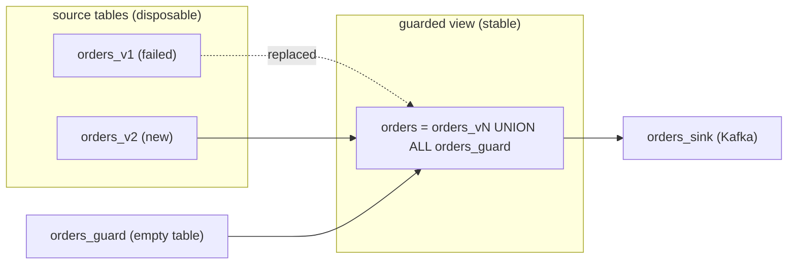

When a table from a source hits a [definite
error](/ingest-data/lifecycle-of-a-source/#which-stalls-clear-on-their-own),
you often have to drop and recreate all downstream objects, including sinks.
This means re-delivering a full backfill of data to your Kafka consumers. This
guide walks you through a pattern to recover from a definite error without
triggering a full backfill.

## How it works

A source table that hits a definite error, such as an upstream `TRUNCATE`,
never receives another update. A materialized view that reads only from that
table stops updating with it and can no longer be
[replaced](/transform-data/updating-materialized-views/replace-materialized-view/).
To recover, you must recreate the table, the views on top of it, and the sinks,
and each new sink with `SNAPSHOT = true` re-emits its entire contents
downstream.

A guard table avoids this. The materialized view that your sinks depend on
reads the source table through a `UNION ALL` with an empty Materialize table.
The guard table keeps the view updating after the source table fails, so you
can swap in a new source table with a replacement. Sinks keep running and emit
only the rows that changed.



## When to use this pattern

| Scenario | Does the guard help? |
|----------|----------------------|
| Upstream `TRUNCATE` of a replicated table | Yes |
| Upstream `DROP TABLE` | Yes |
| Incompatible upstream schema change, such as a dropped column or a changed column type | Yes, if the replacement projects back to the view's original columns and types |
| Upstream `DROP PUBLICATION` | Yes. Recover with a new publication and a new source. |
| Upstream unreachable, for example a network outage | No. The view stalls with the source, and the source recovers on its own once the upstream is reachable. |
| Replication slot dropped upstream (`slot overcompacted`) | No. The source retries indefinitely, so the view stalls with it. You can still replace the view onto a table from a new source, with or without a guard. |

The guard only helps once the source table has permanently stopped updating.
A table with a definite error and a table that is retrying both report
`stalled` in `mz_source_statuses`. To tell them apart, check whether the
table's write frontier is `NULL`, which means it will never update again:

```mzsql
SELECT o.name, f.write_frontier
FROM mz_internal.mz_frontiers AS f
JOIN mz_catalog.mz_objects AS o ON o.id = f.object_id
WHERE o.name = 'orders_v1';
```

## Before you begin

This guide uses a PostgreSQL source, but the pattern applies to tables from any
source.

- Materialize v26.49 or later.
- Familiarity with [replacing materialized
  views](/transform-data/updating-materialized-views/replace-materialized-view/).
- Add the guard before you create the sinks. You cannot add a guard to an
  existing view through a replacement, because the guard changes the view's
  keys and the replacement must match them. See
  [Considerations](#considerations).

## Set up the guard

1. Create a versioned table from the source:

   ```mzsql
   CREATE TABLE orders_v1 FROM SOURCE pg_src (REFERENCE orders);
   ```

1. Create the guard table with the same columns, types, and nullability as the
   source table. Keep it empty.

   ```mzsql
   CREATE TABLE orders_guard (id integer NOT NULL, status text);
   ```

   To prevent accidental writes, revoke write privileges on the guard from
   every role, including its owner:

   ```mzsql
   REVOKE INSERT, UPDATE, DELETE ON orders_guard FROM PUBLIC;
   REVOKE INSERT, UPDATE, DELETE ON orders_guard FROM <owner_role>;
   ```

1. Create the materialized view that the rest of your pipeline reads from:

   ```mzsql
   CREATE MATERIALIZED VIEW orders AS
   SELECT * FROM orders_v1
   UNION ALL
   SELECT * FROM orders_guard;
   ```

1. Build downstream views and sinks on `orders`:

   ```mzsql
   CREATE SINK orders_sink
     FROM orders
     INTO KAFKA CONNECTION kafka_connection (TOPIC 'orders')
     KEY (id) NOT ENFORCED
     FORMAT JSON
     ENVELOPE UPSERT;
   ```

## Recover from a definite error

Suppose the upstream table is truncated and reloaded. `orders_v1` stops
updating, and queries against it and everything downstream return the error:

```nofmt
ERROR:  Source error: source must be dropped and recreated due to failure: table was truncated
```

1. Create a new version of the source table. It snapshots the current upstream
   contents.

   ```mzsql
   CREATE TABLE orders_v2 FROM SOURCE pg_src (REFERENCE orders);
   ```

   If the upstream table was dropped and recreated, first add it back to the
   publication in PostgreSQL, then run `ALTER SOURCE pg_src REFRESH
   REFERENCES`.

1. Create a replacement for `orders` that keeps the guard:

   ```mzsql
   CREATE REPLACEMENT MATERIALIZED VIEW orders_r FOR orders AS
   SELECT * FROM orders_v2
   UNION ALL
   SELECT * FROM orders_guard;
   ```

   If the upstream schema changed, project `orders_v2` back to the original
   columns and types. For example, if `status` was dropped upstream:

   ```mzsql
   CREATE REPLACEMENT MATERIALIZED VIEW orders_r FOR orders AS
   SELECT id, NULL::text AS status FROM orders_v2
   UNION ALL
   SELECT * FROM orders_guard;
   ```

1. Wait for the replacement to hydrate, then apply it:

   ```mzsql
   SELECT h.hydrated
   FROM mz_catalog.mz_materialized_views AS mv
   JOIN mz_internal.mz_hydration_statuses AS h ON mv.id = h.object_id
   WHERE mv.name = 'orders_r';

   ALTER MATERIALIZED VIEW orders APPLY REPLACEMENT orders_r;
   ```

   The error is retracted, and the sink emits only the difference between
   `orders_v1` and `orders_v2`: an update for each changed row, a tombstone
   for each removed row, and an insert for each new row.

1. Drop the failed table. Until you drop it, it holds back compaction of the
   source.

   ```mzsql
   DROP TABLE orders_v1;
   ```

## Considerations

- **Reads fail until you apply the replacement.** From the moment the source
  table fails until the replacement is applied, queries against the guarded
  view and everything downstream return the source error.
- **Sinks do not report the error.** While the guarded view carries the error,
  sinks stay `running` and keep advancing, but write nothing. Monitor the
  source table's status in
  [`mz_source_statuses`](/sql/system-catalog/mz_internal/#mz_source_statuses)
  to detect the failure.
- **The guard removes unique keys.** The view no longer inherits the source
  table's primary key, which can make some downstream queries less efficient.
  Because replacements must keep the same keys, the guard must be in place
  from the start, and every replacement must keep it.
- **One guard per source table.** Each source table that can hit a definite
  error needs its own guard table and guarded view.
- **Rows in the guard appear downstream.** Anything written to the guard table
  shows up in the view and its sinks.

## Related pages

- [Lifecycle of a source](/ingest-data/lifecycle-of-a-source/)
- [Absorbing upstream schema changes](/ingest-data/patterns/upstream-schema-changes/)
- [Replace materialized views](/transform-data/updating-materialized-views/replace-materialized-view/)
- [`ALTER MATERIALIZED VIEW`](/sql/alter-materialized-view/)
